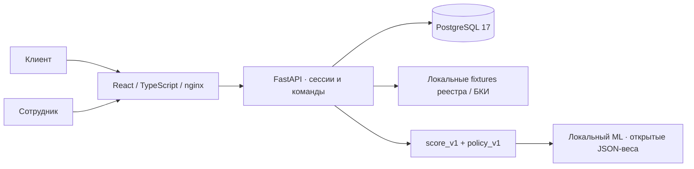

# Credit Pilot

**От потребности бизнеса до понятного кредитного решения — в одном кабинете.**

Credit Pilot — работающий учебный веб-прототип для кейса Альфа-Хак 2026
«Умный кредитный кабинет предпринимателя». Предприниматель выбирает продукт,
заполняет анкету, отвечает на запросы и принимает предложение. Сотрудник видит
очередь, выполняет проверки, изучает объяснимый скоринг и ML, предлагает условия
или отказывает с причиной. Путь завершается моделируемым подписанием и выдачей.

Все компании, финансовые показатели и документы синтетические. Это не продукт
Альфа-Банка; реальные интеграции, юридическая подпись и денежные операции отсутствуют.

## Быстрый запуск

Нужны Docker Engine / Docker Desktop с Compose v2. Интернет нужен для первой
сборки образов и загрузки зависимостей; работа продукта после сборки автономна.

```bash
cp .env.example .env   # только если собственного .env ещё нет
# Проверьте локальные параметры в .env.
docker compose up -d --build
docker compose exec backend python demo.py
```

`demo.py` создаёт локальные аккаунты и четыре отправленные заявки клиента
`client-a`. Повторный запуск ничего не очищает, не меняет пароли и не сбрасывает
пройденные сценарии. Новый экземпляр любого сценария можно создать на главной
клиентского кабинета. Для аккаунтов без готовых заявок: `python seed.py` вместо
`python demo.py`.

- Приложение: [localhost:5173](http://localhost:5173).
- Swagger: [localhost:8000/docs](http://localhost:8000/docs).
- Health: [localhost:5173/api/health](http://localhost:5173/api/health).

| Аккаунт | Назначение | Где задаётся пароль |
| --- | --- | --- |
| `client-a` | Основной предприниматель, четыре демозаявки | `DEMO_CLIENT_PASSWORD` в `.env.example` / вашей `.env` |
| `client-b` | Второй клиент для проверки изоляции | `DEMO_CLIENT_B_PASSWORD` |
| `bank` | Сотрудник банка | `DEMO_BANK_PASSWORD` |

Значения по умолчанию находятся в `.env.example` и предназначены только для
локального демо. Настройки паролей читаются **при первом seed**; существующие
аккаунты сохраняются. Для одновременного показа двух ролей откройте обычное и
приватное окно браузера: разные вкладки одного профиля разделяют session-cookie.

## Что попробовать за пять минут

1. Войдите как `client-a`. На главной выберите «Пекарня открывает вторую точку».
2. Пройдите четыре шага анкеты. Проверьте расчёт платежа, сохраните черновик,
   обновите страницу и отправьте заявку.
3. В отдельном профиле войдите как `bank`. Откройте очередь, найдите заявку,
   нажмите «Запустить проверки» и откройте вкладку «Проверки и риск».
4. Посмотрите сведения локального реестра и БКИ, четыре фактора score_v1,
   ML-оценку и ограничения политики. В обзоре объясните решение и отправьте предложение.
5. В клиентском кабинете откройте договор, подтвердите демонстрационное подписание.
   Сотрудник нажимает «Смоделировать выдачу». Оба кабинета показывают результат,
   а история — автора, время, версию и изменения.

| Сценарий | Что показать | Ожидаемый результат |
| --- | --- | --- |
| Пекарня | Устойчивый денежный поток, исходные условия | Предложение → подписание → выдача |
| Мастерская | Запрос расходов и документа; ответ с расходами `400000.00` | Новый снимок проверок, прежний сохранён, затем предложение |
| Логистика | Просрочка 65 дней и высокая нагрузка | Обоснованный отказ, видимый клиенту |
| Магазин | Запрос `1500000.00` при ограниченном денежном остатке | Рассчитанная меньшая сумма, принятие и выдача; исходный запрос сохранён |

Подробный маршрут и негативные проверки: [docs/demo-guide.md](docs/demo-guide.md).
Пример синтетического документа: [financial-report.csv](frontend/e2e/fixtures/financial-report.csv).

## Возможности

- Два кабинета, серверная авторизация, HttpOnly-cookie, CSRF и права по `owner_id`.
- Каталог двух версионированных продуктов, пошаговая анкета, точные денежные
  значения, сохранение черновика, защита формы от случайного ухода.
- Очередь с поиском, фильтром статуса и пагинацией; досье, polling и временная шкала.
- Локальные проверки реестра/кредитной истории. Неизвестный ИНН — отсутствие
  данных, технический сбой — отдельный результат с возможностью повтора.
- Ограниченные запросы уточнений, ответы внутри продукта, синтетические TXT/CSV
  в БД и защищённое скачивание. Состав запроса определяет разрешённые изменения.
- Балльная модель, отдельная кредитная политика, локальная логистическая регрессия.
  Исходные признаки, версии, объяснения и предыдущие результаты сохраняются.
- Ручное предложение, меньшая сумма, мотивированный отказ, демонстрационный договор,
  подписание и выдача. Новые команды проверяют версию и поддерживают точный повтор.
- Банковская воронка, причины ожидания, заявки без движения больше 24 часов,
  журнал решений и сумма моделируемой выдачи — по данным одной PostgreSQL.
- Локальные материалы клиента меняются с продуктом и этапом заявки.

Скриншоты: [клиентский кабинет](docs/screenshots/client-dashboard.png),
[банковская аналитика](docs/screenshots/bank-dashboard.png),
[досье и ML](docs/screenshots/risk-model.png).

## Архитектура и документы



Три Compose-сервиса, модульный монолит. Backend использует **psycopg** напрямую,
Alembic управляет схемой. Миграция на ORM не требуется. Миграции `0001–0004`
сохранены; `0005_credit_workflow` добавляет банковский процесс и расширяет статусы.

- [Требования и источники](docs/requirements.md).
- [Архитектура и ограничения](docs/architecture.md).
- [Модель данных](docs/domain-model.md), [состояния и переходы](docs/application-flow.md).
- [Актуальный API](docs/api-contract.md), [OpenAPI](docs/openapi.json), [коллекция Postman](api/README.md).
- [Модель риска и ML model card](docs/model-card.md).
- [Сценарии проверки](docs/demo-guide.md), [состояние реализации](docs/mvp-plan.md).
- [Сторонние компоненты и симуляторы](THIRD_PARTY_NOTICES).

Исторические отчёты T01/T06 и контракт T05 оставлены как история предыдущих этапов;
актуальное поведение описано в документах выше.

## Проверки

Backend: настоящий PostgreSQL, уникальная временная БД; основная БД не очищается.

```bash
docker compose up -d postgres
docker compose run --rm --build backend sh -c 'pip install -r requirements-dev.txt && pytest -q'
```

Frontend: Node.js 24.

```bash
cd frontend
npm ci
npm test
npm run build
npm run format:check
```

Пять браузерных проверок: четыре полных сценария и черновик/точность/reload/mobile.
Запускаются на отдельном Compose-проекте с PostgreSQL в **tmpfs**, порт `5183`.
Окружение тестов удаляется по завершении; основной volume не используется.

```bash
# Из корня, после npm ci в frontend:
npm --prefix frontend exec -- playwright install chromium
bash scripts/e2e.sh
```

На Linux при необходимости: `cd frontend && npx playwright install --with-deps chromium`.
Отчёт — `frontend/playwright-report/index.html`. В тестах не записывается trace
с введёнными учётными данными. Скриншоты содержат только синтетическое демо.

Проверка Postman-коллекции и сохранения результата после перезапуска backend:

```bash
bash scripts/api-smoke.sh
```

Она использует отдельный Compose-проект на порту 5183 и Newman 6.2.1 через npm;
одновременно с E2E её запускать нельзя. Все 65 запросов выполняются с тестовыми
аккаунтами временной БД. Фактический отчёт: [docs/verification.md](docs/verification.md).

ML воспроизводится без сторонних Python-библиотек:

```bash
cd backend
python -m ml.train
```

Генератор, seed, train/validation/test split, SHA-256 набора, веса и метрики
сохраняются в `backend/ml/`. Результаты характеризуют **только синтетическую выборку**.

## Конфигурация и разработка

| Переменная | Для чего |
| --- | --- |
| `POSTGRES_DB`, `POSTGRES_USER`, `POSTGRES_PASSWORD` | Локальная БД; обязательны в `.env` |
| `FRONTEND_PORT`, `BACKEND_PORT` | По умолчанию 5173 и 8000, публикация на loopback |
| `DEMO_CLIENT_PASSWORD`, `DEMO_CLIENT_B_PASSWORD`, `DEMO_BANK_PASSWORD` | Первый seed аккаунтов |
| `ALLOWED_ORIGINS` | Разрешённые Origin; при изменении frontend-порта обновить |
| `COOKIE_SECURE` | `false` для локального HTTP; `true` для HTTPS |

Из `frontend/`: `npm run dev`. Vite проксирует `/api` к `localhost:8000`.
Если Compose уже занимает `5173`, остановите только его frontend (`docker compose stop frontend`),
чтобы Vite использовал ожидаемый Origin. Навигация — hash, reload поддержан nginx.

CSRF выдаётся при login, хранится в памяти/sessionStorage. `/api/me` восстанавливает
пользователя, но не выдаёт CSRF. В новой независимой вкладке с действующей cookie
и пустым storage нужен повторный вход перед изменениями. После 401/403 команда
не повторяется автоматически. POST создания черновика пока не имеет ключа
идемпотентности: при потере ответа интерфейс просит проверить список заявок.

Данные хранятся в именованном volume. Остановка без удаления данных:

```bash
docker compose down
```

Не используйте `down -v` для основного стенда. Изменение переменных PostgreSQL
не меняет пароль уже существующего пользователя в непустом volume.

Health выполняет `SELECT 1`: HTTP 200 / `database=ok` или 503 /
`database=unavailable`. Контракт сохранён. Для проверки отказа БД используйте
изолированный тестовый стенд, чтобы не прерывать основной показ.

## Границы MVP

Численные условия, скоринговые пороги, формат документов и ориентир 24 часа —
**Предложение команды**, не правила Альфа-Банка. ML не принимает решения и не
проверялся на реальных заёмщиках. Регистрация, посткредитное обслуживание, OCR,
проверка реальных полномочий, полноценный аудит доступа, антифрод и промышленный
IAM не входят в MVP. Приложение предназначено для локальной демонстрации.

Публикация, commit/tag сдачи, push и доступ жюри выполняются владельцем проекта
после отдельного решения. Локальная реализация сама по себе не означает публикацию.
