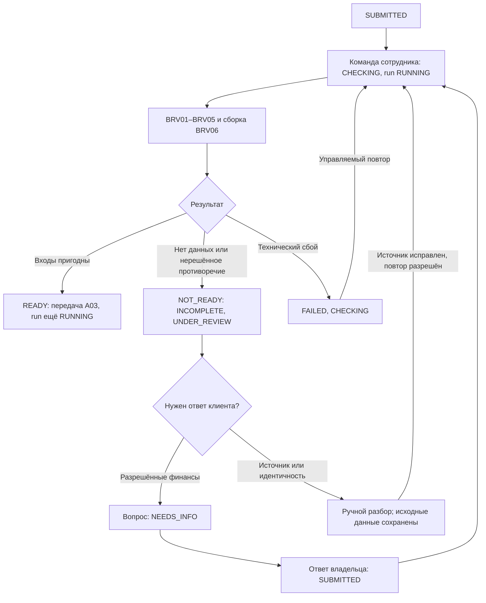
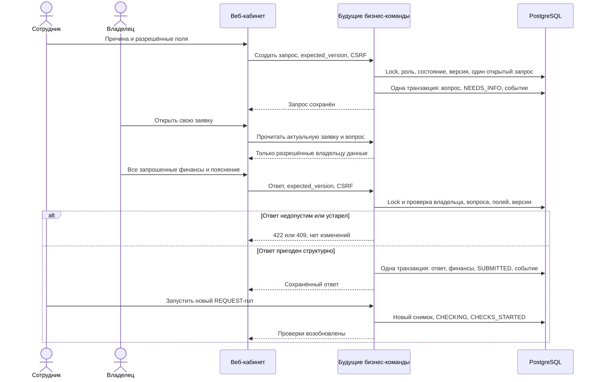

# A04 — Банковское досье и проверка кредитной заявки

Дата анализа и обращения к источникам: **23.10.2026**. База: `origin/main`,
`b4179d0684a7fcc806f2e952ba8bad8759581875`, после объединения T05 и T06.
Это аналитический результат: код, схема БД и действующие контракты не меняются.
Обратная связь по форме: [A04_T07_FEEDBACK.md](A04_T07_FEEDBACK.md).

## 1. Цель и границы

Подготовить минимальное досье между получением `SUBMITTED` и передачей
проверенных входов в A03. A04 не рассчитывает баллы, платёж, коэффициенты,
риск или альтернативные условия и не принимает кредитное решение.

Обозначения обязательны для всего документа:

- **IMPLEMENTED** — найдено в коде указанной базы; это не заявление о запуске
  проверок или сквозного сценария в рамках A04.
- **PLANNED** — предусмотрено проектными документами, отсутствует в коде.
- **PROPOSED / Предложение команды** — новое правило, структура или уточнение
  A04, требующее согласования. Все новые правила ниже имеют этот статус.
- MUST / SHOULD / COULD — приоритет внутри предлагаемого банковского MVP;
  в обратной связи по T07 отложенное обозначается LATER.

| Механизм | Фактическое положение на базе анализа |
| --- | --- |
| IMPLEMENTED: доступ | Серверная сессия, HttpOnly-cookie, CSRF; роли CLIENT/BANK_EMPLOYEE. Владелец определяется `owner_id`, не `company_id` |
| IMPLEMENTED: заявка | Девять редактируемых полей; серверный `product_version`; только DRAFT/SUBMITTED; создание, чтение, PATCH черновика, submit; события DRAFT_CREATED/DRAFT_UPDATED/SUBMITTED |
| IMPLEMENTED: T05 | `GET /api/products`, версии двух продуктов, три финансовых поля, проверка границ и фиксация версии при submit |
| IMPLEMENTED: T06 | Вход, выход, восстановление пользователя через `/api/me`; CSRF в памяти/sessionStorage. Каталог, форма, список и банковский раздел пока заглушки |
| PLANNED: T07 | Клиентские каталог/список/форма/история; серверный список заявок ещё отсутствует |
| PLANNED: T08–T11 | Очередь/досье, новые состояния, ProcessingRun, локальные проверки, скоринг и отдельные команды уточнения |
| PROPOSED: A04 | Шесть правил BRV01–BRV06, готовность входов, сравнение названий, детали запроса/ответа и три сценария |

В текущих миграциях/коде нет ProcessingRun, ExternalCheck, InformationRequest,
ScoreResult и банковских команд. У BANK_EMPLOYEE сейчас только чтение заявки
и событий. Ниже `CHECKING`, `UNDER_REVIEW`, `NEEDS_INFO` — **PROPOSED статусы
заявки из PLANNED-процесса**, а не существующие значения API.

Проектная база, прочитанная вместе с исходниками:

| Код | Источник |
| --- | --- |
| R | [requirements.md](../requirements.md): требования и ограничения |
| A | [architecture.md](../architecture.md): продукты, проверки, транзакции, оценка |
| D | [domain-model.md](../domain-model.md): данные, снимки и инварианты |
| F | [application-flow.md](../application-flow.md): состояния, команды, исключения |
| P | [mvp-plan.md](../mvp-plan.md): T05/T06/T07, T08–T14 |
| T05 | [t05-api-contract.md](../t05-api-contract.md): актуальный контракт формы |
| C | [applications.py](../../backend/applications.py), [products.py](../../backend/products.py), [auth.py](../../backend/auth.py), [audit.py](../../backend/audit.py), [main.py](../../backend/main.py) |
| DB | [Миграции 0001–0004](../../backend/migrations/versions) |
| UI | [App.tsx](../../frontend/src/app/App.tsx), [SessionProvider.tsx](../../frontend/src/auth/SessionProvider.tsx), [навигация](../../frontend/src/app/navigation.ts), [CSRF](../../frontend/src/api/csrf.ts) |
| T | [test_products.py](../../backend/tests/test_products.py), [test_applications.py](../../backend/tests/test_applications.py), [test_events.py](../../backend/tests/test_events.py), [test_migrations.py](../../backend/tests/test_migrations.py), [тесты T06](../../frontend/src/tests) |
| B | [README](../../README.md), [AGENTS.md](../../AGENTS.md) |
| A01 | [Анкета, e29c0ce8308f759132470e016f2712b43f361ed5](https://github.com/StudentSK0/credit-pilot/blob/e29c0ce8308f759132470e016f2712b43f361ed5/docs/application-form-spec.md) |
| A02 | [API, ce6a75a40e3dd86e7aaaeeacaf62db662274a291](https://github.com/StudentSK0/credit-pilot/blob/ce6a75a40e3dd86e7aaaeeacaf62db662274a291/docs/api-contract.md); теперь также [в main](../api-contract.md) |
| A03 | [Скоринг и решение, abaf9bab6b0e0e97d3e352caff6ee466b92fe428](https://github.com/StudentSK0/credit-pilot/blob/abaf9bab6b0e0e97d3e352caff6ee466b92fe428/docs/scoring-decision-spec.md) |

A01/A03 прочитаны через `git show` remote-веток; их файлы не переносились.
Исходный PDF в checkout не найден: требования кейса сверены по R, без прямой
повторной проверки PDF. Срок хакатона — 6 дней по указанию пользователя;
точный остаток времени и загрузка трёх участников неизвестны.

## 2. Краткое исследование банковской практики

Подтверждённые публичные сведения и выводы аналитика разделены в таблице.
Обозначения S01–S09 раскрыты с названием, URL и ограничениями в разделе 3.
Документы отдельных банков показывают примеры процесса, а не единый стандарт.

| Вопрос | Что подтверждается источниками | PROPOSED для Credit Pilot |
| --- | --- | --- |
| Сведения о компании | Для оборотного кредита Альфа-Банк описывает анкету предприятия/ИП и дополнительные материалы по запросу (S05) | Название, ИНН, цель и условия уже есть; расширенную анкету не добавлять |
| Представитель | ФНС описывает сведения о руководителе и участниках; Альфа-Банк упоминает паспорт ИП/руководителя и документы о полномочиях распоряжаться средствами (S02, S09) | Тестовый CLIENT и owner_id обеспечивают доступ; настоящая проверка личности/полномочий вне MVP |
| Обслуживание кредита | В материалах Альфа-Банка упомянуты финансовая отчётность и данные деятельности, при необходимости — движение по счетам (S06, S07) | R/E/D — учебное приближение, не замена отчётности; расчёты остаются A03 |
| Самостоятельная проверка | ФНС предоставляет электронные выписки/сведения об отсутствии записи (S01) | REGISTRY возвращает только заранее заданные синтетические сведения |
| Кредитная история | Банк России связывает основную часть истории с обязательствами и согласием субъекта; НБКИ объясняет сведения о погашении и обращениях (S03, S04) | BKI выдаёт только известную максимальную просрочку; неизвестное не равно нулю |
| Оборотные средства | Публичная страница выделяет этот вид финансирования и анкету заёмщика (S05) | Цель описывается существующим `credit_purpose`, без нового поля запасов/дебиторки |
| Оборудование | Публичный материал связывает кредит с целевым использованием и возможным запросом финансовых документов (S06) | Сотрудник сопоставляет цель и продукт; спецификации/договоры поставки отложить |
| Дополнительные сведения | Альфа-Банк описывает запрос подтверждений платёжеспособности и исправление несогласованных данных; требования ВТБ различаются по условиям/этапу (S07, S08) | Запрашивать конкретное исправление через веб-кабинет, не универсальный пакет документов |
| Противоречия | S07 предупреждает о недостоверных/несогласованных данных, но не раскрывает универсальных правил их обработки | Несовпадение названия и ИНН, неполные расходы — основания ручного разбора, не автоматический отказ |
| Автоматизация и ручной анализ | Открытые страницы не раскрывают внутренний алгоритм банков | Автоматизировать типы, полноту, границы, точный fixture lookup; смысл цели/пояснения и конфликт идентичности оставить сотруднику |

Последние два решения — аналитические предложения, а не подтверждённая внутренняя
политика Альфа-Банка. Публичные ставки, сроки обработки и требования к обеспечению
не переносятся в учебный каталог. Реальное согласие на БКИ не имитируется
декоративной галочкой: настоящих запросов в продукте нет.

## 3. Источники и подтверждённые факты

Дата обращения ко **всем** строкам — **23.10.2026**. «Открыт» означает доступный
текст страницы; «частично» — прочитан индексируемый текст конкретного официального
URL, прямое открытие вернуло HTTP 502. Поисковый индекс мог отставать на несколько
месяцев; полнота и текущая редакция таких материалов не подтверждены.

| ID | Название и конкретный URL | Проверенный факт и доступ |
| --- | --- | --- |
| S01 | ФНС: [ЕГРЮЛ и ЕГРИП](https://www.nalog.gov.ru/rn77/related_activities/registries/egrul_egrip/) | Открыт. Электронный сервис предоставляет выписку либо справку об отсутствии сведений; возможен поиск конкретного ЮЛ/ИП. Регистрация не доказывает платёжеспособность |
| S02 | ФНС: [Электронные сервисы позволяют получать сведения об участии физического лица в качестве руководителя и учредителя онлайн](https://www.nalog.gov.ru/rn56/news/activities_fts/16631850/) | Открыт. «Прозрачный бизнес» содержит сведения о руководителе/участниках. Публикация 19.06.2026 помечена архивной; не используется как доказательство полномочий на конкретную сделку |
| S03 | Банк России: [Может ли кредитная организация ознакомиться с кредитной историей заемщика?](https://www.cbr.ru/Reception/TopicalMessage/Page/3154) | Открыт. Основная часть истории включает обязательства, доступ требует согласия; для информационной части описано исключение. Не утверждается, что вся история публична |
| S04 | НБКИ: [Как читать кредитную историю НБКИ](https://nbki.ru/help/kak-chitat-kreditnuyu-otchet-nbki/) | Открыт. Описывает обязательства, своевременность погашения и обращения. Подробная структура относится к физлицу: её нельзя объявлять схемой отчёта ЮЛ или копировать в MVP |
| S05 | Альфа-Банк: [Кредит на пополнение оборотных средств](https://alfabank.ru/sme/profits/kredit-na-popolnenie-oborotnyh-sredstv/) | Частично, прямой доступ 502. Индекс содержит анкету предприятия/ИП, сведения об участниках сделки и дополнительные документы по запросу |
| S06 | Альфа-Банк: [Кредит на покупку оборудования для малого бизнеса](https://alfabank.ru/sme/profits/kredit-na-oborudovanie/) | Частично, прямой доступ 502. Индекс содержит целевое использование, финансовую/налоговую отчётность и регистры учёта; условия зависят от предложения |
| S07 | Альфа-Банк: [Список документов для получения кредита юрлицу (ООО)](https://alfabank.ru/help/articles/sme/profits/dokumenty-dlya-kreditovaniya-yuridicheskogo-lica/) | Частично, прямой доступ 502. Индекс описывает регистрационные/финансовые сведения, подтверждение цели и запрос исправленных документов при несогласованности |
| S08 | ВТБ: [Кредит для бизнеса без залога и поручителей](https://www.vtb.ru/malyj-biznes/kredity-i-garantii/express-online/bez-zaloga/) | Частично, прямой доступ 502. Индекс различает документы при подаче и дальнейшем оформлении, объём финансовых материалов зависит от условий |
| S09 | Альфа-Банк: [Документы для кредита на развитие бизнеса: какие нужны и что важно знать](https://alfabank.ru/help/articles/sme/profits/kakie-dokumenty-nuzhny-dlya-kreditovaniya-biznesa/) | Частично, прямой доступ 502. Индекс упоминает паспортные сведения и документы о полномочиях; перечень зависит от вида финансирования и участника |

Материалы исследованы только как публичные страницы. Сервисы поиска реальных
компаний, получение реальных историй, платные продукты и корпоративные API не
использовались. Перед использованием S05–S09 как актуальных банковских требований
нужна повторная проверка полной страницы. Для предлагаемых локальных правил
источником являются A/D/F и явно обозначенные решения A04, а не недоступная
внутренняя методика банка.

## 4. Матрица необходимых данных

Девяти редактируемых полей T05 достаточно для **учебного первичного рассмотрения**
вместе с серверными данными и fixtures. Этого недостаточно для настоящего
андеррайтинга. `product_version` — десятый перечисленный в задании атрибут,
но он серверный, не дополнительное поле ввода.

### REQUIRED_ON_SUBMIT

| Поле или информация | Зачем банку | Источник | Этап получения | Уже есть в проекте? | Приоритет MVP |
| --- | --- | --- | --- | --- | --- |
| company_name | Название заявленного бизнеса | CLIENT | DRAFT → submit | IMPLEMENTED, string ≤255, непустая при submit | MUST |
| inn | Ключ локальной сверки | CLIENT | DRAFT → submit | IMPLEMENTED, string из 10/12 ASCII-цифр при submit, без checksum | MUST |
| credit_purpose | Смысл финансирования | CLIENT | DRAFT → submit | IMPLEMENTED, string ≤1000, непустая при submit | MUST |
| product_code | Вид учебного кредита | CLIENT из каталога | DRAFT → submit | IMPLEMENTED, string ≤64; WORKING_CAPITAL/EQUIPMENT в начальном каталоге | MUST |
| amount | Запрошенная сумма, RUB | CLIENT | DRAFT → submit | IMPLEMENTED, Decimal, >0 и границы продукта | MUST |
| term | Запрошенный срок, месяцы | CLIENT | DRAFT → submit | IMPLEMENTED, строгий integer/BIGINT, границы продукта | MUST |
| monthly_revenue = R | Месячная выручка, RUB/мес. | CLIENT | DRAFT → submit | IMPLEMENTED, Decimal >0 | MUST |
| monthly_operating_expenses = E | Месячные операционные расходы, RUB/мес. | CLIENT | DRAFT → submit | IMPLEMENTED, Decimal ≥0 | MUST |
| existing_monthly_debt_payments = D | Месячные платежи по существующим долгам, RUB/мес. | CLIENT | DRAFT → submit | IMPLEMENTED, Decimal ≥0; явный 0 при отсутствии | MUST |

В DRAFT поля nullable, допустимы неполнота, неизвестный код и значения вне
бизнес-границ. Структурные ограничения типов/точности действуют уже в черновике.
Все деньги конечные, максимум два знака; JSON-ответы — строки. `1.230` тоже
отклоняется, тихого округления нет. T07 рекомендуется отправлять десятичные
строки, `term` — JSON integer. Не подменять пустое значение нулём.

### REQUIRED_FOR_REVIEW

| Поле или информация | Зачем банку | Источник | Этап получения | Уже есть в проекте? | Приоритет MVP |
| --- | --- | --- | --- | --- | --- |
| product_version и сохранённые условия продукта | Проверка исходных условий и вход A03 | Сервер / credit_products | Версия фиксируется при submit, условия читаются по паре code/version | IMPLEMENTED версия и каталог; банковская проекция PLANNED | MUST |
| id, owner_id, status, version, timestamps | Доступ, актуальность, история | Сервер | Создание/команды | IMPLEMENTED; expected_version будущих команд PLANNED | MUST |
| registration_active, business_age_months | Известный факт регистрации и возраст для A03 | Локальный REGISTRY по inn | Проверки | PLANNED признаки; имена DTO из A03 PROPOSED | MUST |
| legal_name | Сопоставление названия в сценарии C | Только fixture REGISTRY | Проверки | PROPOSED добавление одного атрибута fixture, не анкеты | MUST для демонстрации конфликта |
| max_overdue_days | Известная просрочка для A03 | Локальный BKI по inn | Проверки | PLANNED признак; имя DTO PROPOSED | MUST |
| run_id, input_snapshot, source, fixture_version, checked_at, результат/причина | Воспроизводимость и происхождение | Сервер/адаптер | Каждый run | PLANNED сущности, детализация A04 PROPOSED | MUST |
| Причина вопроса, fields, ответ и explanation | Разрешить конкретную неполноту | Сотрудник / CLIENT | Только если есть запрос | InformationRequest PLANNED; структура раздела 7 PROPOSED | MUST для T11, не для submit/T07 |

### OPTIONAL

| Поле или информация | Зачем банку в реальной практике | Источник | Этап получения | Уже есть в проекте? | Приоритет MVP |
| --- | --- | --- | --- | --- | --- |
| Паспорт, ФИО/полномочия представителя, учредители, бенефициары | Идентификация/корпоративные сведения (S02/S09); бенефициары в MVP не исследуются | Реальные документы/реестры | Вне учебной анкеты | Нет; seeded user не заменяет реальную проверку | LATER, не запрашивать |
| Полная отчётность, выписки, налоговый режим | Подтверждение финансовых данных (S06/S07) | Документы/учёт | По отдельной будущей задаче | Нет | LATER, без upload/OCR |
| Договор/спецификация оборудования, залог, поручители | Подтверждение цели/обеспечения зависит от продукта (S05–S07) | Документы | Вне текущего MVP | Нет | LATER |
| Email, телефон, адрес, банковские реквизиты | Могут применяться вне данного сценария | Не нужны A04 | Вне основного веб-пути | Нет в анкете | LATER, не блокируют MVP |

В A03 передаются неизменный снимок R/E/D, amount/term, code/version и annual_rate
именно сохранённой версии, registration_active, возраст и просрочка вместе с
результатами/версиями источников. Название, ИНН и цель обеспечивают сверку и
контекст, но новых баллов не получают. Неизвестные признаки не заменяются
«хорошими» значениями. Снимок A04 не содержит score/recommendation/Decision.

## 5. Минимальный набор проверок

Все правила BRV ниже — **PROPOSED / Предложение команды**. Их минимальные части
MUST; это небольшие валидации и два локальных lookup, не шесть интеграций.

| ID | Проверка | Приоритет и предел автоматизации |
| --- | --- | --- |
| BRV01 | Полнота и пригодность входов | MUST: автоматическая проверка девяти полей и серверной версии |
| BRV02 | Сведения о компании | MUST: REGISTRY и точное сравнение синтетического названия; разбор конфликта сотрудником |
| BRV03 | Финансовая согласованность | MUST: типы/знаки/единицы; смысл явного противоречия оценивает сотрудник |
| BRV04 | Условия продукта | MUST: сохранённая версия и включительные пределы |
| BRV05 | Кредитная история | MUST: BKI, различение известной просрочки/отсутствия/сбоя |
| BRV06 | Сборка досье | MUST: снимок, шесть результатов, причины, готовность и история |
| BRV02/03, расширения | Подсказки по расхождениям | SHOULD: удобное сравнение двух значений; COULD: необязательная группировка замечаний в UI. Не добавлять нечёткий поиск, детектор мошенничества или новые источники |

Общий PROPOSED формат результата проверки: `check_id`, `result`, `reason_codes`,
`source`, `fixture_version` (если применимо), `checked_at`, разрешённый
`evidence_snapshot`. `result` = PASS / ISSUE / NO_DATA / ERROR — **результат
проверки, не статус заявки и не состояние ProcessingRun**. PASS означает
пригодность/полноту известных входов, а не хорошую кредитную историю.
Пример: известная просрочка не превращается в ERROR.

### BRV01 — Полнота

- Назначение/вход: определить наличие девяти полей и server code/version у SUBMITTED.
- Источник/исполнитель: снимок Application, C/T05; система.
- Алгоритм: повторно проверить непустоту строк, формат ИНН, типы, конечность,
  точность, знаки и наличие версии; не дополнять отсутствующее нулём.
- Успех: PASS, все необходимые входы пригодны. Дублирование защиты submit нужно
  для legacy/повреждённых данных, не для добавления новых правил анкеты.
- Ошибки/отсутствие: неполные старые SUBMITTED → NO_DATA с перечнем полей;
  нарушенный тип/инвариант → ISSUE. Это не основание автоматически исправить БД.
- Далее: пригодные входы идут дальше; legacy без обязательных полей блокируется
  до отдельного контролируемого решения AQ04. Обычный PATCH после отправки запрещён.
- Аудит: результат в снимке run, ссылка/итог в будущем CHECKS_COMPLETED;
  техническая невозможность прочитать входы — CHECKS_FAILED.

### BRV02 — Компания

- Назначение/вход: inn/company_name; получить факт регистрации и возраст,
  обнаружить демонстрационный конфликт идентичности.
- Источник/исполнитель: только REGISTRY fixture; система сравнивает, сотрудник разбирает.
- Алгоритм: точный lookup по строке inn; проверить echo ИНН, boolean
  registration_active, integer business_age_months ≥0, непустое legal_name.
  Для детерминированного демо сравнивать company_name и legal_name буквально;
  отличие создаёт ISSUE/`COMPANY_NAME_MISMATCH`, без fuzzy matching и автозамены.
- Успех: известные корректные сведения, совпавшее название, PASS.
  `registration_active=false` — известный отрицательный факт для политики A03/
  сотрудника, **не** отсутствие/сбой; неактивность не даёт автоматического решения A04.
- Ошибки/отсутствие: нет записи/обязательного значения → NO_DATA; сбой адаптера
  или неверная схема fixture → ERROR. Возраст 0 известен, null — неизвестен.
- Далее: совпадение передаётся A03; конфликт — ручной разбор без score (AQ02/AQ05);
  отсутствие fixture исправляет команда демо, клиент не вводит возраст/активность.
- Аудит: CHECKS_COMPLETED со ссылкой на сохранённый REGISTRY-результат;
  ERROR — CHECKS_FAILED. Нового отдельного типа события для BRV02 не требуется.

### BRV03 — Финансы

- Назначение/вход: R/E/D из одного снимка, credit_purpose, полученные пояснения.
- Источник/исполнитель: анкета/ответ; система проверяет структуру, сотрудник — смысл.
- Алгоритм: повторить Decimal/точность/знаки, использовать RUB за месяц для всех
  трёх показателей. Интерфейс поясняет, что E — операционные расходы, а D —
  платежи по существующим долгам. Уточнить явно признанную неполноту расходов,
  как в сценарии B. Текст не интерпретируется LLM/автоматическим парсером.
- Успех: PASS при пригодных значениях и отсутствии выявленного смыслового
  противоречия; это не подтверждение цифр банковской выпиской.
- Ошибки/отсутствие: null → NO_DATA; некорректные значения или явная неполнота →
  ISSUE, например `EXPENSES_INCOMPLETE`. `E>R`, `E=0`, `D=0` сами по себе
  **допустимы**, не создают запрета/обязательного уточнения. Новых порогов нет.
- Далее: подтверждённая неполнота → сотрудник формирует ограниченный запрос;
  валидные неблагоприятные финансы передаются A03 без изменения.
- Аудит: CHECKS_COMPLETED для результатов; вопрос/ответ — отдельные
  INFORMATION_REQUESTED/INFORMATION_PROVIDED, не DRAFT_UPDATED.

### BRV04 — Продукт

- Назначение/вход: проверить amount/term по исходной паре product_code/product_version.
- Источник/исполнитель: сохранённая строка credit_products; система.
- Алгоритм: читать **сохранённую**, а не текущую активную версию; проверить
  валюту RUB, существование условий, включительные пределы ниже. Сотрудник
  сопоставляет credit_purpose с продуктом без автоматического анализа текста.
- Успех: PASS, условия и параметры согласованы. Неактивная сейчас, но корректно
  закреплённая при submit версия не является ошибкой старой заявки.
- Ошибки/отсутствие: неизвестная версия → NO_DATA и блокировка; нарушение
  границ/явное противоречие цели → ISSUE, не молчаливая замена условий;
  недоступность БД → ERROR.
- Далее: PASS → входы A03; конфликт фиксированных полей → ручной разбор AQ05,
  без расширения allowlist ответа клиента.
- Аудит: CHECKS_COMPLETED со ссылкой на условия; технический сбой CHECKS_FAILED.

| Код / начальная версия | Сумма, RUB, включительно | Срок, месяцы, включительно | annual_rate, доля в год |
| --- | --- | --- | --- |
| WORKING_CAPITAL / product_v1 | 50000–3000000 | 3–24 | `"0.20"` |
| EQUIPMENT / product_v1 | 100000–5000000 | 6–36 | `"0.18"` |

Источник: T05, C/products и миграция 0004; величины — учебное Предложение команды,
уже IMPLEMENTED, не реальные банковские условия. `GET /api/products` показывает
только активные версии и не является API исторического досье. В T08 серверу
нужно читать сохранённые условия из БД; отдельный исторический каталог не нужен.

### BRV05 — BKI

- Назначение/вход: получить известный факт максимальной просрочки по inn.
- Источник/исполнитель: только локальный BKI fixture; система.
- Алгоритм: точный lookup; проверить echo ИНН, max_overdue_days как integer ≥0,
  source/version. Никаких запросов настоящего БКИ и клиентского ввода результата.
- Успех: PASS при известном корректном значении, включая 0 и ненулевую просрочку.
  Оценка/ограничения по просрочке находятся в A03, не в A04.
- Ошибки/отсутствие: неизвестный ИНН/null → NO_DATA, не 0; технический сбой или
  повреждённый fixture → ERROR, не «плохая кредитная история».
- Далее: известное значение передать A03; отсутствующий источник подготовить
  силами команды демо и запустить новый run, без бессодержательного запроса клиенту.
- Аудит: CHECKS_COMPLETED для известного/отсутствующего результата;
  CHECKS_FAILED для технической ошибки, с безопасным кодом причины.

### BRV06 — Досье

- Назначение/вход: объединить снимок заявки, сохранённые условия, BRV01–05,
  вопросы/ответы и историю с идентификатором текущего run.
- Источник/исполнитель: серверные записи и разрешённые бизнес-поля; система,
  сотрудник читает причины и решает, требуется ли уточнение.
- Алгоритм: проверить привязку всех результатов к текущему run и одному снимку,
  наличие версий/времени; не смешивать результаты разных попыток. Рассчитать
  PROPOSED `readiness=READY/NOT_READY` и `blocking_reason_codes` без баллов.
- Успех: PASS/READY, входы могут быть переданы A03. Это производное свойство
  досье, **не** новый статус заявки, таблица или дополнительный workflow.
- Ошибки/отсутствие: блокирующий ISSUE/NO_DATA → ISSUE/NOT_READY; ERROR любого
  обязательного источника → ERROR/NOT_READY; неполный состав досье → NO_DATA.
- Далее: READY — граница передачи в T10; NOT_READY — разбор/уточнение/повтор
  согласно разделу 6. Не создавать пустой ScoreResult с нулём.
- Аудит: CHECKS_COMPLETED/CHECKS_FAILED для всей попытки, отдельное событие
  «досье просмотрено/сформировано» не добавляется в минимальный набор.

Коды `COMPANY_NAME_MISMATCH`, `EXPENSES_INCOMPLETE` и формат готовности — PROPOSED.
Сохранение результата ручного смыслового разбора должно входить в завершение
текущего run либо отдельную согласованную бизнес-команду, не в произвольный PATCH.
До такого завершения система не объявляет входы READY (AQ02).

## 6. Процесс формирования банковского досье

Состав минимального досье, **PROPOSED**: идентификатор и владелец заявки;
статус/версия/время; исходные поля и условия продукта; input_snapshot текущего
run; результаты BRV01–06 с причинами и версиями fixtures; видимые клиенту
вопросы/ответы; история. Внутренние закрытые заметки не входят в MVP: существующий
API событий показывает все события владельцу и банку, механизма visibility нет.

Порядок согласуется с A/D/F и не превращает A04 в отдельный механизм исполнения:

1. Сотрудник запускает PLANNED REQUEST-run только допустимой командой. Первая
   транзакция блокирует заявку, проверяет состояние/ожидаемую версию, создаёт
   RUNNING и неизменный снимок, переводит в PROPOSED CHECKING, пишет CHECKS_STARTED.
2. Локальные REGISTRY/BKI работают вне длинной транзакции, детерминированно.
   Структурные проверки и замечания собираются по тому же снимку.
3. При READY A04 передаёт входы в T10. **На самой границе A04 run ещё RUNNING,
   заявка CHECKING:** COMPLETE/UNDER_REVIEW нельзя фиксировать раньше расчёта,
   который архитектура включает в общий REQUEST-run. Сам расчёт здесь не описывается.
4. При отсутствии входов — INCOMPLETE без оценки, PROPOSED UNDER_REVIEW и
   CHECKS_COMPLETED во второй транзакции. Применение этого же пути к нерешённому
   смысловому конфликту — PROPOSED уточнение AQ02, а не изменение кода A/D/F.
5. Техническая ошибка — FAILED, заявка остаётся CHECKING, CHECKS_FAILED; сотрудник
   может выполнить предусмотренный повтор. Нет случайного успеха или автоматического отказа.
6. Финализация проверяет, что run всё ещё текущий. Только она обновляет заявку;
   прежние снимки не переписываются. Повтор неполного run — UNDER_REVIEW → CHECKING;
   retry FAILED/stale — CHECKING → CHECKING, по правилам A/F, без нового численного таймаута A04.

| Ситуация | Готовность A04 | Следующее действие, PLANNED/PROPOSED |
| --- | --- | --- |
| Все необходимые входы известны, нет нерешённого конфликта | READY | Передать в A03; известные неблагоприятные факты не скрывать |
| Не найден fixture/поле источника | NOT_READY | INCOMPLETE/UNDER_REVIEW; подготовить источник и повторить run |
| Нужен ответ о разрешённых финансовых полях | NOT_READY | INCOMPLETE/UNDER_REVIEW → запрос раздела 7 |
| Название/ИНН или фиксированные условия противоречат источнику | NOT_READY | INCOMPLETE/UNDER_REVIEW, ручной разбор AQ05 |
| Адаптер/БД недоступен | NOT_READY | FAILED/CHECKING, управляемый повтор |

Подтверждённая неактивная регистрация — отдельное известное бизнес-основание
из A03/F, не технический сбой. Передать факт сотруднику/политике без принудительного
score; A04 не вводит свой отказ или требование подменять этот факт активностью.

До новых статусов нужна **новая** Alembic revision: расширить VARCHAR(9) и CHECK
applications.status, previous_status/new_status и CHECK типов application_events,
Enum Status, Literal ApplicationEvent и схемы API. Применённые 0001–0004 не менять.
Данные заявки и успешное событие каждой бизнес-мутации сохранять одной транзакцией.

## 7. Сценарий запроса дополнительных сведений

**UC-A04-INFO, PROPOSED детализация T11.** Цель — устранить конкретную неполноту
финансовых данных, сохранив вопрос, ответ и прежние снимки. Основной путь целиком
в веб-кабинете. Файлы, SMS, email, звонки и мессенджеры не требуются.

Предусловия: пользователь-сотрудник авторизован; заявка в PROPOSED UNDER_REVIEW;
неполнота документирована; нет открытого InformationRequest; вопрос можно
разрешить allowlist из трёх финансовых полей и пояснением. Отсутствие fixture
или спорный ИНН не исправляются ответом клиента вместо источника.

1. Сотрудник видит исходные цифры, причину и источник проблемы, историю попыток.
2. Выбирает непустой набор из monthly_revenue, monthly_operating_expenses,
   existing_monthly_debt_payments; пишет понятный клиенту вопрос с причиной.
3. Сервер проверяет BANK_EMPLOYEE, CSRF, состояние, expected_version, единственный
   открытый запрос; атомарно сохраняет вопрос, NEEDS_INFO, новую версию и INFORMATION_REQUESTED.
4. Владелец при следующем открытии/обновлении своей заявки видит блок «Банк
   запросил уточнение», текст и только запрошенные поля. Отдельного канала доставки нет.
5. CLIENT вводит все запрошенные значения и непустое explanation; остальные
   поля заявки видит без редактирования. Значения не заменяются незаметно.
6. Сервер под блокировкой проверяет владельца, CSRF, активный запрос,
   expected_version, точный набор полей, Decimal/знаки/точность и общие инварианты.
7. Одна транзакция сохраняет неизменный response_snapshot, новые финансовые
   значения, ответившего/время, закрывает запрос, переводит NEEDS_INFO → SUBMITTED,
   повышает version и пишет INFORMATION_PROVIDED. Ошибка откатывает всё.
8. Клиент видит свой ответ и SUBMITTED. Сотрудник запускает **новый** REQUEST-run;
   его снимок включает новые значения/ответ, прежние входы/проверки/оценки сохранены.
9. Новый run повторяет проверки. Ответ не означает, что пояснение автоматически
   принято по смыслу: сотрудник проверяет устранение причины. Далее READY либо новый разбор.

| Момент | Сотрудник | CLIENT | Система |
| --- | --- | --- | --- |
| Обнаружена неполнота | Видит поле и обоснование | Видит рассмотрение заявки | Сохраняет результат/причину |
| Создан вопрос | Видит открытый запрос | Видит вопрос в кабинете | Одна открытая запись, NEEDS_INFO, история |
| Ввод ответа | Не меняет клиентские цифры | Редактирует только запрошенные финансы, поясняет | Повторяет серверную валидацию |
| Ответ принят структурно | Видит ответ и возможность нового запуска | Видит SUBMITTED и сохранённый ответ | Закрывает запрос атомарно |
| Рассмотрение возобновлено | Проверяет актуальные результаты | Читает статус/историю | Новый снимок/run, без подмены старого |

### Минимальные структуры, PROPOSED

Примеры **не являются текущим API**. Будущие пути команд из A02:
`POST /api/applications/{id}/information-requests` и
`POST /api/applications/{id}/information-requests/{request_id}/response`.
Точные схемы/ответы требуют AQ03; не добавлять их в T07 или текущий POST/PATCH.

Команда сотрудника (expected_version — актуальная версия из чтения заявки):

```json
{
  "expected_version": 4,
  "reason": "В цели указано, что аренда не учтена. Уточните полный месячный объём операционных расходов с арендой.",
  "fields": ["monthly_operating_expenses"]
}
```

Команда владельца после создания запроса и увеличения версии:

```json
{
  "expected_version": 5,
  "financial_fields": {
    "monthly_operating_expenses": "140000.00"
  },
  "explanation": "Добавлена ежемесячная аренда 20000.00 RUB; полный объём расходов — 140000.00 RUB за месяц."
}
```

`expected_version` в обеих командах — строгий integer ≥1 по предложению A02,
проверяемый под row lock; это не поле текущего PATCH/submit.

Минимальная серверная запись запроса: id, application_id, requested_by,
requested_at, reason, fields; после ответа — responded_by/responded_at и
response_snapshot. Открыт, если ответа ещё нет; отдельный новый enum состояния
запроса необязателен. Actor, идентификаторы, даты и версии назначает сервер.
`fields` — уникальный непустой subset allowlist; ответ содержит **ровно все**
запрошенные финансовые ключи и explanation. Новых произвольных лимитов длины
или количества вопросов A04 не задаёт; технические границы согласовать в AQ03.

Запрещены company_name, inn, credit_purpose, product_code/product_version,
amount, term, owner_id, status, баллы, возраст и просрочки. Только R>0, E≥0, D≥0,
конечные Decimal с ≤2 знаками. Пояснение без изменения числа допустимо, если
запрошенное поле передано и ответ действительно поясняет его; это всё равно
отдельное событие ответа, не no-op PATCH черновика.

### Ошибки и исключения, PROPOSED

| Случай | Ответ/поведение | Инвариант |
| --- | --- | --- |
| Нет сессии | 401, вернуться ко входу | Нет мутации |
| Неверная роль/CSRF | 403 | Скрытая кнопка не заменяет серверную проверку |
| Чужая заявка/запрос для CLIENT, неизвестный id | 404 | Не раскрывать чужие данные; request_id связан с application_id |
| Неверный статус, старый expected_version, уже есть открытый вопрос | 409, перечитать данные | Не перезаписывать параллельное действие |
| Повтор ответа на закрытый запрос | 409, показать сохранённый ответ | Нет второго INFORMATION_PROVIDED |
| Лишний/пропущенный финансовый ключ, null, неверная точность/знак, пустое пояснение | 422 с указанием поля | Данные, timestamps, version и история не меняются |
| Техническая ошибка сохранения | 5xx, безопасное сообщение | Транзакция целиком откатывается |
| Сбой сети после отправки | Перечитать запрос/историю перед повтором | Не предполагать, что ответ не сохранился |
| Клиент не ответил | Остаётся NEEDS_INFO, открытый вопрос виден обоим | Нет автоматического отказа/истечения по новому сроку |
| Клиент сообщил об ошибке ИНН/условий | Ручной разбор AQ05 | Не расширять финансовый allowlist |

Аудит: INFORMATION_REQUESTED содержит разрешённые ссылку/поля/причину;
INFORMATION_PROVIDED — ссылку и разрешённые изменения финансов. Полные вопрос
и ответ хранить в InformationRequest; не сериализовать HTTP-тело в события.
Причина и пояснение клиентские по назначению; закрытые банковские заметки здесь
не хранить. Секреты, cookie, пароли и session-token не входят ни в досье, ни в историю.

## 8. Роли клиента и сотрудника

| Возможность | CLIENT | BANK_EMPLOYEE | Статус |
| --- | --- | --- | --- |
| Создать/PATCH/отправить DRAFT | Только owner_id = users.id | Запрещено | IMPLEMENTED |
| Читать заявку/события | Только свои, даже при общей company_id | Существующие заявки | IMPLEMENTED |
| Менять отправленную заявку обычным PATCH | Запрещено | Запрещено | IMPLEMENTED |
| Запустить/повторить проверку | Запрещено | Команда с проверкой роли/состояния/версии | PLANNED |
| Создать вопрос | Запрещено | UNDER_REVIEW, нет открытого запроса | PLANNED; детали PROPOSED |
| Ответить | Только владелец, актуальный вопрос, allowlist | Не отвечает за клиента | PLANNED; детали PROPOSED |
| Редактировать fixture | Не через продукт | Не через банковскую анкету | Подготовка синтетического демо командой, вне API |

SYSTEM — исполнитель внутри авторизованной бизнес-команды, а не третья
пользовательская роль. Нельзя доверять переданным клиентом actor/role/status.
CSRF требуется всем будущим мутациям. `/api/me` сейчас возвращает пользователя
без CSRF: T06 хранит полученный при login токен в sessionStorage; если cookie
есть, а токен утрачен, нужен повторный вход перед изменениями, не выдуманный endpoint.

## 9. Диаграммы процессов

Все банковские узлы ниже — **PLANNED/PROPOSED**. READY/NOT_READY — готовность
данных, INCOMPLETE/FAILED — ProcessingRun, CHECKING/UNDER_REVIEW/NEEDS_INFO —
PROPOSED статусы заявки. В текущем API переход после SUBMITTED отсутствует.





Чтение вопроса/досье обозначает необходимую будущую возможность, не уже
существующий GET. Конкретную проекцию/контракт чтения согласовать в AQ03.

## 10. Три синтетических демонстрационных сценария

**Только эти три сценария A04**, без повторения 16 примеров A03 и без вычисления
оценки. Компании и ИНН ниже придуманы; совпадение с реальной записью не проверяется
и не требуется. ИНН хранить строками с ведущими нулями, никогда не отправлять в ФНС.
Пользователь-создатель — seeded CLIENT, сотрудник — seeded BANK_EMPLOYEE.

### Подготовка, общая для A/B/C

Использовать initial product_v1 из T05 и девять ключей JSON ниже: создать DRAFT
через текущий POST, затем текущий submit без тела. Сервер вернёт product_version.
Ожидаемы DRAFT_CREATED и SUBMITTED; если создание сразу со всеми полями, отдельного
DRAFT_UPDATED нет. ID, version и время брать из ответов сервера.

Будущие fixtures: REGISTRY хранит inn, legal_name, registration_active,
business_age_months, fixture_version; BKI — inn, max_overdue_days, fixture_version.
Для всех трёх регистрация true, возраст 36, просрочка 0, версии соответственно
`a04_registry_v1` / `a04_bki_v1`. legal_name совпадает с анкетой, кроме C.
Это **PROPOSED контент локальных fixtures**, не существующий seed/API. Адаптер
добавляет source и checked_at; случайной генерации нет.

Проверки, run, запросы и интерфейсы после submit пока нельзя воспроизвести в
работающем продукте: ниже детерминированный приёмочный сценарий будущих T08–T11.
В текущей базе можно проверить только создание/submit и чтение истории.

### A — Корректная заявка

```json
{
  "company_name": "Синтетика A04-А",
  "inn": "0000000401",
  "credit_purpose": "Пополнение запасов расходных материалов для текущей деятельности.",
  "product_code": "WORKING_CAPITAL",
  "amount": "100000.00",
  "term": 12,
  "monthly_revenue": "200000.00",
  "monthly_operating_expenses": "100000.00",
  "existing_monthly_debt_payments": "10000.00"
}
```

REGISTRY legal_name = `Синтетика A04-А`, остальные результаты — общие выше.
Сотрудник запускает run и не выявляет смысловых противоречий; клиент после
отправки читает состояние. Система сохраняет снимок/проверки, получает READY.
Ожидаемый итог A04: пригодные входы переданы A03, без score и Decision;
на границе run RUNNING / PROPOSED CHECKING. В полном последующем конвейере
CHECKS_COMPLETED появится после завершения A03, не раньше.

### B — Недостаточно сведений о расходах

```json
{
  "company_name": "Синтетика A04-Б",
  "inn": "0000000402",
  "credit_purpose": "Приобретение станка. В указанных расходах пока не учтена ежемесячная аренда помещения.",
  "product_code": "EQUIPMENT",
  "amount": "250000.00",
  "term": 12,
  "monthly_revenue": "300000.00",
  "monthly_operating_expenses": "120000.00",
  "existing_monthly_debt_payments": "0.00"
}
```

REGISTRY legal_name = `Синтетика A04-Б`. **Обязательные поля численно заполнены**:
современный submit не пропускает null R/E/D. Недостаточность смысловая:
сотрудник читает явное указание о неучтённой аренде и фиксирует EXPENSES_INCOMPLETE.
Первый run r1: INCOMPLETE, PROPOSED UNDER_REVIEW, оценки нет.

Сотрудник задаёт вопрос раздела 7 только о monthly_operating_expenses.
Клиент отвечает `"140000.00"` и поясняет включение аренды `"20000.00"`;
API будущей команды закрывает вопрос, сохраняет новые финансы и SUBMITTED.
Сотрудник запускает r2 и проверяет пояснение. r1.input_snapshot.E остаётся
`"120000.00"`, r2.input_snapshot.E = `"140000.00"`; R/D/продукт/сумма/срок прежние.
Итог r2 на границе A04 — READY, без расчёта A03.

### C — Противоречие синтетическому источнику

```json
{
  "company_name": "Синтетика A04-В",
  "inn": "0000000403",
  "credit_purpose": "Пополнение оборотных средств для закупки упаковки.",
  "product_code": "WORKING_CAPITAL",
  "amount": "200000.00",
  "term": 12,
  "monthly_revenue": "250000.00",
  "monthly_operating_expenses": "150000.00",
  "existing_monthly_debt_payments": "5000.00"
}
```

REGISTRY возвращает тот же inn, но legal_name = `Синтетика A04-Другая`;
registration_active=true, business_age_months=36; BKI max_overdue_days=0.
Система фиксирует COMPANY_NAME_MISMATCH. Сотрудник видит оба названия и версию
источника, разбирает причину; клиент не может исправить ИНН/название через ответ
о финансах. Нет автозамены названия, отказа или заявления о мошенничестве.
Итог: NOT_READY, run INCOMPLETE, PROPOSED UNDER_REVIEW, score отсутствует.
Если ошибочен fixture — команда демо выпускает новую версию и сотрудник повторяет
run; если ошибочна фиксированная анкета — нужен согласованный AQ05 процесс.
Демонстрация C заканчивается на ручном анализе, не требует вымышленного разрешения.

### Ожидаемые проверки, события и интерфейс

| Проверка | A | B: r1 → r2 | C |
| --- | --- | --- | --- |
| BRV01 | PASS | PASS → PASS | PASS |
| BRV02 | PASS | PASS → PASS | ISSUE / COMPANY_NAME_MISMATCH |
| BRV03 | PASS | ISSUE / EXPENSES_INCOMPLETE → PASS после ответа/разбора | PASS |
| BRV04 | PASS | PASS → PASS | PASS |
| BRV05 | PASS, известный 0 | PASS, известный 0 → PASS | PASS, известный 0 |
| BRV06 | PASS / READY | ISSUE / NOT_READY → PASS / READY | ISSUE / NOT_READY |

| Сценарий | Аудит после DRAFT_CREATED/SUBMITTED | Что отображается в будущем UI |
| --- | --- | --- |
| A | CHECKS_STARTED; CHECKS_COMPLETED только после будущего A03 | Банку: входы/версии/шесть результатов и готовность; клиенту: «Проверяется», без обещания одобрения |
| B | CHECKS_STARTED(r1), CHECKS_COMPLETED(r1 без оценки), INFORMATION_REQUESTED, INFORMATION_PROVIDED, CHECKS_STARTED(r2); завершение r2 после A03 | Банку: причина, вопрос, старое/новое E, оба снимка; клиенту: вопрос, одно поле и пояснение, затем сохранённый ответ/статус |
| C | CHECKS_STARTED, CHECKS_COMPLETED без оценки | Банку: оба названия, ИНН, версия источника, ручной разбор; клиенту: «На рассмотрении», без обвинения/фиктивного отказа |

Все банковские события в таблице PLANNED, не текущие Literal/check constraints.
Числа expected_version в примере раздела 7 иллюстрируют последовательные версии;
в воспроизведении всегда подставлять серверную актуальную версию, не константы.

## 11. Согласование с A01/A02/A03

Документы A01/A02/A03 основаны на b0fc, до T05/T06. Их описания «ещё нет» не
перекрывают проверенную реализацию b4179d0. Сами документы в A04 не изменяются.

| Расхождение/граница | Решение для A04 и передачи разработчикам |
| --- | --- |
| A01/A02/A03: продукты/финансы PLANNED, frontend health-only | Теперь T05 и вход T06 IMPLEMENTED; форма/список/банк ещё PLANNED. Часть вводных README/P/A тоже устарела; ориентироваться на код и T05, не объявлять весь UI готовым |
| A01/A02: предложение передавать code/version клиентом | Текущий POST/PATCH принимает code, но **отклоняет product_version**. Версию фиксирует сервер при submit. Не переносить старый PROPOSED payload в T07 |
| A02: GET products PLANNED, старый список endpoints | GET products реализован, включён router; использовать T05, не создавать второй каталог |
| A02: прежний пример SUBMITTED с пустыми changes | В T05 событие содержит изменение product_version: old=null, new=product_v1. Историю читать с сервера, не реконструировать пример |
| A03: missing финансов → нет расчёта | Новые заявки без R/E/D не проходят submit; это важно для сценария B. Legacy SUBMITTED с null возможны после 0004, обычный PATCH не разрешён |
| A03/A: возраст/просрочка/активность | Тот же смысл признаков и разница false/0/null; legal_name — только новый PROPOSED контекст проверки, не фактор score |
| A/D: REQUEST-run включает score и финализацию | READY — внутренняя граница до T10, не ранний COMPLETE. Для смыслового конфликта без численных пропусков предложен INCOMPLETE, согласовать AQ02 |
| A02/F: ответ отдельной командой | Сохраняется allowlist трёх финансовых полей, owner_id, один открытый вопрос, новый run. expected_version для новых команд PROPOSED; в текущем PATCH его нет |
| T05: выбор активной версии в момент submit | Каталог мог измениться после просмотра клиентом; ожидаемая версия клиентом не передаётся. Обновление карточки уменьшает риск непонимания, но не устраняет гонку (AQ06) |
| События/закрытые заметки | Текущие события полностью видны владельцу; private notes требуют будущего отдельного контракта, не скрытого поля в changes |

Детальные формулы, пороги и 16 демонстраций A03 не повторяются. A04 не добавляет
eligibility-порогов по расходам, возрасту, просрочкам или отношению суммы к выручке.

## 12. Предположения и ограничения MVP

- Все новые решения A04 — **PROPOSED / Предложение команды**, не политика
  Альфа-Банка, не банковская точность и не подтверждение нормативного соответствия.
- Только синтетические аккаунты, компании, показатели и ответы локальных
  REGISTRY/BKI. Никаких реальных интеграций, подписей, денег, обязательных платных
  API, внешних сообщений или LLM. Внешнее исследование не означает внешний запрос из продукта.
- Сохранить модульный монолит, три Compose-сервиса, psycopg и текущий health.
  ORM-перенос, очереди, workflow framework, новые сервисы не нужны.
- Шесть MUST-проверок используют существующие поля, два lookup и одну сборку
  досье. Единственный дополнительный бизнес-атрибут fixture — legal_name для C.
  Новых обязательных полей анкеты **нет**. Нет отдельных событий на каждую проверку.
- T07 получает рекомендации по действующему контракту, а запрос/ответ остаётся
  T11, досье/run — T08, fixtures — T09, score — T10. Этот документ не разрешает
  автоматически реализовывать задачи или менять согласованный объём T07.
- Для трёх участников за 6 дней нельзя обосновать добавление KYC-пакета,
  отчётности/upload/OCR, залога, судебных/налоговых проверок, назначения исполнителей,
  комитетов, SLA, уведомлений вне кабинета. Это LATER; оценка остатка часов не выдумывается.
- Запрос без ответа остаётся открытым; дополнительные сроки, автозакрытие и
  автоотказ не вводятся. Ошибки источника не поручаются исправлять клиенту.
- Название сравнивается буквально только в синтетическом демо; это не полноценная
  идентификация ЮЛ/ИП и не проверка полномочий пользователя.

## 13. Открытые вопросы для команды

| ID | Что согласовать | Предлагаемая граница до решения |
| --- | --- | --- |
| AQ01 | Принять legal_name и буквальное сравнение для трёх fixtures? | Только локальные синтетические данные, без нового поля T07 |
| AQ02 | Как фиксируется ручной смысловой разбор и блокировка по противоречию в общем REQUEST-run? | PROPOSED INCOMPLETE/UNDER_REVIEW без score; READY только после устранения причины, без раннего COMPLETE |
| AQ03 | Утвердить DTO/read-проекцию запроса, точный allowlist, expected_version и технические ограничения строк? | Отдельная T11, никаких новых полей текущего PATCH; вопрос и ответ клиентские по назначению |
| AQ04 | Как обрабатывать старые неполные SUBMITTED после T05? | Не выдумывать финансы/версию, не обходить статус прямым PATCH/SQL; контролируемая процедура отдельно |
| AQ05 | Как разрешать ошибку company_name/inn/условий после submit? | Ручной разбор; исправление ошибочного fixture новой версией либо отдельно согласованный путь, не расширение ответа |
| AQ06 | Нужна ли защита ожиданий клиента при смене версии до submit? | Сейчас сервер фиксирует текущую активную; T07 показывает полученный результат, изменение backend-контракта отдельно |
| AQ07 | Нужны ли закрытые банковские заметки? | LATER; текущие события не имеют visibility и видны клиенту |
| AQ08 | Нужны ли сроки ответа/закрытие неотвеченного запроса? | LATER; оставить NEEDS_INFO без автоматического отказа |
| AQ09 | Кто повторно проверит полные S05–S09 при восстановлении доступа? | Не использовать частичный индекс как актуальную обязательную банковскую инструкцию |
| AQ10 | Где в T08–T10 проходит передача READY и финализация общего run? | Сохранить общий REQUEST-run и транзакционные правила A/D/F, без самостоятельного A04 workflow |

AQ02/AQ03/AQ10 важны до реализации банковских команд; они не блокируют
документационную A04 и не требуют изменения клиентской формы T07 сейчас.

## 14. Критерии приёмки

| ID | Проверяемый результат будущей реализации по этой спецификации |
| --- | --- |
| A04-01 | Девять полей и серверный product_version соответствуют T05; POST/PATCH не принимает версию от клиента |
| A04-02 | Современный submit без R/E/D даёт 422; legacy неполнота не маскируется нулями |
| A04-03 | По каждому BRV01–06 сохранены результат/причина и связь с одним актуальным снимком/run |
| A04-04 | REGISTRY/BKI детерминированы; null/нет записи, известные false/0 и технический сбой различаются |
| A04-05 | Включительные пределы обоих продуктов проверяются по сохранённой версии; смена active не переписывает старую заявку |
| A04-06 | E>R и нулевые допустимые E/D не создают новых запретов; A04 не вычисляет score/Decision |
| A04-07 | A даёт READY; B — NOT_READY, вопрос, ответ и READY нового run; C — NOT_READY и ручной разбор |
| A04-08 | READY не объявляется статусом заявки или COMPLETE до будущего A03; INCOMPLETE не содержит фиктивного ScoreResult |
| A04-09 | Вопрос единственный открытый, виден владельцу в вебе; точный набор полей и пояснение валидируются сервером |
| A04-10 | Чужая заявка/роль/CSRF/старая версия/повтор ответа обрабатываются без недопустимых изменений |
| A04-11 | Ответ и INFORMATION_PROVIDED атомарны; r1 и его вопрос/снимок не переписываются r2 |
| A04-12 | Молчание клиента не вызывает придуманного срока/отказа; источник не заменяется клиентским вводом |
| A04-13 | Новые статусы/события вводятся новой миграцией и согласованными схемами; текущие ограничения не обходятся |
| A04-14 | Досье/история не содержат секретов и закрытых заметок без отдельной модели доступа |

Для **аналитической поставки A04** приёмка означает наличие этих двух документов,
проверяемых источников с ограничениями, матрицы, шести проверок, UC, двух диаграмм,
трёх непротиворечивых синтетических сценариев и рекомендаций без изменения кода.
Это не утверждение, что будущие критерии A04-01–14 уже пройдены приложением.
