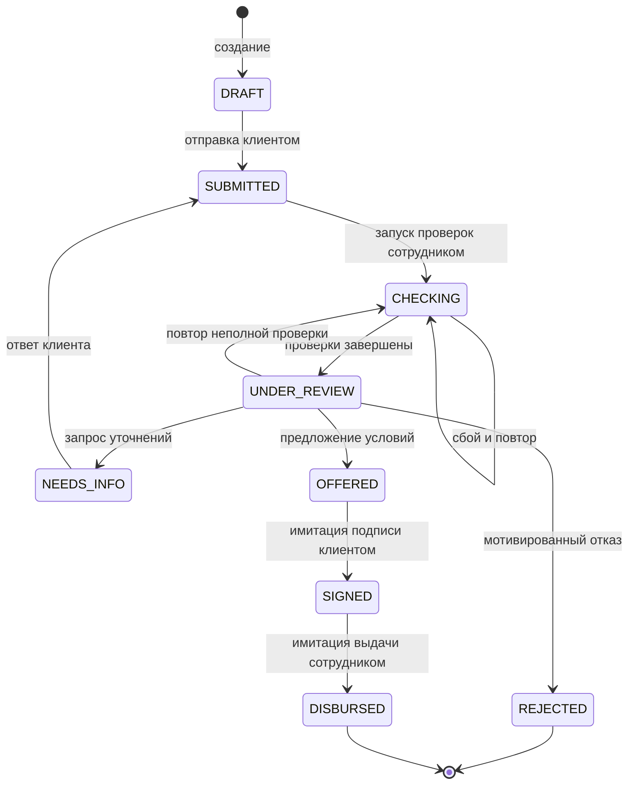

# Путь кредитной заявки Credit Pilot

Статус: проект для согласования. Конкретные состояния, команды и демонстрационные
сценарии — **Предложение команды**. Требование связанного процесса — ТЗ, с. 6;
возможные результаты и допустимость симуляций — с. 11, 13–15.

## Сквозной пользовательский путь

1. Клиент входит в локальный кабинет тестовой компании, выбирает один из двух
   продуктов, видит учебные условия и требуемые сведения.
2. Создаёт DRAFT, постепенно заполняет реквизиты, сумму, срок, цель и финансовые
   показатели. Может сохранить неполный черновик, выйти и продолжить позже.
3. Отправляет заявку. Сервер проверяет поля и продукт, фиксирует SUBMITTED
   и событие. При ошибке форма объясняет, что исправить; состояние не меняется.
4. Сотрудник видит заявку в очереди, запускает локальные проверки. В CHECKING
   клиент видит, что проверяется; после завершения — UNDER_REVIEW.
5. Сотрудник видит досье, результаты, баллы и основания рекомендации. При
   противоречивых показателях запрашивает уточнения: NEEDS_INFO.
6. Клиент получает запрос внутри кабинета, исправляет разрешённые финансовые поля
   и добавляет пояснение. После ответа — SUBMITTED, новый цикл проверок.
7. Сотрудник оформляет предложение либо мотивированный отказ. При меньшей сумме
   клиент видит исходный запрос и новые условия отдельно; скоринг проверяется
   для предлагаемых условий, первоначальные сведения не подменяются.
8. Клиент открывает OFFERED, читает условия и подтверждает демонстрационное
   подписание. Фиксируется SIGNED, версия документа и событие.
9. Сотрудник запускает локальную симуляцию выдачи. Фиксируется DISBURSED,
   клиент видит сумму и отметку, что деньги реально не переводились.

При REJECTED клиент видит понятное основание и результат, а сотрудник — полную
историю. Запрос дополнительных сведений — промежуточный результат, не отказ.
Уведомления и действия не выходят в email, SMS, телефон или мессенджеры.

## Единая машина состояний

| Статус | Текст для клиента | Следующее действие |
| --- | --- | --- |
| DRAFT | Черновик | Заполнить и отправить |
| SUBMITTED | Заявка отправлена | Ожидать начала проверки |
| CHECKING | Проверяем сведения | Ожидать; при сбое сотрудник повторит проверку |
| UNDER_REVIEW | Заявка на рассмотрении | Ожидать решение или запрос сведений |
| NEEDS_INFO | Нужны дополнительные сведения | Открыть запрос и ответить |
| OFFERED | Для вас подготовлены условия | Прочитать и подтвердить имитацию подписи |
| REJECTED | По заявке принято отрицательное решение | Прочитать причину |
| SIGNED | Подписание смоделировано | Ожидать демонстрационную выдачу |
| DISBURSED | Выдача смоделирована | Посмотреть итог и историю |

«Одобрено» в интерфейсе соответствует OFFERED с конкретными условиями.
Отдельный APPROVED или ACCEPTED не нужен: подтверждение условий и имитация
подписи выполняются одной явной командой. Истечение предложения, отказ клиента
от предложения, отмена и возврат из терминального состояния не входят в v1;
клиент может оставить предложение неподписанным. Это выбор команды, не запрет PDF.

## Таблица переходов и условий

| Команда | Исполнитель | Из → в | Предусловия | Сохраняемый результат |
| --- | --- | --- | --- | --- |
| Создать | CLIENT | отсутствует → DRAFT | Действующая сессия своей компании | Номер, владелец, автор, данные, DRAFT_CREATED |
| Сохранить поля | CLIENT | DRAFT → DRAFT | Только редактируемые поля; длина и точность валидны | Изменённые поля, version, DRAFT_UPDATED; пустой PATCH без изменения — без события |
| Отправить | CLIENT | DRAFT → SUBMITTED | Все поля и границы продукта, серверные ограничения | Снимок версии продукта, SUBMITTED |
| Начать проверки | BANK | SUBMITTED → CHECKING | Нет активного run; актуальная version | REQUEST-run со снимком и CHECKS_STARTED |
| Повторить неполную проверку | BANK | UNDER_REVIEW → CHECKING | Текущий run INCOMPLETE; источник данных подготовлен, version актуальна | Новый REQUEST-run и CHECKS_STARTED; прежние результаты сохранены |
| Завершить проверки | SYSTEM внутри команды BANK | CHECKING → UNDER_REVIEW | Run текущий, завершение без технического сбоя | Проверки и оценка либо INCOMPLETE без оценки, CHECKS_COMPLETED |
| Зафиксировать сбой | SYSTEM | CHECKING → CHECKING | Сбой текущего run | FAILED, безопасный код ошибки, CHECKS_FAILED |
| Повторить | BANK | CHECKING → CHECKING | Прошлая попытка FAILED либо истёк таймаут RUNNING | Новый run; старая попытка остаётся в истории |
| Запросить сведения | BANK | UNDER_REVIEW → NEEDS_INFO | Причина и список полей заданы; нет открытого запроса | InformationRequest, INFORMATION_REQUESTED |
| Ответить | CLIENT | NEEDS_INFO → SUBMITTED | Ответ на актуальный запрос; только разрешённые поля, версия актуальна | Закрытие запроса, ответ, обновлённые финансовые поля, INFORMATION_PROVIDED |
| Предложить условия | BANK | UNDER_REVIEW → OFFERED | Полные актуальные проверки, политика допускает; комментарий для MEDIUM | Decision OFFER, условия, связанная оценка, OFFER_ISSUED |
| Отказать | BANK | UNDER_REVIEW → REJECTED | Актуальная полная оценка/проверки либо подтверждённая неактивная регистрация; reason_code и понятный текст | Decision REJECT, REJECTED |
| Подписать (симуляция) | CLIENT | OFFERED → SIGNED | Своя заявка; подтверждена текущая неизменная версия условий | SimulatedContract и SIGNED_SIMULATED |
| Выдать (симуляция) | BANK | SIGNED → DISBURSED | Подпись есть; выдачи ещё нет | SimulatedDisbursement, DISBURSED_SIMULATED |

Неактивная регистрация — завершённая проверка с отрицательным результатом,
а не технический сбой; в таком случае допускается отказ с причиной даже если
расчёт баллов не применим. При INCOMPLETE из-за неизвестных признаков отказ по
кредитному риску не выдаётся: сначала уточнение/повтор. Это исключение к требованию
полной оценки должно быть одинаково отражено в политике и API.

## Правила неизменности

- После SUBMITTED обычный PATCH заявки запрещён (409), в том числе в NEEDS_INFO.
  Ответ — отдельная команда с allowlist полей. Исходные запрос суммы/срока/продукта
  не меняются; альтернативные условия живут в Decision.
- Для любой запрещённой пары состояния и команды — 409 без частичного изменения.
  Недоступная/отсутствующая заявка — 404; чужая роль — 403; нет входа — 401.
- Невалидная отправка оставляет DRAFT, поля, version и timestamps без изменений.
  То же правило действует для невалидных уточнений и решения.
- Повтор submit — 409, как в текущем API. Подпись/выдача с тем же ключом команды
  возвращают прежний результат; с несовместимыми данными — 409. Дубликатов нет.
- Отчётность и UI опираются на текущие записи и журнал одной БД; никакой отдельной
  «фронтенд-версии» процесса. История предыдущих run и запросов не удаляется.

## Проверяемые сценарии — Предложение команды

| ID | Исходные данные и действия | Что доказать |
| --- | --- | --- |
| S01 | Активная компания, устойчивый денежный остаток, 0 дней просрочки; полный путь до DISBURSED | Два кабинета связаны; формула объяснена; предложение, подпись и выдача сохранены |
| S02 | Сотрудник видит противоречие расходов и пояснения; NEEDS_INFO, клиент уточняет расходы; новый run | Нет обхода PATCH; прежний снимок неизменен; новая оценка использует ответ |
| S03 | Неактивная регистрация либо полный набор данных с DSCR <1; сотрудник отказывает | Баллы не обходят жёсткое ограничение; клиент видит понятную причину |
| S04 | MEDIUM и допустимые признаки; сотрудник предлагает меньшую сумму, достаточную для DSCR ≥1.2 | Новая оценка для новых условий, исходный запрос сохранён |
| S05 | Неизвестный fixture и отдельный сценарий технического сбоя симулятора | Нет ложной успешной проверки/оценки; видимая ошибка, безопасный повтор без двойных результатов |
| S06 | Параллельные решения, устаревшая форма, повтор sign/disburse | Конфликт версии; не более одного решения, договора и выдачи |
| S07 | Клиент B читает/меняет заявку клиента A или вызывает BANK-команду | Серверная изоляция данных и ролей, аудит доступа |
| S08 | Перезагрузка страницы, перезапуск backend, обрыв CHECKING и повтор | Состояние и история сохраняются, stale-run восстанавливается |
| S09 | Разные продукты или этапы у двух клиентов | Лента содержит разные локальные материалы с открываемым текстом |
| S10 | Новый checkout, seed и запуск по README; после сборки выключен исходящий интернет | Полный путь без платных API, внешних ключей и корпоративных систем |

Воспроизводимые fixtures содержат ожидаемые результаты; случайность во время
демонстрации исключена. S01–S03 — основной короткий показ жюри. S04–S10 —
самостоятельная техническая проверка и усиление качества, а не дополнительные
независимые продукты.
