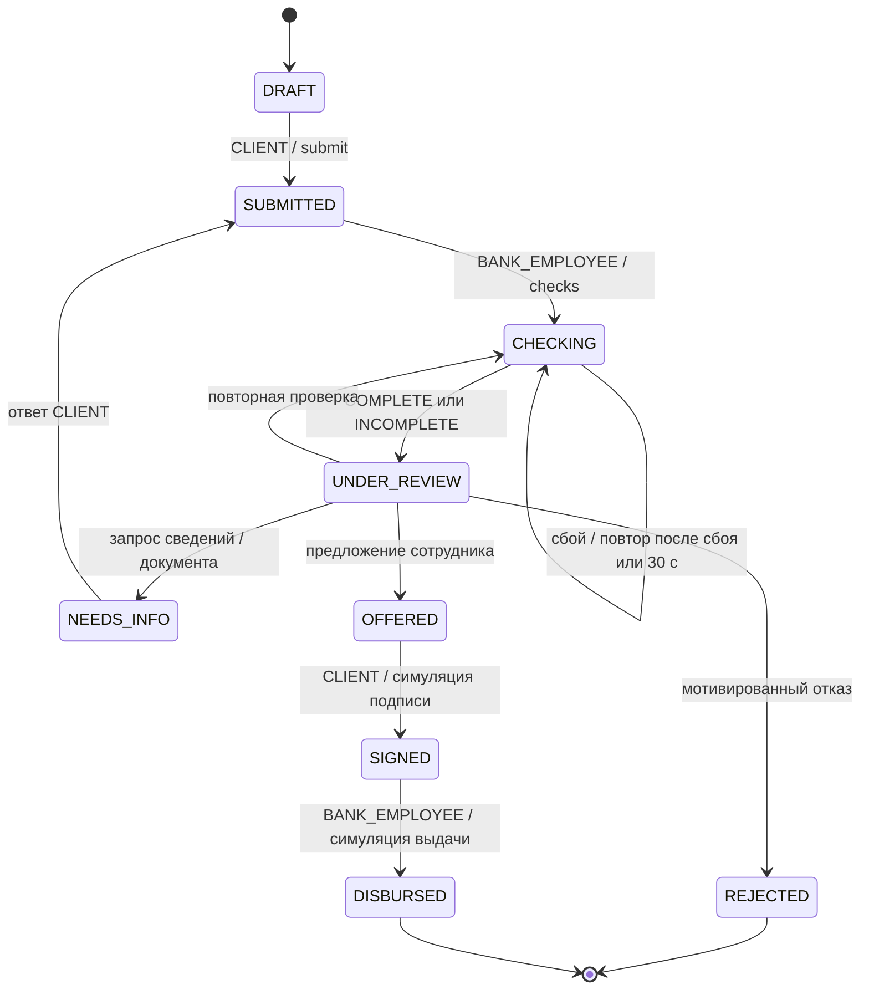

# Путь заявки

Актуальная реализация ветки `feature/slava-dore`. Состояние определяет сервер.
Решения о числе этапов и порогах — **Предложение команды**.

| Этап | Ответственный | Что разрешено |
| --- | --- | --- |
| DRAFT | Владелец | Изменять девять полей, сохранять неполные данные, отправить полный черновик |
| SUBMITTED | Сотрудник | Начать локальные проверки |
| CHECKING | Сотрудник | Дождаться результата, повторить FAILED; RUNNING повторяется после 30 секунд |
| UNDER_REVIEW | Сотрудник | Повтор проверки, запрос, предложение или обоснованный отказ |
| NEEDS_INFO | Владелец | Ответить на единственный открытый запрос, заполнить ровно запрошенные поля, приложить документ |
| OFFERED | Владелец | Прочесть неизменные условия и подтвердить демонстрационную подпись |
| SIGNED | Сотрудник | Смоделировать выдачу по подписанным условиям |
| REJECTED / DISBURSED | Обе роли | Читать результат, историю и документы |

После отправки обычный PATCH запрещён. Ответ может уточнять финансовые поля,
название компании или цель **только если они перечислены сотрудником**. ИНН,
продукт, исходные сумма/срок и владелец через ответ не меняются. Расширение ответа
названием/целью — предложение команды для исправления противоречий с локальным
реестром; прежние снимки сохраняются.

Проверки состоят из двух транзакций: старт с RUNNING и CHECKS_STARTED, затем
результат и CHECKS_COMPLETED/FAILED. Между ними локальный адаптер и скоринг работают
без блокировки заявки. При обрыве RUNNING восстанавливается повтором после
30 секунд; старый run отмечается FAILED/INTERRUPTED. Завершить переход может только
последняя RUNNING-попытка. Неизвестный ИНН — INCOMPLETE без score, а не «хорошая история».

Все новые бизнес-команды требуют `expected_version` и UUID `command_id`.
Заявка блокируется `FOR UPDATE`, ключ проверяется до версии. Точный повтор
возвращает первоначальный ответ без нового события. Другой payload/автор/команда
с тем же ключом — 409; новая команда с устаревшей версией — 409. Каждое успешное
изменение и событие истории атомарны. PATCH/submit дополнительно принимают
`If-Match` с версией, который отправляет интерфейс.

Встречное предложение уменьшает сумму при неизменных продукте и сроке. Сервер
пересчитывает оценку на предложенную сумму и повторно проверяет политику.
Исходный запрос и его оценка не переписываются. Причина и текст сотрудника
обязательны; SCORE и ML не создают Decision самостоятельно.

Подписание содержит id актуального решения и `confirmed=true`. Договор имеет
версию и SHA-256 текста, выдача — отдельную уникальную запись и точную сумму.
Ни один из этих шагов не имеет юридической силы и не переводит деньги.

Отмена заявки, отклонение/истечение предложения, изменение срока встречного
предложения и сопровождение после выдачи в текущий MVP не входят.
