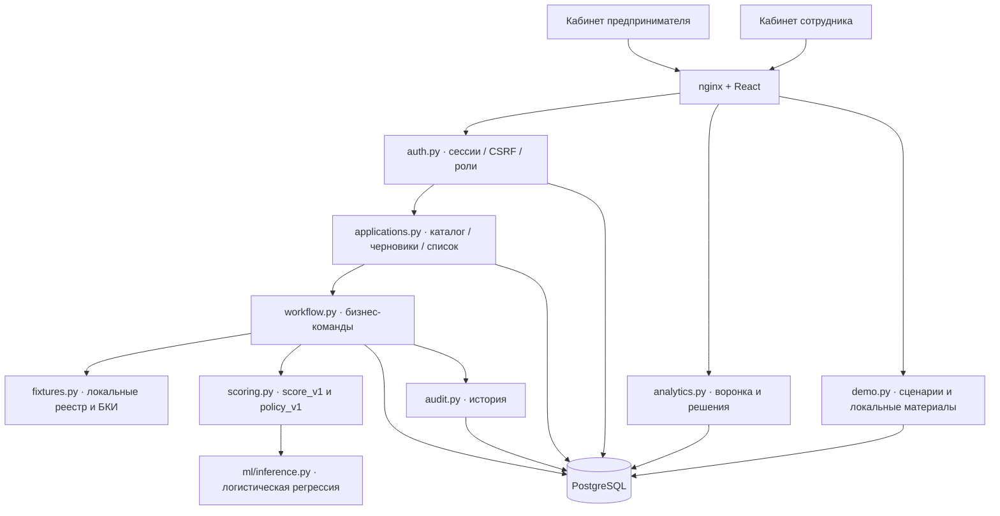

# Архитектура Credit Pilot

Реализован локальный модульный монолит: React/TypeScript/Vite + nginx,
FastAPI/Python 3.12/psycopg, PostgreSQL 17. Три Compose-сервиса, одна БД,
Alembic 0001–0005. SQLAlchemy используется в миграциях; ORM-перенос не выполнен
и не нужен для работы текущего MVP.

## Модули

- `applications.py`: девять полей, Decimal JSON parsing, валидация submit,
  владение, список и пагинация. `products.py`: версии продуктов и оценка платежа.
- `workflow.py`: проверки, запрос/ответ, документы, решения, договор/выдача,
  row lock, проверка версии, дедупликация и атомарный аудит.
- `fixtures.py`: детерминированные локальные сведения по синтетическому ИНН.
- `scoring.py`: чистые расчёты Decimal; рекомендации отдельно от команд решения.
- `ml/`: генератор/обучение, JSON-веса, отчёт метрик и локальный inference без
  внешних библиотек и сетевых запросов.
- `analytics.py`: агрегаты по текущим состояниям, достигнутым этапам и решениям;
  `demo.py`: шаблоны, идемпотентный seed и материалы по контексту клиента.
- Frontend: общий fetch с cookie/CSRF, hash-маршруты, SessionProvider,
  пошаговая форма, очередь, досье, проверки/ML, история и банковская аналитика.

## Деньги и риск

Все деньги хранятся как точные Decimal/NUMERIC, JSON использует строки.
Не более двух знаков на входе; неявного округления сохранённых сумм нет.
Аннуитет: `P = A*r/(1-(1+r)^(-n))`, `r=annual_rate/12`; при нулевой ставке `A/n`.
`DSCR=(R-E)/(D+P)`, `margin=(R-E)/R`. Расчёт с Decimal precision=50;
сравнения используют неокруглённые значения, отображаемый платёж — HALF_UP до копеек.

Баллы DSCR / возраста / маржи / просрочки имеют максимумы 40/15/20/25.
Пороги и политика описаны в [model-card.md](model-card.md). Меньшая сумма
вычисляется из допустимого платежа `(R-E)/1.2-D`, округляется вниз до копейки,
затем проходит новый полный расчёт. Нельзя увеличить исходную сумму или обойти
политику ручным вводом. Решение всегда создаёт сотрудник отдельной командой.

ML использует float только для статистического преобразования признаков и
вероятности. Денежный payload, хранилище, расчёт платежа и ограничения остаются
Decimal. ML-вероятность не определяет право на предложение или отказ.

## Транзакции и восстановление

Новые команды требуют UUID и ожидаемую версию. Под блокировкой заявки проверяются
роль/состояние, сохранённый ключ, версия и бизнес-предусловия. Изменение, событие
и receipt фиксируются в одной транзакции. Точный повтор возвращает прежний ответ,
несовместимый повтор или устаревшая версия — 409. Интерфейс не повторяет команды
автоматически после сетевой ошибки. GET перечитывается после команды и каждые 5 с.

Проверки имеют две короткие транзакции. Старт RUNNING сохраняется до вызова
адаптера, завершение возможно только для последнего RUNNING. FAILED можно повторить;
прерванный RUNNING — через 30 с. Неизвестный ИНН/несовпадение названия приводит
к INCOMPLETE без score, технический сбой — FAILED. Снимки прошлых попыток остаются.
Сами адаптеры локальные, без сетевых зависимостей и фоновой очереди.

Досье и банковская аналитика читаются в REPEATABLE READ, чтобы не объединять
разные моменты процесса. Список использует серверные фильтры и пагинацию.
История содержит отдельные версии; документы и решения не удаляются через API.

## Доступ

- Только SERVER role CLIENT/BANK_EMPLOYEE. Клиент получает права по `owner_id`;
  совпадение `company_id` не открывает чужие заявки. Сотрудник не создаёт клиентские заявки.
- Пароли PBKDF2-SHA256; серверные сессии на 8 часов, токены/CSRF хранятся хешами.
  HttpOnly-cookie, SameSite=Lax, Secure по конфигурации. Logout отзывает сессию.
- Все изменения требуют X-CSRF-Token и проверку Origin/Sec-Fetch-Site.
  Login проверяет Origin. Cookie и пароли не сохраняются frontend.
- CSRF выдаётся только login; память/sessionStorage сохраняют его в той же
  вкладке. Новая вкладка без CSRF требует повторного входа. `/api/me` отдаёт
  только пользователя. Переключайте роли в разных профилях браузера.
- Запрос уточнения содержит явный allowlist; невозможно ответом поменять сумму,
  срок, продукт, ИНН, owner_id или результат источника. До трёх синтетических
  TXT/CSV по 64 КиБ. Скачивание требует той же роли/владения и отдаёт attachment,
  text/plain, nosniff. HTML документа никогда не исполняется в интерфейсе.
- Чувствительные ответы имеют Cache-Control: no-store. История не копирует
  HTTP-заголовки, cookie, токены, пароли или произвольный request body.

## Запуск и пределы

Образы закреплены digest, npm — lock, Python — точными версиями. Первая сборка
требует интернета, runtime автономен. Миграции выполняются перед запуском API,
seed запускается явно и сохраняет существующие записи. Health — SELECT 1,
200 при доступной БД, 503 при ошибке. Основной volume сохраняется при остановке.

Это один узел PostgreSQL без HA, промышленного IAM, rate limiting и полного
аудита входов/чтений. При потере БД операции недоступны, health сообщает об ошибке.
При потере ответа POST создания пользователь проверяет список перед повтором;
создание черновика пока не имеет ключа идемпотентности. Оптимистическая защита
PATCH/submit обязательна для нашего UI, но опциональна для совместимости старого API.

Предложения не истекают, нельзя отменить заявку или отклонить встречное предложение.
Нет OCR, реального БКИ/ФНС, настоящих подписей, переводов или обслуживания кредита.
Сервис рассчитан на локальный показ с синтетическими данными, не на production.
