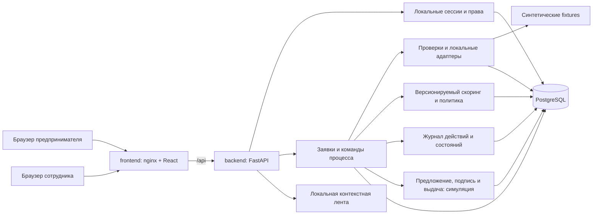

# Архитектура MVP Credit Pilot

Статус: архитектура предварительно согласована, T01 закрыта после предварительной
приёмки внешним ревью. Текущее состояние и будущие решения разделены ниже.
Нереализованные технические решения — **Предложение команды**, если не указано требование ТЗ.
Основание и матрица покрытия: [requirements.md](requirements.md).

## Текущее состояние и направление развития

В репозитории уже есть React/TypeScript/Vite, nginx, FastAPI, PostgreSQL 17,
Compose из трёх сервисов, Alembic и API черновика/отправки. Запросы приложений
сейчас выполняются через psycopg; SQLAlchemy используется для миграций.
Реализованы application_events, пользователи CLIENT/BANK_EMPLOYEE, серверные
сессии, CSRF и права по owner_id; миграции 0001–0004. Журнал содержит создание,
редактирование и отправку заявки; событий входа и просмотра пока нет.
T05 добавляет версионированный каталог и финансовые поля;
[контракт T05](t05-api-contract.md) фиксирует форматы и совместимость.
Банковской обработки и скоринга ещё нет.
Frontend показывает только health с опросом каждые 5 секунд; формы входа,
заявок и банковского кабинета отсутствуют. Tailwind/shadcn не подключены.

Существующие API и данные сохраняются. T02 — перенос запросов на SQLAlchemy —
отложена по решению пользователя. T05 и T06 развиваются на текущем psycopg,
без переписывания рабочего backend и без зависимости от ORM-переноса.

## Модульный монолит

Схема ниже — целевой MVP. Сейчас работают frontend/API/auth/applications/products/audit/БД;
checks, scoring, документы и лента ещё не реализованы.

Три Compose-сервиса остаются: `frontend`, `backend`, `postgres`. Модули на схеме
не отдельные процессы. Локальные адаптеры не требуют сервисов БКИ/ФНС, очереди
или исходящего интернета. Сейчас в образ входит seed аккаунтов; fixtures проверок
и материалы ленты будут добавлены при реализации соответствующих задач.
Backend не хранит авторитетное состояние заявок в памяти или на локальном диске.

Сейчас маршруты и SQL находятся в applications.py, доступ — auth.py,
запись событий — audit.py, подключение — database.py. При росте выделять небольшие
сервисы/репозитории на psycopg по необходимости, не делать полный рефакторинг.
Каталог выделен в products.py. Границы будущих модулей: processing, scoring, decisions, simulation.
SQLAlchemy остаётся возможным поздним решением T02, не обязательным новым слоем.

## Кабинеты

Таблица описывает целевые экраны. В T06 реализованы оболочки кабинетов и данные
пользователя из auth API; содержимое будущих разделов — явные заглушки.

| Клиент | Сотрудник |
| --- | --- |
| Каталог и сравнение двух продуктов | Очередь заявок с фильтром статуса |
| Список своих заявок, форма с сохранением черновика | Досье: данные, проверки, финансовые показатели |
| Таймлайн, статус и следующее действие | Таблица вкладов скоринга и основания рекомендации |
| Ответ на запрос сведений | Запрос структурированных уточнений |
| Предложение условий, объяснение отказа | Предложение суммы или мотивированный отказ |
| Демонстрационные подписание и выдача | История действий и повторный запуск сбойной проверки |

UI: React + TypeScript + Vite, Tailwind CSS и локальные Button/Input по подходу
shadcn. Компоненты находятся в `frontend/src/components`, страницы — в `pages`,
API и CSRF — в `api`, жизненный цикл сессии — в `auth/SessionProvider`.
Hash-маршруты из `app/navigation.ts` поддерживают reload на существующем nginx.
Неподходящий роли маршрут не открывается; это не заменяет проверку прав API.
Роль не выбирается на форме и не читается из localStorage: после login она
получается из ответа сервера, после reload/возврата фокуса — из `/api/me`.
Общий fetch использует относительные `/api`, cookie (`credentials: same-origin`),
`cache: no-store`, тайм-аут 10 секунд и CSRF на изменениях (кроме login).
Тайм-аут и hash-навигация — **Предложение команды**, не новые продуктовые правила.

Опрос активной заявки раз в несколько секунд и перечитывание после команды —
будущий этап, сейчас запросов к продуктам или заявкам из интерфейса нет.
Возврат допустимых действий сервером — будущее расширение API, сейчас его нет.
WebSocket не требуется.
Лента из requirements.md — локальные материалы по тегам, отдельная от таймлайна.

## Безопасность и доступ

Работают seed-аккаунты client-a/client-b (CLIENT) и bank (BANK_EMPLOYEE).
Пароли — PBKDF2-SHA256 с солью и 600 000 итерациями. sessions хранит SHA-256
хеши session/CSRF-токенов и expires_at. Срок — 8 часов; logout удаляет запись.
Cookie credit_pilot_session: HttpOnly, SameSite=Lax, Path=/api; Secure настраивается
COOKIE_SECURE и требуется при HTTPS-публикации.
Изменяющие запросы защищены X-CSRF-Token, проверкой Origin при его наличии
и Sec-Fetch-Site. Login выдаёт сессию без прежнего CSRF, но проверяет Origin.
Для разработки с Vite использовать same-origin proxy.

CLIENT работает только со своими заявками: applications.owner_id = users.id.
Совпадение company_id не даёт доступа. BANK_EMPLOYEE пока только читает заявку
и историю, а создание/PATCH/submit получает 403; банковских команд ещё нет.
Роль, owner_id и actor_id берутся сервером из действующей сессии, не из frontend.
Документы и их будущие endpoint также потребуют проверки прав.
Для чужой клиентской заявки возвращать 404; для действия неподходящей роли — 403.
Без сессии — 401. Сессии и пароли не журналировать. Это минимальная защита
демо, не замена промышленной IAM-системы.

### CSRF после перезагрузки страницы

**Действующий backend-контракт:** csrf_token возвращает только POST /api/auth/login.
GET /api/me отдаёт id/role/company_id, без CSRF. В sessions хранится только
csrf_hash, поэтому восстановить прежний токен из БД нельзя. HttpOnly session-cookie
доступна серверу после reload, но frontend не может прочитать её и не должен
использовать её как CSRF.

**Реализовано в T06:** авторизация backend не меняется. После login только
csrf_token сохраняется в памяти и sessionStorage (`credit-pilot.csrf`). Bootstrap
вызывает GET /api/me через same-origin proxy с cookie и проверяет формат ответа,
пользователя и допустимую роль по серверу. CSRF восстанавливается из sessionStorage;
изменяющие fetch передают его в X-CSRF-Token. При запрете storage токен остаётся
в памяти до reload. Роль, пользователь, пароль и owner_id в storage не сохраняются.

Если сессия действительна, но storage пуст (новая независимая вкладка, очистка,
старый curl-login), доступны чтения, а формы изменений требуют явного повторного
входа. В T06 это относится и к logout: без CSRF кнопка ведёт на повторный вход,
а не имитирует отзыв сессии. Это ограничение текущего контракта, не скрытый endpoint
восстановления. При 401/успешном logout storage очищается, при login токен заменяется.
При сетевой ошибке logout успешный выход не показывается: остаётся возможность
повторить запрос. Backend создаёт новую сессию при повторном login; автоматический
отзыв прежней сессии на login не добавлялся. Logout отзывает текущую сессию.
403 с неверным CSRF после входа в другой вкладке требует переаутентификации,
а не слепого повтора бизнес-команды: POST создания пока не идемпотентен.
CSRF в sessionStorage доступен JS и не является защитой от XSS; session-cookie
остаётся HttpOnly. На будущее можно отдельно согласовать выдачу CSRF в отдельной
читаемой cookie либо защищённый bootstrap endpoint, но их сейчас нет.

Проверки T06 и ограничения среды — в [T06_REVIEW.md](T06_REVIEW.md): компонентные
тесты отдельно от реальных HTTP-запросов login/me/logout. PATCH/создание из UI
не добавлялись; их сквозная проверка с будущей формой относится к T07.
Переход в независимую вкладку с пустым CSRF требует повторного входа. Вкладки,
открытые с opener/дублированием, могут наследовать sessionStorage; после смены
общей cookie старый CSRF будет отклонён сервером и потребуется повторный вход.

## Команды, транзакции и API

Существующие маршруты создания, чтения, PATCH и `/submit` сохранить по пути.
T05 вводит обязательные продукт и финансовые данные при submit
с обновлённой схемой/тестами и ошибками полей для старых черновиков.
Не подставлять владельца или продукт старым заявкам молча.

Текущий контракт: POST /api/auth/login, POST /api/auth/logout, GET /api/me,
POST /api/applications, GET/PATCH /api/applications/{id},
POST /api/applications/{id}/submit, GET /api/applications/{id}/events,
GET /api/health, GET /api/products. Пагинация событий — after_id и limit 1–100.
Списка заявок пока нет. Планируемое развитие групп API:

| Группа | Действия |
| --- | --- |
| `/api/auth/*`, `/api/me` | Реализованы login/logout/me; восстановления CSRF отдельным endpoint нет |
| `/api/products` | Реализовано T05: действующие версии и ограничения двух учебных продуктов |
| `/api/applications` | Создание/чтение/PATCH/submit работают; список своих заявок ещё предстоит |
| `/api/applications/{id}/checks` | BANK_EMPLOYEE: выполнить или повторить проверки |
| `/api/applications/{id}/information-requests` | BANK_EMPLOYEE: запросить; CLIENT: ответить на конкретный запрос |
| `/api/applications/{id}/decisions` | BANK_EMPLOYEE: предложение или отказ, с причинами и версией оценки |
| `/api/applications/{id}/events` | Реализовано: только владелец или BANK_EMPLOYEE |
| `/api/applications/{id}/offer`, `/sign`, `/disburse` | Прочитать предложение; CLIENT: имитация подписи; BANK_EMPLOYEE: имитация выдачи |
| `/api/feed` | Материалы, выбранные сервером для текущего клиента |

OpenAPI формируется FastAPI; перед сдачей сохранить согласованный экспорт
и коллекцию запросов. Ошибки: 422 — поля, 404 — нет доступной заявки,
409 сейчас — несовместимое состояние; конфликт ожидаемой версии ещё не реализован.
Клиент не PATCH-ит статус напрямую.

Реальная мутация заявки увеличивает version и добавляет application_events
в одной транзакции; UNIQUE(application_id, application_version) защищает журнал.
Пустой/не меняющий значения PATCH не создаёт мутации или события. PATCH/submit
используют SELECT ... FOR UPDATE. Ожидаемая версия клиента пока не проверяется;
разные последовательные обновления одного поля работают как last-write-wins.
Для банковских команд отдельно предусмотреть конфликт версии и UI перечитывания.
Sign/disburse и их идемпотентность — будущий план; повтор submit сейчас даёт 409.
POST создания не имеет ключа идемпотентности и не должен автоматически повторяться.
Общий event sourcing и универсальная таблица workflow не нужны.

Бизнес-события сохраняют исполнителя, время, действие, предыдущий/новый статус,
версию и old/new только бизнес-полей. Сейчас пишутся только DRAFT_CREATED,
DRAFT_UPDATED, SUBMITTED; ошибки валидации не меняют заявку и историю.
Входы/выходы, просмотры и отказы доступа пока не журналируются; общий аудит —
отдельное будущее расширение. Пароли, токены и заголовки не копируются в события.
Журнал неизменяем только через API, не защищён от администратора БД.

## Проверки и восстановление

Этот раздел — план банковского процесса после T05/T06, не реализация T01.
Перед ним обязательна миграция состояний и событий из domain-model.md:
сейчас applications.status ограничен VARCHAR(9) и CHECK DRAFT/SUBMITTED,
а application_events и API допускают только три текущих типа событий.

Источник реестра возвращает статус бизнеса и возраст в месяцах; источник БКИ —
максимум дней просрочки. Это синтетические результаты, не реальные запросы.
Fixtures выбираются по синтетическому ИНН. Неизвестный ИНН даёт «нет данных»,
а не случайную успешную историю. Версия fixture входит в результат.

Команда BANK_EMPLOYEE запускает проверки синхронно, без фоновых задач в памяти:

1. Транзакция фиксирует `CHECKING`, новый ProcessingRun со снимком полей,
   версиями продукта/правил и событие старта; блокировка освобождается.
2. Локальные адаптеры выполняются вне длинной транзакции с ограничением времени.
3. Вторая транзакция проверяет состояние/актуальный run, сохраняет результаты,
   оценку и переводит заявку в `UNDER_REVIEW` с событием завершения.

При отсутствии данных run заканчивается `INCOMPLETE`; оценка отсутствует,
заявка попадает на разбор сотруднику. После подготовки отсутствовавшего источника
сотрудник может вернуть UNDER_REVIEW в CHECKING отдельным повторным запуском;
не нужно заставлять клиента отправлять бессодержательный ответ на запрос.
При техническом сбое run имеет `FAILED`,
заявка остаётся в `CHECKING` с понятной ошибкой и возможностью повтора.
После обрыва процесса stale-run можно повторить по таймауту: старый run помечается
FAILED, создаётся новый. Только текущий run может завершить переход; поздний
ответ старого run игнорируется с событием. Повтор команды при активном run — 409.
Таймаут и правила восстановления задаются конфигурацией и тестируются.

## Объяснимый скоринг — Предложение команды

Это учебная модель `score_v1` для синтетических сценариев. Порогов и ставок
Альфа-Банка PDF не задаёт. Модель не прогнозирует вероятность дефолта и не
претендует на статистическую калибровку.

Демонстрационные продукты `product_v1`:

| Код | Назначение | Сумма RUB | Срок | Учебная годовая ставка |
| --- | --- | --- | --- | --- |
| WORKING_CAPITAL | Оборотные средства | 50 000–3 000 000 | 3–24 мес. | 20% |
| EQUIPMENT | Оборудование | 100 000–5 000 000 | 6–36 мес. | 18% |

Это вымышленные условия команды, не предложения банка. Границы включительные.
В форме отображаются до отправки; подходящий продукт выбирает сам клиент.

Вводимые финансовые данные: месячная выручка R > 0, операционные расходы E ≥ 0,
ежемесячные выплаты по существующим долгам D ≥ 0. Отрицательный денежный остаток
допустим как вход и влияет на риск. Внешние признаки: возраст бизнеса M ≥ 0,
максимальная просрочка O ≥ 0, активность регистрации. Все суммы Decimal/RUB.

Для запрошенной суммы A и срока n, месячной ставки r = annual_rate / 12:

`P = A * r / (1 - (1 + r)^(-n))`; при r = 0 используется `A / n`.

`DSCR = (R - E) / (D + P)`; `margin = (R - E) / R`.
Расчёт Decimal с фиксированной точностью контекста 50; сравнения по неокруглённым
значениям. Только показ P округляется до копеек HALF_UP. Входные суммы с лишними
десятичными знаками отклоняются, никогда не округляются при сохранении.

| Фактор | Интервалы | Баллы |
| --- | --- | --- |
| DSCR | <1; [1, 1.2); [1.2, 1.5); ≥1.5 | 0; 15; 30; 40 |
| Возраст M, полные месяцы | <6; 6–11; 12–23; ≥24 | 0; 5; 10; 15 |
| margin | <0.10; [0.10, 0.20); ≥0.20 | 0; 10; 20 |
| Просрочка O, дни | 0; 1–30; >30 | 25; 10; 0 |

Сумма 0–100: LOW ≥75, MEDIUM 50–74, HIGH <50.
Неизвестный/ошибочный признак не равен нулю просрочки или нулевому риску:
оценка становится недоступной до уточнения. Хранятся вход, значение каждого
фактора, правило, баллы, итог, версия и время.

Контрольный вектор для WORKING_CAPITAL: A=100000, n=12, R=200000,
E=100000, D=10000, M=36, O=0, регистрация активна. P примерно 9263.45,
DSCR >1.5, margin=0.5; баллы 40+15+20+25=100, LOW.
Границы 1/1.2/1.5, 6/12/24, 0.10/0.20, 0/30/31 тестируются отдельно.

### Скоринг и решение разделены

Политика `policy_v1` учитывает продукт и жёсткие ограничения независимо от баллов:

- Нет необходимых данных или проверки не завершены — решение по риску запрещено,
  доступны запрос сведений или повтор проверки. Исключение: подтверждённая
  неактивная регистрация позволяет отказ по допустимости продукта без score;
  это не заключение о кредитном риске и отдельно объясняется клиенту.
- Неактивная регистрация, O >90 или DSCR <1 — блок предложения,
  сотрудник может запросить уточнение либо мотивированно отказать.
- HIGH — рекомендация отказа; в v1 предложение заблокировано.
- MEDIUM — ручной разбор; предложение требует комментария сотрудника.
- LOW — рекомендация предложения, но сотрудник всё равно подтверждает результат.
- Предложение требует активной регистрации, O ≤90, итогового DSCR ≥1.2,
  допустимых суммы/срока продукта и отсутствия незакрытого запроса сведений.

Альтернатива — меньшая сумма при том же сроке. Исходный запрос не переписывается:
условия сохраняются отдельно, создаётся расчёт для предлагаемой суммы, и политика
проверяется повторно. Увеличение суммы и изменение срока не входят в v1.
Безопасный расчёт альтернативы выполняется на сервере по актуальному снимку;
вручную назначить баллы или обойти блокировки нельзя. Отказ всегда с причиной.

## Эксплуатация и границы надёжности

- Миграции Alembic только вперёд для уже используемой схемы; не менять применённую
  миграции 0001–0004. Для нескольких экземпляров backend миграции выполняются отдельной
  командой до запуска; текущий одиночный Compose может сохранить startup-migration.
- Seed идемпотентен, отдельная явная команда; не очищает volume и не присваивает
  старые заявки случайным клиентам. Демоданные можно загрузить без платных сервисов.
- Health сохраняет текущий контракт 200/503 с SELECT 1. Сейчас используются
  стандартные логи uvicorn; request_id и структурированные бизнес-логи — план.
- Timestamps — PostgreSQL timestamptz; отображение времени в будущем UI делать явно.
- Денежные значения Decimal/NUMERIC; API отдаёт строки. Constraints, FK,
  уникальность подписи/выдачи и индексы по владельцу/статусу поддерживают целостность.
- Проверка восстановления: перезапуск backend, повтор команды, stale-run,
  сохранность volume. Это демонстрация восстановления, не обещание HA:
  один PostgreSQL остаётся единой точкой отказа, репликация не входит в MVP.
- HTTP локально на loopback; публичная демонстрация только после настройки HTTPS,
  секретов и проверки доступа. Публикация отдельный шаг после разрешения пользователя.

Сложность растёт только при доказанной потребности. Замена локального адаптера
реальным, фоновые задания и разделение банковских ролей — направления развития,
не скрытые зависимости MVP.
