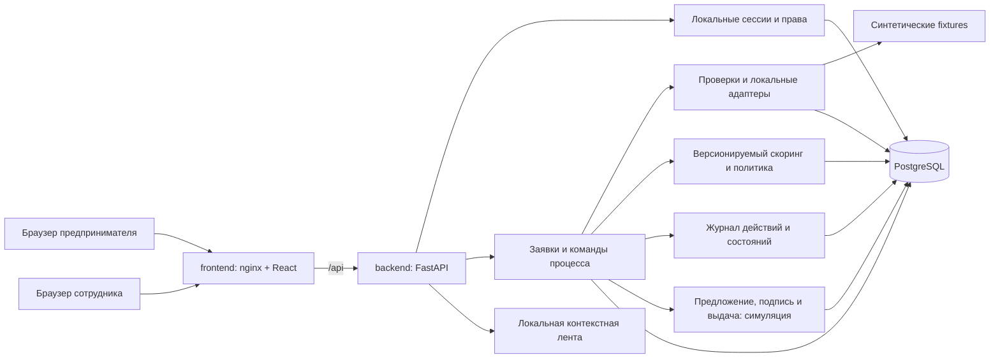

# Архитектура MVP Credit Pilot

Статус: проект для согласования. Все конкретные технические решения ниже —
**Предложение команды**, если не указано требование ТЗ.
Основание и матрица покрытия: [requirements.md](requirements.md).

## Текущее состояние и направление развития

В репозитории уже есть React/TypeScript/Vite, nginx, FastAPI, PostgreSQL 17,
Compose из трёх сервисов, Alembic и API черновика/отправки. Запросы приложений
сейчас выполняются через psycopg; SQLAlchemy используется для миграций.
Авторизации, продуктового каталога, банковского процесса, скоринга и истории нет.
Frontend показывает health. Tailwind/shadcn ещё не подключены.

Существующие рабочие API и данные сохраняются. Не переписывать каркас целиком:
постепенно вынести бизнес-команды в сервисы и перенести запросы на синхронный
SQLAlchemy с psycopg-драйвером, сохранив тесты, точность Decimal и row locks.
Технологическое выравнивание — маленькая отдельная задача, не условие проектирования.

## Модульный монолит

Три Compose-сервиса остаются: `frontend`, `backend`, `postgres`. Модули на схеме
не отдельные процессы. Локальные адаптеры не требуют сервисов БКИ/ФНС, очереди
или исходящего интернета. Статические seed/fixtures и материалы входят в образ.
Backend не хранит авторитетное состояние заявок в памяти или на локальном диске.

Рекомендуемые границы backend при реализации: API/схемы → сервисы команд →
репозитории/SQLAlchemy. Модули: identity, products, applications, processing,
scoring, decisions, audit, simulation. Для небольших модулей достаточно файлов;
пакеты создавать по фактическому росту, без универсального framework.

## Кабинеты

| Клиент | Сотрудник |
| --- | --- |
| Каталог и сравнение двух продуктов | Очередь заявок с фильтром статуса |
| Список своих заявок, форма с сохранением черновика | Досье: данные, проверки, финансовые показатели |
| Таймлайн, статус и следующее действие | Таблица вкладов скоринга и основания рекомендации |
| Ответ на запрос сведений | Запрос структурированных уточнений |
| Предложение условий, объяснение отказа | Предложение суммы или мотивированный отказ |
| Демонстрационные подписание и выдача | История действий и повторный запуск сбойной проверки |

UI: React + TypeScript + Vite, Tailwind CSS и небольшое число shadcn/ui-компонентов
для форм, таблиц, диалогов и уведомлений. Объяснения важнее декоративных эффектов.
Опрос активной заявки раз в несколько секунд; после команды — перечитать ресурс.
Сервер возвращает допустимые действия для роли. WebSocket не требуется.
Лента из requirements.md — локальные материалы по тегам, отдельная от таймлайна.

## Безопасность и доступ

Локальные seed-аккаунты CLIENT и BANK, пароли только в виде стойких хешей.
Серверные сессии в БД; cookie HttpOnly, SameSite=Lax, ограниченный срок жизни,
выход отзывает сессию. Secure-cookie обязателен при HTTPS-публикации.
Все изменяющие запросы с cookie защищать CSRF-токеном и проверкой Origin.
Для разработки с Vite использовать same-origin proxy.

CLIENT работает только со своей компанией; BANK имеет доступ к банковским
действиям. Роль, company_id и actor_id берутся из сессии, а не из тела запроса.
Проверки прав действуют для каждого endpoint, включая историю и документы.
Для чужой клиентской заявки возвращать 404; для действия неподходящей роли — 403.
Без сессии — 401. Сессии и пароли не журналировать. Это минимальная защита
демо, не замена промышленной IAM-системы.

## Команды, транзакции и API

Существующие маршруты создания, чтения, PATCH и `/submit` сохранить по пути.
Добавление обязательных продукта и финансовых данных вводить отдельной задачей
с обновлённой схемой/тестами и понятными ошибками для старых черновиков.
Не подставлять владельца или продукт старым заявкам молча.

Планируемые группы API, не текущий контракт:

| Группа | Действия |
| --- | --- |
| `/api/auth/*`, `/api/me` | Вход, выход, текущая сессия |
| `/api/products` | Каталог и ограничения демонстрационных продуктов |
| `/api/applications` | Создать/список своих, прочитать, PATCH черновика, submit |
| `/api/applications/{id}/checks` | BANK: выполнить или повторить проверки |
| `/api/applications/{id}/information-requests` | BANK: запросить; CLIENT: ответить на конкретный запрос |
| `/api/applications/{id}/decisions` | BANK: предложение или отказ, с причинами и версией оценки |
| `/api/applications/{id}/events` | История с фильтрацией по роли |
| `/api/applications/{id}/offer`, `/sign`, `/disburse` | Прочитать предложение; CLIENT: имитация подписи; BANK: имитация выдачи |
| `/api/feed` | Материалы, выбранные сервером для текущего клиента |

OpenAPI формируется FastAPI; перед сдачей сохранить согласованный экспорт
и коллекцию запросов. Ошибки: 422 — поля, 404 — нет доступной заявки,
409 — состояние или конфликт версии. Клиент не PATCH-ит статус напрямую.

Каждая успешная команда изменяет сущность, увеличивает `version` и добавляет
событие в одной транзакции. Сериализация по заявке через `SELECT ... FOR UPDATE`;
ожидаемая версия защищает от устаревшей формы сотрудника. После конфликта UI
предлагает перечитать данные. Идемпотентные ответы для повторных sign/disburse
обеспечиваются уникальными записями и ключом команды; текущий повторный submit
сохраняет 409. Общий event sourcing и универсальная таблица workflow не нужны.

Бизнес-события сохраняют исполнителя, время, действие, предыдущий/новый статус,
версию, изменённые поля и ссылку на результат. Чтение защищённых данных и входы
тоже пишутся в журнал с ограниченным payload. Ошибки валидации не изменяют
заявку и не создают успешного события; отказ доступа может быть отдельным
аудит-событием. Клики, прокрутка и фокус полей не являются бизнес-действиями.

## Проверки и восстановление

Источник реестра возвращает статус бизнеса и возраст в месяцах; источник БКИ —
максимум дней просрочки. Это синтетические результаты, не реальные запросы.
Fixtures выбираются по синтетическому ИНН. Неизвестный ИНН даёт «нет данных»,
а не случайную успешную историю. Версия fixture входит в результат.

Команда BANK запускает проверки синхронно, без фоновых задач в памяти:

1. Транзакция фиксирует `CHECKING`, новый ProcessingRun со снимком полей,
   версиями продукта/правил и событие старта; блокировка освобождается.
2. Локальные адаптеры выполняются вне длинной транзакции с ограничением времени.
3. Вторая транзакция проверяет состояние/актуальный run, сохраняет результаты,
   оценку и переводит заявку в `UNDER_REVIEW` с событием завершения.

При отсутствии данных run заканчивается `INCOMPLETE`; оценка отсутствует,
заявка попадает на разбор сотруднику. После подготовки отсутствовавшего источника
сотрудник может вернуть UNDER_REVIEW в CHECKING отдельным повторным запуском;
не нужно заставлять клиента отправлять бессодержательный ответ на запрос.
При техническом сбое run имеет `FAILED`,
заявка остаётся в `CHECKING` с понятной ошибкой и возможностью повтора.
После обрыва процесса stale-run можно повторить по таймауту: старый run помечается
FAILED, создаётся новый. Только текущий run может завершить переход; поздний
ответ старого run игнорируется с событием. Повтор команды при активном run — 409.
Таймаут и правила восстановления задаются конфигурацией и тестируются.

## Объяснимый скоринг — Предложение команды

Это учебная модель `score_v1` для синтетических сценариев. Порогов и ставок
Альфа-Банка PDF не задаёт. Модель не прогнозирует вероятность дефолта и не
претендует на статистическую калибровку.

Демонстрационные продукты `product_v1`:

| Код | Назначение | Сумма RUB | Срок | Учебная годовая ставка |
| --- | --- | --- | --- | --- |
| WORKING_CAPITAL | Оборотные средства | 50 000–3 000 000 | 3–24 мес. | 20% |
| EQUIPMENT | Оборудование | 100 000–5 000 000 | 6–36 мес. | 18% |

Это вымышленные условия команды, не предложения банка. Границы включительные.
В форме отображаются до отправки; подходящий продукт выбирает сам клиент.

Вводимые финансовые данные: месячная выручка R > 0, операционные расходы E ≥ 0,
ежемесячные выплаты по существующим долгам D ≥ 0. Отрицательный денежный остаток
допустим как вход и влияет на риск. Внешние признаки: возраст бизнеса M ≥ 0,
максимальная просрочка O ≥ 0, активность регистрации. Все суммы Decimal/RUB.

Для запрошенной суммы A и срока n, месячной ставки r = annual_rate / 12:

`P = A * r / (1 - (1 + r)^(-n))`; при r = 0 используется `A / n`.

`DSCR = (R - E) / (D + P)`; `margin = (R - E) / R`.
Расчёт Decimal с фиксированной точностью контекста 50; сравнения по неокруглённым
значениям. Только показ P округляется до копеек HALF_UP. Входные суммы с лишними
десятичными знаками отклоняются, никогда не округляются при сохранении.

| Фактор | Интервалы | Баллы |
| --- | --- | --- |
| DSCR | <1; [1, 1.2); [1.2, 1.5); ≥1.5 | 0; 15; 30; 40 |
| Возраст M, полные месяцы | <6; 6–11; 12–23; ≥24 | 0; 5; 10; 15 |
| margin | <0.10; [0.10, 0.20); ≥0.20 | 0; 10; 20 |
| Просрочка O, дни | 0; 1–30; >30 | 25; 10; 0 |

Сумма 0–100: LOW ≥75, MEDIUM 50–74, HIGH <50.
Неизвестный/ошибочный признак не равен нулю просрочки или нулевому риску:
оценка становится недоступной до уточнения. Хранятся вход, значение каждого
фактора, правило, баллы, итог, версия и время.

Контрольный вектор для WORKING_CAPITAL: A=100000, n=12, R=200000,
E=100000, D=10000, M=36, O=0, регистрация активна. P примерно 9263.45,
DSCR >1.5, margin=0.5; баллы 40+15+20+25=100, LOW.
Границы 1/1.2/1.5, 6/12/24, 0.10/0.20, 0/30/31 тестируются отдельно.

### Скоринг и решение разделены

Политика `policy_v1` учитывает продукт и жёсткие ограничения независимо от баллов:

- Нет необходимых данных или проверки не завершены — решение по риску запрещено,
  доступны запрос сведений или повтор проверки. Исключение: подтверждённая
  неактивная регистрация позволяет отказ по допустимости продукта без score;
  это не заключение о кредитном риске и отдельно объясняется клиенту.
- Неактивная регистрация, O >90 или DSCR <1 — блок предложения,
  сотрудник может запросить уточнение либо мотивированно отказать.
- HIGH — рекомендация отказа; в v1 предложение заблокировано.
- MEDIUM — ручной разбор; предложение требует комментария сотрудника.
- LOW — рекомендация предложения, но сотрудник всё равно подтверждает результат.
- Предложение требует активной регистрации, O ≤90, итогового DSCR ≥1.2,
  допустимых суммы/срока продукта и отсутствия незакрытого запроса сведений.

Альтернатива — меньшая сумма при том же сроке. Исходный запрос не переписывается:
условия сохраняются отдельно, создаётся расчёт для предлагаемой суммы, и политика
проверяется повторно. Увеличение суммы и изменение срока не входят в v1.
Безопасный расчёт альтернативы выполняется на сервере по актуальному снимку;
вручную назначить баллы или обойти блокировки нельзя. Отказ всегда с причиной.

## Эксплуатация и границы надёжности

- Миграции Alembic только вперёд для уже используемой схемы; не менять применённую
  миграцию 0001. Для нескольких экземпляров backend миграции выполняются отдельной
  командой до запуска; текущий одиночный Compose может сохранить startup-migration.
- Seed идемпотентен, отдельная явная команда; не очищает volume и не присваивает
  старые заявки случайным клиентам. Демоданные можно загрузить без платных сервисов.
- Health сохраняет текущий контракт 200/503 с SELECT 1. В логах request_id,
  application_id, действие, время и техническая ошибка; без секретов и полного досье.
- Приложение и PostgreSQL используют UTC/timestamptz, UI отображает время явно.
- Денежные значения Decimal/NUMERIC; API отдаёт строки. Constraints, FK,
  уникальность подписи/выдачи и индексы по владельцу/статусу поддерживают целостность.
- Проверка восстановления: перезапуск backend, повтор команды, stale-run,
  сохранность volume. Это демонстрация восстановления, не обещание HA:
  один PostgreSQL остаётся единой точкой отказа, репликация не входит в MVP.
- HTTP локально на loopback; публичная демонстрация только после настройки HTTPS,
  секретов и проверки доступа. Публикация отдельный шаг после разрешения пользователя.

Сложность растёт только при доказанной потребности. Замена локального адаптера
реальным, фоновые задания и разделение банковских ролей — направления развития,
не скрытые зависимости MVP.
