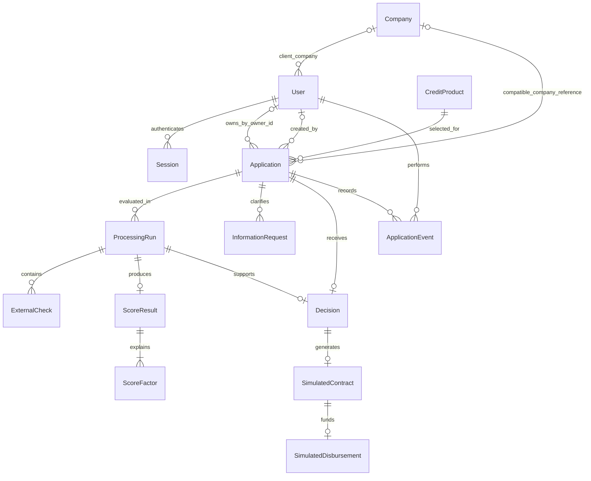

# Модель предметной области Credit Pilot

Статус: T01 закрыта после предварительной приёмки внешним ревью. Ниже разделены
реальная схема 0001–0004 и будущие расширения. Контракт реализованной T05 —
[t05-api-contract.md](t05-api-contract.md). Они не являются банковской схемой
из PDF. [Процесс](application-flow.md) определяет команды;
[архитектура](architecture.md) — безопасность, будущую оценку и транзакции.

## Сущности и отношения

Схема объединяет текущее ядро и целевой MVP. ProcessingRun,
ExternalCheck, ScoreResult/Factor, InformationRequest, Decision и симуляции
ещё не существуют. Текущий журнал — ApplicationEvent (`application_events`).

Владелец — User через applications.owner_id. Company — совместимая ссылка
и синтетическая запись seed, не граница доступа и не проверка регистрации.
Сведения, введённые в заявку, принадлежат заявке и не должны менять старые снимки
других заявок, если позже появится редактирование профиля. Демо упрощает членство: один CLIENT связан
с одной Company, BANK_EMPLOYEE — без привязки к компании. Даже два клиента
одной компании не могут читать чужие заявки. owner_id nullable только для
legacy-заявок без известного автора; новые API-заявки получают его из сессии.

## Реализованные таблицы T01 и T05

| Сущность | Ключевые данные | Инварианты |
| --- | --- | --- |
| Company / companies | id, name, inn | Только seed/совместимость; доступа к заявкам не предоставляет |
| User / users | id, login, password_hash, role CLIENT/BANK_EMPLOYEE, company_id | CLIENT имеет company_id по существующему CHECK; роль/инициатор получаются из БД, не frontend |
| Session / sessions | token_hash (PK), csrf_hash, user_id, expires_at | Только хеши токенов; срок 8 часов. revoked_at нет: logout удаляет запись |
| Application / applications | id, owner_id, company_id, created_by, прежние пять полей, product_code/version и три финансовых поля T05, status, version, created_at/updated_at | DRAFT/SUBMITTED, server-generated id; owner_id назначается из сессии. company_id/created_by не дают прав |
| CreditProduct / credit_products (T05) | code/version (PK), name, currency, min/max_amount, min/max_term, annual_rate, is_active | Неизменные условия версии; не более одной действующей версии на код; пара code/version заявки — FK, версия фиксируется сервером при submit |
| ApplicationEvent / application_events | id, application_id, event_type, occurred_at, actor_id, actor_role, previous_status, new_status, application_version, changes JSONB | FK заявки и инициатора NOT NULL; UNIQUE(application_id, application_version); только 3 типа событий |

## Будущие сущности — Предложение команды

Таблиц ниже ещё нет. Они добавляются небольшими задачами, без замены текущего
application_events универсальной таблицей AuditEvent.

| Сущность | Ключевые данные | Инварианты |
| --- | --- | --- |
| Расширение Application | current_processing_run_id | owner_id остаётся границей прав; новые данные не подменяют исходные значения старых заявок |
| ProcessingRun | id, application_id, purpose REQUEST/OFFER, state RUNNING/COMPLETE/INCOMPLETE/FAILED, immutable input_snapshot, версии продукта/скоринга/политики/fixtures, started_at/finished_at, error_code | Только текущий REQUEST-run меняет состояние заявки; прежние попытки не перезаписываются |
| ExternalCheck | id, run_id, source REGISTRY/BKI, state, fixture_version, result_snapshot, checked_at, error_code | Ошибка или отсутствие данных отличается от успешного результата |
| ScoreResult | id, run_id, score, risk_band, recommendation, derived_values, calculated_at | Только полный набор признаков даёт оценку; нет результата при INCOMPLETE/FAILED |
| ScoreFactor | result_id, code, raw_value, rule, points | Уникальность result_id/code; сумма баллов факторов равна score |
| InformationRequest | id, application_id, requested_by, текст причины, список разрешённых уточняемых полей, response_snapshot, responded_by, requested_at/responded_at | Не более одного открытого запроса; ответ не переписывает исходный вопрос |
| Decision | id, application_id, run_id, type OFFER/REJECT, reason_code/text, actor_id, requested_terms_snapshot, offered_terms_snapshot, created_at | Одно итоговое решение на заявку в v1; OFFER проверен политикой по предлагаемым условиям |
| SimulatedContract | id, decision_id, terms_snapshot, текст/версия шаблона, signed_by, signed_at, command_key | Только для OFFER; одна подпись, неизменные условия, явная пометка симуляции |
| SimulatedDisbursement | id, contract_id, amount, currency RUB, performed_by, occurred_at, command_key | Одна запись на подписанный договор; нет настоящей денежной операции |

Общий аудит входов/просмотров/отказов, SYSTEM/LEGACY-события и visibility —
будущий контракт, не текущие поля application_events. Сейчас все события T01
связаны с настоящим тестовым CLIENT, nullable-инициаторов и ANONYMOUS нет.

ProcessingRun purpose=OFFER нужен только для расчёта альтернативных условий.
Он использует актуальные результаты проверок REQUEST-run со ссылкой на источник,
сохраняет новый снимок условий и отдельный ScoreResult. Внешние проверки повторно
не имитируются без необходимости. Состояние заявки остаётся UNDER_REVIEW до
создания Decision. Это сохраняет различие между запрошенной и предлагаемой суммой.

Лента — небольшой набор версионированных локальных материалов (code, title,
body, product_tags, stage_tags) в seed/fixture-файле. Отдельная CMS, модель
пользовательских подписок и хранилище настоящих новостей не нужны. Лента не
заменяет application_events и не выдаёт материалы за внешнюю новостную публикацию.

## Поля заявки и валидация

Все поля ниже реализованы в T05; уточнения после отправки остаются будущей задачей.
В DRAFT product_version=null; клиент меняет
только product_code, действующая версия фиксируется сервером при submit.

| Поле | Хранение и черновик | При отправке и уточнении |
| --- | --- | --- |
| company_name | Строка ≤255, nullable/пустая | Обязательна, не whitespace-only |
| inn | Строка, nullable/пустая | Ровно 10 или 12 ASCII-цифр, без checksum |
| credit_purpose | Строка ≤1000, nullable/пустая | Обязательна, не whitespace-only |
| amount | NUMERIC без автоматического приведения scale; nullable | Конечная Decimal, максимум 2 знака; включительные границы продукта |
| term | BIGINT месяцев, nullable | Включительные границы продукта, дроби отклоняются |
| product_code/version | Код nullable в черновике, версия серверная | Выбран действующий продукт; версия фиксируется при отправке |
| monthly_revenue | NUMERIC, nullable | >0, максимум 2 десятичных знака |
| monthly_operating_expenses | NUMERIC, nullable | ≥0, максимум 2 десятичных знака |
| existing_monthly_debt_payments | NUMERIC, nullable | ≥0, максимум 2 десятичных знака |

Последние четыре поля — **Предложение команды** для выбора продукта и понятного
расчёта. Их обязательность при отправке введена T05 явно с миграцией и тестами;
старые пяти-полевые черновики теперь получают 422 до дополнения. Будущая ветка NEEDS_INFO используется
для уточнения противоречивых показателей или неполных внешних данных, а не
для обхода валидации формы. Возраст бизнеса, просрочка и статус регистрации
приходят из локальных симуляторов и не назначаются клиентом как результат проверки.

Разрешённый ответ на запрос ограничен финансовыми полями и пояснением клиента.
Нельзя через ответ менять владельца, ИНН, продукт, запрошенные сумму и срок,
статус или баллы. При неизвестном ИНН в симуляторе клиент не может подделать
результат БКИ: сотрудник повторяет проверку после исправления fixture/seed
в контролируемом демо либо оставляет заявку без решения до получения данных.
Редактирование ИНН после отправки и ручной ввод заключений БКИ исключены из v1.

Обновление финансовых значений по закрытому запросу создаёт снимок ответа,
изменяет текущие финансовые поля атомарно и требует нового REQUEST-run.
Предыдущее рассмотрение и исходные данные остаются в старом run.

## История и неизменность

Сейчас event_type ограничен DRAFT_CREATED, DRAFT_UPDATED, SUBMITTED в БД и API.
changes хранит old/new разрешённых бизнес-полей, суммы — строками. Создание:
previous_status=NULL, new_status=DRAFT; PATCH: DRAFT/DRAFT; submit: DRAFT/SUBMITTED.
Пустой/не меняющий данные PATCH не пишет событие, повтор submit — 409 без события.
Просмотры, входы/выходы и отказы доступа не пишутся. Журнал доступен только
владельцу по owner_id или BANK_EMPLOYEE, не всем участникам компании.

Будущие события — Предложение команды: CHECKS_STARTED,
CHECKS_FAILED, CHECKS_COMPLETED, INFORMATION_REQUESTED, INFORMATION_PROVIDED,
OFFER_ISSUED, REJECTED, SIGNED_SIMULATED, DISBURSED_SIMULATED, а также вход,
выход и чтение защищённых ресурсов. Их типов/полей ещё нет. Точное имя события не обязано совпадать
со статусом: повтор проверки меняет историю, но может оставить CHECKING.

Payload успешного изменения включает изменённые поля и old/new значения
либо ссылку на неизменный снимок. Нельзя сохранять только новый статус без
автора и основания. Событие просмотра не увеличивает version заявки.
Просмотр истории не должен рекурсивно порождать бесконечную цепочку просмотров.

Общий журнал доступа потребует отдельного решения о таблице/схеме; текущие
application_id и actor_id NOT NULL менять молча нельзя. Сейчас нет факторов
скоринга и внутренних банковских заметок; будущую видимость полей определить
при их добавлении. Журнал не защищён от администратора БД, но API изменения
и удаления событий отсутствует. Пароли и токены запроса в changes не копируются.

## Ограничения, индексы и конкурентность

Уже есть FK users/companies/applications/events/sessions, UNIQUE(login),
UNIQUE(company.inn), UNIQUE(application_id, application_version), индексы
applications.company_id/owner_id и application_events(application_id, id).
Все денежные ограничения T01 и CHECK DRAFT/SUBMITTED действуют.
PATCH/submit блокируют строку; version растёт при изменении, но ожидаемая версия
клиента не проверяется. Ниже — будущие ограничения, не действующие таблицы:

- FK для владельца, автора, продукта, run и решения; CHECK для статусов,
  точности/конечности сумм; уникальность результата по run и фактора по result/code.
- UNIQUE по Decision.application_id, Contract.decision_id и Disbursement.contract_id.
- Частичный уникальный индекс на один открытый InformationRequest по заявке.
- Индексы Application(company_id, updated_at), Application(status, created_at),
  application_events(application_id, id), ProcessingRun(application_id, started_at).
- Version — возрастающее целое; мутация заявки и событие одной транзакцией;
  row lock и проверка ожидаемой версии перед банковскими действиями.
- Все timestamps — серверные UTC/timestamptz. Денежные API-значения — строки;
  JSON-snapshots сериализуют Decimal строкой, не float.
- Сущности процесса не удаляются через пользовательский API. Очистка только
  отдельной явной процедурой для тестовой БД, никогда автоматически при старте.

## Применённые миграции и дальнейшая эволюция

Существующие `applications.id`, пять полей, timestamps, DRAFT/SUBMITTED и пути API
сохранить. Применены 0001 (заявка), 0002 (пользователи, сессии, application_events,
company_id/created_by/version) и 0003 (owner_id и переименование прежней роли BANK в BANK_EMPLOYEE).
T05 добавила продукт и финансовые данные миграцией 0004; 0001–0003 не изменялись.

0003 переносит owner_id из ранее сохранённого created_by только для CLIENT.
Без известного автора owner остаётся NULL, CLIENT не видит запись, сотрудник
может её читать. У заявок до T05 новые продуктовые и финансовые поля остаются NULL.
Старые DRAFT дополняются через PATCH перед submit; старые SUBMITTED остаются
доступны для чтения и не изменяются автоматически. Ручное назначение неизвестных
владельцев и событие LEGACY_IMPORTED пока не реализованы и остаются отдельной
задачей с собственным контрактом. Не выдумывать даты и авторов прежней истории.

### Перед банковскими статусами — обязательная подготовка

Сейчас applications.status — VARCHAR(9), CHECK application_status допускает
только DRAFT/SUBMITTED. Одного изменения Python Enum недостаточно. До T08 нужна
новая миграция, которая расширит длину (например до 32 — Предложение команды)
и CHECK, сохранив текущие записи и значения по умолчанию.

Также расширить previous_status/new_status VARCHAR(9) и CHECK application_event_type
в application_events под новые переходы и события. Согласованно обновить Enum
Status в applications.py, Literal event_type и схемы статусов в ApplicationEvent,
схемы команд/ответов OpenAPI и затем типы frontend. Добавить регрессию старой
истории и тесты новых/запрещённых переходов. Уникальность версии и атомарность
записи события сохранить. Эта миграция сейчас не выполняется и не нужна T05/T06.

Тестовые базы мигрируются с нуля, а обновление проверяется и на копии старой схемы
с неполными черновиками. Новый seed не должен уничтожать существующие записи.
