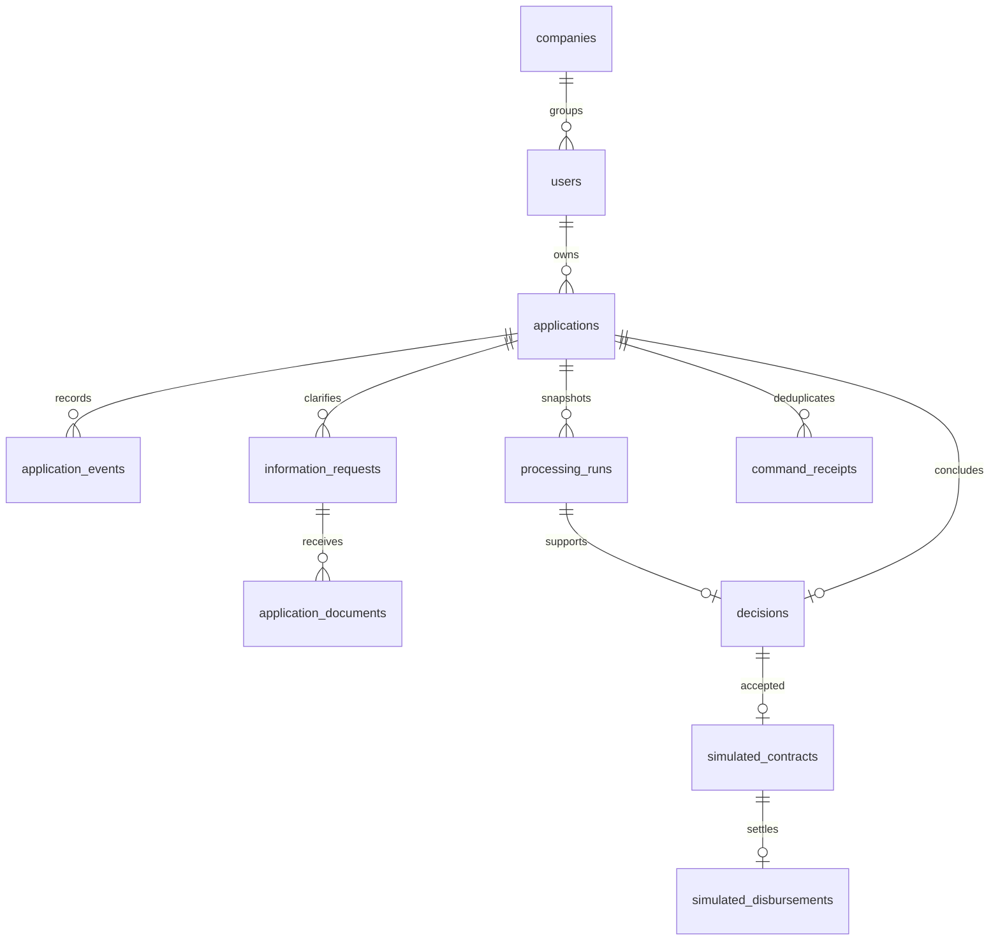

# Модель данных

Реальная схема: Alembic `0001–0005`, PostgreSQL. Применённые `0001–0004`
не изменялись. `0005_credit_workflow` расширяет длину и CHECK статусов/типов
событий, создаёт таблицы процесса без изменения существующих заявок.

| Таблица | Назначение / ключевые инварианты |
| --- | --- |
| companies / users | Демоорганизации и CLIENT/BANK_EMPLOYEE. Компания сама по себе не даёт доступа к чужой заявке |
| sessions | Хеши токенов сессии/CSRF, user_id, срок 8 часов |
| credit_products | Неизменные опубликованные условия `(code, version)`; активна одна версия кода |
| applications | Владелец, девять полей анкеты, статус, версия, серверные timestamps. product_version фиксируется при submit |
| application_events | Автор, роль, old/new статус, версия, allowlist бизнес-изменений. UNIQUE(application_id, application_version) |
| processing_runs | RUNNING/COMPLETE/INCOMPLETE/FAILED, снимок анкеты/продукта, результаты источников и оценки, timestamps, код ошибки |
| information_requests | Вопрос, allowlist полей, тип документа, ответ. Частичный UNIQUE на один открытый запрос заявки |
| application_documents | Только текст TXT/CSV, приложение и запрос, автор, имя, content ≤64 КиБ, SHA-256, timestamp |
| decisions | UNIQUE application_id; OFFER/REJECT, автор, run_id, основание и текст, отдельные terms/assessment |
| simulated_contracts | UNIQUE application_id и decision_id; текст, версия, SHA-256, кто и когда подтвердил |
| simulated_disbursements | UNIQUE application_id и contract_id, точная сумма, сотрудник и время |
| command_receipts | PK(application_id, command_id), автор/действие/hash запроса, первоначальный ответ |
| demo_scenarios | Один первоначальный экземпляр сценария на владельца; повторный seed не сбрасывает процесс |

## Анкета

Поля: `company_name`, `inn`, `credit_purpose`, `product_code`, `amount`, `term`,
`monthly_revenue`, `monthly_operating_expenses`, `existing_monthly_debt_payments`.
В DRAFT они могут быть пустыми. При отправке все обязательны: непустые название
и цель, ИНН 10/12 ASCII-цифр, сумма/срок в диапазоне продукта, выручка >0,
расходы и текущие платежи ≥0. Контрольная сумма ИНН не проверяется: это учебные идентификаторы.

Суммы — Decimal/NUMERIC, не float; в JSON и снимках — строки. Ввод более двух
десятичных знаков отклоняется. Расходы могут превышать выручку; такой вход не
исправляется автоматически. Сервер назначает id, статус, owner_id, баллы и время.

## Снимки и видимость

JSONB снимки сохраняют деньги строками. Каждый run включает фактически
использованные признаки, условия закреплённой версии продукта, значения и
версии локальных источников, score_v1/policy_v1 и model_version/feature_version.
Результаты старых run не меняются при уточнении. Условия решения и его пересчёт
сохраняются отдельно от запрошенных условий.

В этом MVP досье, объяснения и документы прозрачны для владельца и сотрудника;
секретных внутренних заметок нет. Все routes документов проверяют владельца/роль.
Содержимое документа отдаётся только как attachment text/plain с nosniff.
В события попадают ссылки на документы, но не их содержимое и не credentials.
Тексты пользователя предназначены только для синтетических бизнес-данных.

Журнал и завершённые бизнес-сущности не редактируются через API. Это не защита
от администратора БД. FK, UNIQUE, CHECK и row locks поддерживают целостность;
условия переходов дополнительно проверяются серверными командами.

## Совместимость

Старые DRAFT/SUBMITTED, неизвестные владельцы, timestamps и история сохраняются.
Без версии продукта/полных полей старая отправленная заявка получает INCOMPLETE,
а не выдуманные значения. Автоматическая процедура достраивания legacy-заявок
не добавлена. Новая миграция не назначает владельцев и не создаёт событий задним числом.
Downgrade 0005 запрещён после появления run/новых состояний, чтобы не потерять историю;
пустая новая схема и наследованные DRAFT/SUBMITTED допускают безопасный rollback в тестовой БД.
