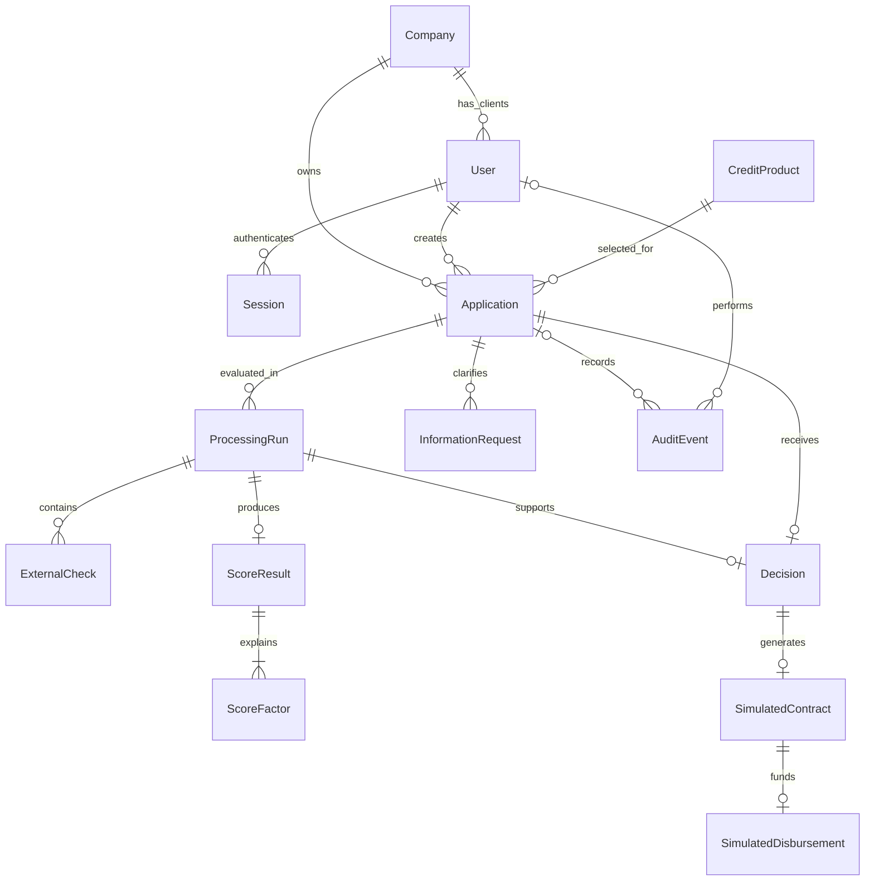

# Модель предметной области Credit Pilot

Статус: проект для согласования. **Предложение команды:** все сущности и
технические поля ниже — способ выполнить [требования](requirements.md),
а не банковская схема, заданная PDF. [Процесс](application-flow.md) определяет
допустимые команды; [архитектура](architecture.md) — формулу оценки и транзакции.

## Сущности и отношения

Company — организация-владелец, а не глобальный источник истинных реквизитов.
Сведения, введённые в заявку, принадлежат заявке и не меняют старые снимки других
заявок при редактировании профиля. Демо упрощает членство: один CLIENT связан
с одной Company, BANK — без привязки к компании.

## Основные данные

| Сущность | Ключевые данные | Инварианты |
| --- | --- | --- |
| Company | id, синтетическое название, синтетический ИНН | Используется для изоляции доступа; не считается проверкой регистрации |
| User | id, login, password_hash, role CLIENT/BANK, company_id | CLIENT имеет company_id; роль и владелец не задаются клиентом в заявке |
| Session | id/хеш случайного токена, user_id, expires_at, revoked_at, CSRF-секрет | Cookie не содержит пароль; выход отзывает сессию |
| CreditProduct | code, version, название, назначение, пределы суммы/срока, учебная ставка | Версия неизменна; новые условия — новая версия; состав продуктов см. architecture.md |
| Application | id, company_id, created_by, product_code/version, пять полей заявки, финансовые поля, status, version, created_at/updated_at, current_processing_run_id | id — БД-generated integer; DRAFT допускает пустоты; статус/владелец/версии/timestamps — серверные |
| ProcessingRun | id, application_id, purpose REQUEST/OFFER, state RUNNING/COMPLETE/INCOMPLETE/FAILED, immutable input_snapshot, версии продукта/скоринга/политики/fixtures, started_at/finished_at, error_code | Только текущий REQUEST-run меняет состояние заявки; прежние попытки не перезаписываются |
| ExternalCheck | id, run_id, source REGISTRY/BKI, state, fixture_version, result_snapshot, checked_at, error_code | Ошибка или отсутствие данных отличается от успешного результата |
| ScoreResult | id, run_id, score, risk_band, recommendation, derived_values, calculated_at | Только полный набор признаков даёт оценку; нет результата при INCOMPLETE/FAILED |
| ScoreFactor | result_id, code, raw_value, rule, points | Уникальность result_id/code; сумма баллов факторов равна score |
| InformationRequest | id, application_id, requested_by, текст причины, список разрешённых уточняемых полей, response_snapshot, responded_by, requested_at/responded_at | Не более одного открытого запроса; ответ не переписывает исходный вопрос |
| Decision | id, application_id, run_id, type OFFER/REJECT, reason_code/text, actor_id, requested_terms_snapshot, offered_terms_snapshot, created_at | Одно итоговое решение на заявку в v1; OFFER проверен политикой по предлагаемым условиям |
| SimulatedContract | id, decision_id, terms_snapshot, текст/версия шаблона, signed_by, signed_at, command_key | Только для OFFER; одна подпись, неизменные условия, явная пометка симуляции |
| SimulatedDisbursement | id, contract_id, amount, currency RUB, performed_by, occurred_at, command_key | Одна запись на подписанный договор; нет настоящей денежной операции |
| AuditEvent | id, application_id nullable, actor_id nullable, actor_role, action, from_status/to_status nullable, application_version nullable, payload, occurred_at, request_id, visibility | Append-only на уровне приложения; SYSTEM — явный actor_role, а не чужой user_id; для периода до входа предусмотрены LEGACY/ANONYMOUS |

ProcessingRun purpose=OFFER нужен только для расчёта альтернативных условий.
Он использует актуальные результаты проверок REQUEST-run со ссылкой на источник,
сохраняет новый снимок условий и отдельный ScoreResult. Внешние проверки повторно
не имитируются без необходимости. Состояние заявки остаётся UNDER_REVIEW до
создания Decision. Это сохраняет различие между запрошенной и предлагаемой суммой.

Лента — небольшой набор версионированных локальных материалов (code, title,
body, product_tags, stage_tags) в seed/fixture-файле. Отдельная CMS, модель
пользовательских подписок и хранилище настоящих новостей не нужны. Лента не
заменяет AuditEvent и не выдаёт материалы за внешнюю новостную публикацию.

## Поля заявки и валидация

| Поле | Хранение и черновик | При отправке и уточнении |
| --- | --- | --- |
| company_name | Строка ≤255, nullable/пустая | Обязательна, не whitespace-only |
| inn | Строка, nullable/пустая | Ровно 10 или 12 ASCII-цифр, без checksum |
| credit_purpose | Строка ≤1000, nullable/пустая | Обязательна, не whitespace-only |
| amount | NUMERIC без автоматического приведения scale; nullable | Конечная Decimal, >0, максимум 2 десятичных знака; границы продукта |
| term | Целое число месяцев, nullable | >0 и границы продукта; без преобразования дроби в целое |
| product_code/version | Ссылка на версию продукта, nullable в черновике | Выбран существующий продукт; версия фиксируется при отправке |
| monthly_revenue | NUMERIC, nullable | >0, максимум 2 десятичных знака |
| monthly_operating_expenses | NUMERIC, nullable | ≥0, максимум 2 десятичных знака |
| existing_monthly_debt_payments | NUMERIC, nullable | ≥0, максимум 2 десятичных знака |

Последние четыре поля — **Предложение команды** для выбора продукта и понятного
расчёта. При обычной отправке они обязательны. Ветка NEEDS_INFO используется
для уточнения противоречивых показателей или неполных внешних данных, а не
для обхода валидации формы. Возраст бизнеса, просрочка и статус регистрации
приходят из локальных симуляторов и не назначаются клиентом как результат проверки.

Разрешённый ответ на запрос ограничен финансовыми полями и пояснением клиента.
Нельзя через ответ менять владельца, ИНН, продукт, запрошенные сумму и срок,
статус или баллы. При неизвестном ИНН в симуляторе клиент не может подделать
результат БКИ: сотрудник повторяет проверку после исправления fixture/seed
в контролируемом демо либо оставляет заявку без решения до получения данных.
Редактирование ИНН после отправки и ручной ввод заключений БКИ исключены из v1.

Обновление финансовых значений по закрытому запросу создаёт снимок ответа,
изменяет текущие финансовые поля атомарно и требует нового REQUEST-run.
Предыдущее рассмотрение и исходные данные остаются в старом run.

## История и неизменность

События: DRAFT_CREATED, DRAFT_UPDATED, SUBMITTED, CHECKS_STARTED,
CHECKS_FAILED, CHECKS_COMPLETED, INFORMATION_REQUESTED, INFORMATION_PROVIDED,
OFFER_ISSUED, REJECTED, SIGNED_SIMULATED, DISBURSED_SIMULATED, а также вход,
выход и чтение защищённых ресурсов. Точное имя события не обязано совпадать
со статусом: повтор проверки меняет историю, но может оставить CHECKING.

Payload успешного изменения включает изменённые поля и old/new значения
либо ссылку на неизменный снимок. Нельзя сохранять только новый статус без
автора и основания. Событие просмотра не увеличивает version заявки.
Просмотр истории не должен рекурсивно порождать бесконечную цепочку просмотров.

Один общий журнал может обслуживать события приложения и доступа: application_id
nullable для входа и отказа доступа без раскрытия чужой заявки. Клиенту показывается
только проекция событий его компании с разрешённым содержимым; внутренние
технические ошибки, сведения сессий и чужие данные в неё не попадают.
Сотрудник видит историю обработки и все факторы. Журнал не объявляется защищённым
от администратора БД; криптографический аудит не входит в MVP.

## Ограничения, индексы и конкурентность

- FK для владельца, автора, продукта, run и решения; CHECK для статусов,
  точности/конечности сумм; уникальность результата по run и фактора по result/code.
- UNIQUE по Decision.application_id, Contract.decision_id и Disbursement.contract_id.
- Частичный уникальный индекс на один открытый InformationRequest по заявке.
- Индексы Application(company_id, updated_at), Application(status, created_at),
  AuditEvent(application_id, id), ProcessingRun(application_id, started_at).
- Version — возрастающее целое; мутация заявки и событие одной транзакцией;
  row lock и проверка ожидаемой версии перед банковскими действиями.
- Все timestamps — серверные UTC/timestamptz. Денежные API-значения — строки;
  JSON-snapshots сериализуют Decimal строкой, не float.
- Сущности процесса не удаляются через пользовательский API. Очистка только
  отдельной явной процедурой для тестовой БД, никогда автоматически при старте.

## Эволюция существующей схемы

Существующие `applications.id`, пять полей, timestamps, DRAFT/SUBMITTED и пути API
сохранить. Нужны новые миграции после 0001, включая расширение длины status
и CHECK для новых состояний, новые таблицы, version, ссылки и финансовые поля.
Применённую 0001 не редактировать.

Для существующих записей владелец и продукт неизвестны. Сначала nullable-колонки,
затем явное сопоставление тестовых записей владельцам и продуктам, только затем
NOT NULL там, где требуется. До сопоставления такие записи недоступны клиентским
аккаунтам; не отдавать их первому вошедшему пользователю. Сопоставление выполняется
контролируемой миграцией данных/командой и фиксируется событием LEGACY_IMPORTED.
Не выдумывать даты и авторов отсутствовавшей истории. Старый SUBMITTED нельзя
рассматривать до заполнения необходимых данных и назначения владельца.

Тестовые базы мигрируются с нуля, а обновление проверяется и на копии старой схемы
с неполными черновиками. Новый seed не должен уничтожать существующие записи.
