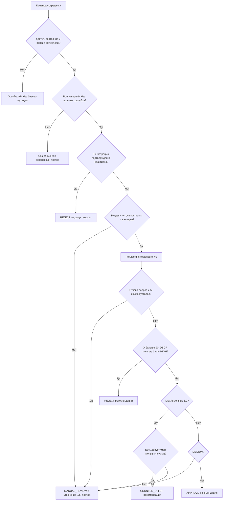
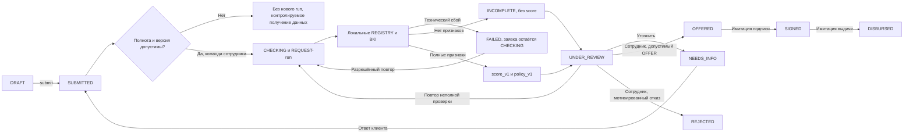

# A03. Бизнес-правила скоринга и кредитного решения

Дата: 21 октября 2026 года. Базовый `origin/main`:
`b0fc4c796d2417b52366987fb2f04fdf828f6570`.
A01 прочитана через Git из `origin/docs/a01-application-form-spec`
(`e29c0ce8308f759132470e016f2712b43f361ed5`), A02 — из
`origin/docs/a02-api-contract` (`ce6a75a40e3dd86e7aaaeeacaf62db662274a291`).
Merge и копирование этих документов в A03 не выполняются.

Статусы правил:

- **IMPLEMENTED** — подтверждено кодом текущей базы. Реализованы доступ,
  черновик, отправка и три бизнес-события; самого скоринга нет.
- **BASELINE_PLANNED** — уже описано в архитектуре/модели/процессе команды,
  но ещё не реализовано. Это предварительная проектная база и учебное
  «Предложение команды», а не окончательная кредитная политика банка.
- **PROPOSED** — новое уточнение A03, требует согласования. Новые формулы,
  алгоритм альтернативы, логические исходы, DTO и коды причин имеют этот статус.
  Публикация документа не означает их утверждения.

Источники:

| Код | Источник |
| --- | --- |
| R | [Требования](requirements.md), особенно R03–R05/R14–R20, U02–U04 |
| A | [Архитектура](architecture.md): «Проверки и восстановление», «Объяснимый скоринг», «Скоринг и решение разделены» |
| D | [Модель данных](domain-model.md): поля, ProcessingRun/ScoreResult/Decision, неизменность и миграции |
| F | [Путь заявки](application-flow.md): команды, статусы, условия и S01–S10 |
| P | [План MVP](mvp-plan.md): T05/T06/T07 и T08–T14 |
| A01 | [Анкета, зафиксированная версия](https://github.com/StudentSK0/credit-pilot/blob/e29c0ce8308f759132470e016f2712b43f361ed5/docs/application-form-spec.md) |
| A02 | [API-контракт, зафиксированная версия](https://github.com/StudentSK0/credit-pilot/blob/ce6a75a40e3dd86e7aaaeeacaf62db662274a291/docs/api-contract.md) |
| C | [applications.py](../backend/applications.py), [auth.py](../backend/auth.py), [audit.py](../backend/audit.py), [database.py](../backend/database.py), [main.py](../backend/main.py) |
| T | [Тесты заявок](../backend/tests/test_applications.py), [событий/доступа](../backend/tests/test_events.py), [миграций](../backend/tests/test_migrations.py) |
| B | [README](../README.md), [AGENTS.md](../AGENTS.md) |

Локальный PDF исходного ТЗ не найден. Требования организаторов сверены только
по R, самостоятельная проверка PDF не заявляется. Срок 6 дней известен из
уточнения пользователя; A03 не расширяет технический объём хакатона.

## 1. Назначение и границы

Модель объясняет учебную оценку синтетической заявки через воспроизводимые
факторы и ограничения. Она не прогнозирует вероятность дефолта, не является
ML/LLM, реальным андеррайтингом, нормативом либо кредитной политикой Альфа-Банка.
Все пользователи, компании, показатели, документы и результаты источников
синтетические; реальных запросов БКИ/ФНС, подписей и платежей нет.

**Скоринг** `score_v1` вычисляет факторы, балл 0–100 и категорию риска.
**Политика** `policy_v1` независимо проверяет допустимость предложения:
высокий балл не отменяет блокировки. **Решение сотрудника** — отдельная команда
с причиной, актором, условиями и ссылкой на неизменный расчёт (A/D/F).
Система автоматически считает и формирует рекомендацию; финального автоматического
одобрения, отказа, подписи или выдачи в согласованной базе нет.

| Участник | Действие | Выход |
| --- | --- | --- |
| CLIENT | Вводит реквизиты/условия/финансы, отправляет; позже отвечает на разрешённый запрос | Заявка, данные и пояснение, но не назначенные баллы/результаты проверок |
| BANK_EMPLOYEE | Запускает/повторяет проверки, разбирает результаты, запрашивает сведения, оформляет OFFER/REJECT | Сохранённое обоснованное решение; при MEDIUM предложение требует комментария |
| SYSTEM внутри банковской команды | Локальные адаптеры, проверка полноты, арифметика и политика | ProcessingRun, результаты проверок/оценки либо INCOMPLETE/FAILED |

Входы — снимок заявки/версии продукта и результаты локальных проверок.
Выходы — показатели, баллы факторов, итог/риск, рекомендация, ограничения,
причины и при необходимости кандидат альтернативы. Сотрудник подтверждает
условия; клиент видит результат только после серверной бизнес-команды.
Нельзя вручную назначить баллы или обойти запрещённое предложение.

**Факт:** C содержит пять полей анкеты и DRAFT/SUBMITTED, owner_id/сессии/CSRF,
создание/PATCH/submit/GET/events. CreditProduct, финансовых полей, fixtures,
ProcessingRun, ScoreResult и банковских команд в коде нет. Полный конвейер —
T08–T14, продукты/финансы — T05, вход/форма — T06/T07. A03 создаёт только
спецификацию, не движок, endpoint, таблицы или миграции.

## 2. Входные данные

### 2.1. Заявка и продукт

В таблице обязательность относится к будущему **расчёту**, а не к сохранению
черновика. DRAFT допускает пропуски; сейчас submit требует только пять полей
из C. `product_version` — предложенное A01 Q01/A02 имя, в D логическая ссылка
написана как `product_code/version`; тип opaque string ещё не утверждён.

| Техническое имя | Экономический смысл / тип / единица | Обязательность и источник | Диапазон | Если отсутствует / использование | Статус |
| --- | --- | --- | --- | --- | --- |
| id / application_id в результате | Идентификатор заявки, JSON integer/BIGINT, без единицы | Для связи результата обязательно, сервер | Существующая доступная заявка; вне BIGINT чтение 404 | Нет заявки — 404, расчёт не начинается; не фактор риска | IMPLEMENTED id; связь будущего результата PLANNED |
| status | Этап заявки, enum, без единицы | Сервер | Сейчас DRAFT/SUBMITTED, банковские значения только из F | Неподходящая команда/состояние — 409, не кредитный отказ | IMPLEMENTED два значения; остальные BASELINE_PLANNED |
| version | Версия заявки, integer, без единицы | Сервер, нужна для снимка и будущего expected_version | У новой 1, растёт при реальных мутациях | Нет актуального снимка — не принимать решение; не балльный фактор | IMPLEMENTED, expected_version только PLANNED |
| inn | Ключ выбора локального fixture, string, без единицы | Анкета, обязательно при submit | Ровно 10/12 ASCII-цифр без checksum | Нет/неизвестный fixture — нет данных; не присваивать хорошую историю | IMPLEMENTED строка; lookup BASELINE_PLANNED |
| product_code | Выбранный вид кредита, string/null, без единицы | Анкета со ссылкой на серверный каталог; для расчёта обязательно | WORKING_CAPITAL/EQUIPMENT из версии каталога | Не подставлять продукт по умолчанию; INCOMPLETE/ошибка входов, не score=0 | BASELINE_PLANNED |
| product_version | Версия условий, предлагается string/null | Каталог; допустимую ссылку фиксирует сервер при submit | Существующая неизменная версия | Не брать случайную текущую ставку; расчёт недоступен до разрешения версии | PROPOSED имя/тип, A01 Q01/Q02 |
| amount = A | Запрошенная сумма, Decimal/NUMERIC, RUB | Анкета; обязательна | Конечная, >0, ≤2 знаков, пределы продукта ниже | Нет — не считать P/score, не заменять нулём | IMPLEMENTED; продуктовые пределы BASELINE_PLANNED |
| term = n | Срок, строгий JSON integer/BIGINT, месяцы | Анкета; обязателен | >0, целый, в пределах продукта | n=0/нет/дробь — ошибка входов, деления нет | IMPLEMENTED; пределы продукта BASELINE_PLANNED |
| monthly_revenue = R | Месячная выручка, Decimal/NUMERIC, RUB/мес. | Анкета; обязательна для оценки | Конечная, >0, ≤2 знаков | R=0/нет — непригодные входы, ratios/score отсутствуют | BASELINE_PLANNED T05 |
| monthly_operating_expenses = E | Месячные операционные расходы, Decimal, RUB/мес. | Анкета; обязательны | Конечная, ≥0, ≤2 знаков; E>R допустимо | Нет — INCOMPLETE, не заменять нулём | BASELINE_PLANNED T05 |
| existing_monthly_debt_payments = D | Платежи по существующим долгам, Decimal, RUB/мес. | Анкета; обязательны | Конечная, ≥0, ≤2 знаков | При отсутствии долгов нужен явный 0; null не ноль | BASELINE_PLANNED T05 |
| annual_rate = i | Учебная годовая ставка, Decimal, доля единицы в формулах | Только версия CreditProduct, не редактируемое поле заявки | 0.20 / 0.18 для двух продуктов | Неизвестная ставка/версия блокирует расчёт; не приравнивать к нулю | BASELINE_PLANNED величины; JSON-имя/единица A02 Q05 PROPOSED |

`company_name`/`credit_purpose` остаются существующими полями анкеты с лимитами
255/1000 и непустотой при submit; они не получают баллов за формулировку.
owner_id/actor берутся из сессии, не из анкеты. Идентификаторы в текущем JSON
целые, не строки; риск точности JS для BIGINT отмечен в A02 BQ05.

| Продукт | A, RUB, включительно | n, мес., включительно | i |
| --- | --- | --- | --- |
| WORKING_CAPITAL | 50 000–3 000 000 | 3–24 | 20% = 0.20 |
| EQUIPMENT | 100 000–5 000 000 | 6–36 | 18% = 0.18 |

Источник A, те же условия в A01/A02. Конкретное значение версии `product_v1`
в демонстрационных JSON — условное, не существующая запись БД. Старым заявкам
нельзя молча назначать продукт/финансы. Неполные старые SUBMITTED не допускаются
к новому рассмотрению до контролируемого получения данных (P, A01 Q07).

### 2.2. Локальные симуляторы — BASELINE_PLANNED

Все технические ключи ниже — **PROPOSED логические имена**, DTO ещё нет.
Экономические признаки предусмотрены A. Параметры всегда привязаны к fixture
и версии источника текущего run; случайной генерации результата при показе нет.

| Параметр | Смысл / тип / единица | Источник / обязательность | Допустимые значения | Отсутствие и применение |
| --- | --- | --- | --- | --- |
| registry.registration_active | Активность регистрации, boolean | Локальный REGISTRY по синтетическому ИНН; для предложения обязательно | true/false; null — неизвестно | false — подтверждённая недопустимость, не технический сбой; null не false/true |
| registry.business_age_months = M | Возраст, integer полных месяцев | REGISTRY; для score обязательно | ≥0, без нового верхнего бизнес-лимита | Нет — score отсутствует; M=0 известен и даёт 0 баллов возраста |
| bki.max_overdue_days = O | Максимальная просрочка, integer дней | Локальный BKI; для score/предложения обязательно | ≥0, без нового верхнего лимита | null не O=0; баллы 25/10/0; O>90 отдельно блокирует предложение |
| check_state | Готовность проверки, enum | Адаптер; обязательно | Схема отдельных checks требует A02 BQ02; различать успех, отсутствие данных, ошибку | Неизвестно/ошибка не успешная проверка, не безопасный заёмщик |
| fixture_version / source | Происхождение результата, string | Детерминированный fixture; обязательно для снимка | REGISTRY/BKI и известная версия | Не подменять источник; сохранить вместе с результатом |

ProcessingRun.state RUNNING/COMPLETE/INCOMPLETE/FAILED и его purpose REQUEST/OFFER
из D не являются статусами заявки. Неизвестный ИНН даёт INCOMPLETE, технический
сбой — FAILED. Клиент не может ввести себе возраст/нулевую просрочку/активную
регистрацию как результат проверки; исправление fixture выполняется отдельно
командой разработки демо, затем сотрудник повторяет run.

## 3. Финансовые показатели

### 3.1. Точность и порядок вычислений

BR01 — **BASELINE_PLANNED** из A/D: деньги Decimal/NUMERIC, входные суммы
конечные с максимум двумя знаками, без автоматического округления. JSON-ответы
с денежными величинами — строки. Контекст расчёта — **50 значащих цифр**,
не 50 знаков после точки. Сравнение с порогом по вычисленному неокруглённому
значению, а не UI-строке. Только показ P округляется до копеек HALF_UP.

BR02 — **PROPOSED, SV01**: явно закрепить ROUND_HALF_EVEN для арифметических
операций в контексте 50; разбирать входы из строк, не binary float. Порядок:
`r=i/12`, `q=(1+r)^(-n)`, `P=(A*r)/(1-q)`, затем C, D+P, DSCR и margin.
Для r=0 использовать A/n. Не округлять промежуточный P до копеек.
При делении/степени использовать Decimal-операции, включая целочисленный n.
Не применять epsilon для признания DSCR≥1.2 и не округлять показатель «в пользу»
заявки. Для альтернативы окончательный повторный расчёт обязателен.

В таблицах ниже P показан с 2 знаками, коэффициенты с 6 как иллюстрации.
Показ коэффициентов с 6 знаками — **PROPOSED** для документа/банковского UI,
не точность решения и не формат хранения. В снимке сохраняются значения до
UI-округления строками и версии правил. Любые неизвестные/некорректные входы
останавливают score; отсутствует деление — нет подставленного нуля/Infinity.

### 3.2. Формулы, единицы и примеры

Контрольный пример V0 из A: A=100000, n=12, i=0.20, R=200000, E=100000,
D=10000, M=36, O=0, активная регистрация. Суммы RUB, финансовые потоки за месяц.

| BR / показатель | Формула | Единица | V0, пример | Интерпретация / нули и отрицательные значения | Статус |
| --- | --- | --- | --- | --- | --- |
| BR03. Операционный финансовый результат C | R−E | RUB/мес. | 100000 | Приближённый остаток выручки после операционных расходов; не аудированная прибыль/EBITDA. C=0/отрицательный допустим как вход, ухудшает оценку | Разность есть в A; название/трактовка PROPOSED |
| BR04. Свободный поток до нового кредита F | C−D | RUB/мес. | 90000 | Остаток после существующих платежей; F≤0 не превращать в пропуск. Не учитывает налоги/capex и другие отсутствующие статьи | PROPOSED диагностика без новых порогов |
| BR05. Долговая нагрузка L_old / L_total | D/R; (D+P)/R | Доля месячной выручки; ×100 для % | 0.05 / 0.096317, то есть 5% / ≈9.6317% | Не официальный ПДН. R=0/нет — не определена; D=0 допустим; L_total>1 не обрезать до 1 | PROPOSED, новых баллов/лимитов нет |
| BR06. Платёж нового кредита P | A·r / (1−(1+r)^(-n)), r=i/12; при r=0: A/n | RUB/мес. | 9263.45 для показа | При валидных A,n,i≥0 знаменатель положителен; n=0/отрицательная ставка — не считать; A=0 вне входов score | BASELINE_PLANNED A |
| BR07. Упрощённый DSCR | C/(D+P) | Коэффициент покрытия | ≈5.191178 | C=0 даёт 0, C<0 даёт отрицательный DSCR. D=0 не ошибка при P>0. D+P=0 — недопустимый знаменатель, нет оценки | BASELINE_PLANNED A |
| BR08. Сумма относительно месячной выручки K | A/R | Число месячных выручек | 0.5 месячной выручки | Не доля годовой выручки и не число месяцев окупаемости. R=0/нет — не определён; >1 допустимо без нового запрета | PROPOSED диагностика |
| BR09. Операционная маржа margin | C/R | Доля, ×100 для % | 0.5, то есть 50% | Нулевая/отрицательная маржа допустима при R>0; не обрезать. При R=0 — не определена | BASELINE_PLANNED A |

Уточнение BR04: после нового кредита диагностический остаток был бы F−P,
для V0 ≈80736.55 RUB/мес.; это **PROPOSED** пояснение, не пятый фактор скоринга.
Операционные статьи — самоотчётные данные, определения R/E/D требуют SV02;
не выдумывается состав обязательной бухгалтерской отчётности.

Аннуитет уже зафиксирован в A, поэтому не заменяется упрощённым
`A/n + A·i/12`. Последняя формула даёт 10000 RUB для V0 вместо 9263.45,
не описывает тот же график платежей и потребовала бы другой версии правил.
Выбор аннуитета — сохранение BASELINE_PLANNED, а не новое молчаливое решение.
Формулы не учитывают комиссии/страхование/реальные банковские графики, которых
нет в источниках. У продуктов ставки положительные; r=0 — техническая ветка
формулы и тест, не третий бесплатный продукт.

## 4. Скоринговая модель

### 4.1. BR10 — четыре фактора score_v1, BASELINE_PLANNED

Сохранена минимальная модель A: нет новых весов, машинного обучения или LLM.
Перед score обязательны корректные финансовые входы/продукт и известные
M/O из завершённых проверок. Неизвестный фактор не получает 0 баллов:
**оценка отсутствует**, что отличается от полного расчёта с итогом 0.

| Фактор / входы | Расчёт и диапазоны | Баллы / максимум | Обоснование команды / согласование |
| --- | --- | --- | --- |
| Покрытие, R/E/D/A/n/i | DSCR<1; [1,1.2); [1.2,1.5); ≥1.5 | 0 / 15 / 30 / 40, максимум 40 | Денежный остаток покрывает оба платежа; уже в A, BASELINE_PLANNED |
| Возраст бизнеса, M | M<6; 6–11; 12–23; ≥24 полных месяцев | 0 / 5 / 10 / 15, максимум 15 | Учебный признак устойчивости, не доказанная статистика; уже в A |
| Операционный результат, R/E | margin<0.10; [0.10,0.20); ≥0.20 | 0 / 10 / 20, максимум 20 | Относительный денежный остаток; уже в A |
| Просрочка, O | O=0; 1–30; >30 дней | 25 / 10 / 0, максимум 25 | Учебный риск истории платежей; уже в A; O>90 отдельно блокирует предложение |

`score = points_dscr + points_age + points_margin + points_overdue`.
Максимальные вклады: 40/15/20/25, сумма 100. Это максимальные баллы, не
дополнительное умножение на веса. Все факторы и входы сохраняются отдельно.

| Категория A | Итог | Рекомендация исходной базы |
| --- | --- | --- |
| LOW | ≥75 | Предложение возможно только при прохождении policy_v1 и подтверждении сотрудником |
| MEDIUM | 50–74 | Ручной разбор; предложение требует комментария сотрудника |
| HIGH | <50 | Рекомендация отказа; OFFER в v1 запрещён |

При этих баллах реальные суммы кратны 5; граница 74 описывает классификатор,
но не достижимую сумму четырёх факторов. Проверка классификации 74 изолирована
от теста суммирования. Для V0: 40+15+20+25=100, LOW.

### 4.2. Учет перечисленных рисков без двойного начисления

| Риск | Где учитывается | Новые баллы/пороги |
| --- | --- | --- |
| Долговая нагрузка и существующие обязательства | D входит в знаменатель DSCR; L_old/L_total для диагностики | Нет; отдельный вес дублировал бы DSCR |
| Операционный результат | C участвует в DSCR и margin | Только существующие 40/20, без нового фактора |
| Размер суммы | A определяет P/DSCR; K показывает отношение к выручке | Нет прямого порога K, он не блокирует кредит сам по себе |
| Срок | n определяет P и проверяется по продукту | Нет нового штрафа за длинный срок |
| Соответствие продукту | До расчёта — валидные сумма/срок/ссылка; перед OFFER — повторная проверка | Не «хорошие баллы» за соответствие, а обязательный gate |
| Реестр / БКИ | M/O в баллах, регистрация и O>90 в политике; полнота источников до score | Нет новых признаков от клиента |

Иной вес или порог — только **PROPOSED новая версия**, с пересчётом контрольных
векторов и согласованием SV03. Нельзя молча расширить score_v1 до 6–7 факторов.

### 4.3. Недостаток данных и нерасчётные состояния

BR11 — BASELINE_PLANNED A/D: при отсутствующем/ошибочном признаке нет ScoreResult,
нет частичного score, PD и «LOW по умолчанию». Для API-объяснения можно вернуть
логическую сводку со score/risk_level=null, не создавать фиктивную запись оценки.
При INCOMPLETE сотрудник запрашивает конкретные финансовые уточнения либо
повторяет источник; технический FAILED не маскируется как кредитный отказ.

PROPOSED SV04: исходы непригодных входов/изменившихся условий объяснять как
MANUAL_REVIEW с причиной, а не REJECT по риску. При активной регистрации, но
неизвестном O, нельзя ни считать O=0, ни суммировать остальные баллы. При
подтверждённой неактивной регистрации действует отдельное исключение раздела 5.

## 5. Кредитная политика

### 5.1. BR12 — существующие ограничения policy_v1

BASELINE_PLANNED из A/F: нет необходимых данных/полных проверок — решение по
риску запрещено; подтверждённая неактивная регистрация допускает отказ по
допустимости без score. Неактивная регистрация, O>90, DSCR<1 либо HIGH
блокируют OFFER независимо от общей суммы баллов. Для предложения необходимы
активная регистрация, O≤90, DSCR≥1.2, корректный продукт/лимиты, отсутствие
открытого запроса сведений. MEDIUM требует комментария сотрудника.
Сотрудник может запросить уточнения вместо отказа при основаниях для проверки
данных, но не выдать запрещённый политикой OFFER.

### 5.2. Логические исходы — PROPOSED, SV04

Это значения **рекомендации**, не новые Application.status и не новые
Decision.type. В D уже предусмотрены только OFFER/REJECT для сохраняемого решения.

| Исход | Когда предлагается | Роль сотрудника / действие | Маппинг на F после явной команды | Сообщение клиенту |
| --- | --- | --- | --- | --- |
| APPROVE | Запрошенные условия допустимы, LOW, DSCR≥1.2 и все gates пройдены | Подтверждает предложение исходных условий; автоматической выдачи нет | Decision OFFER → OFFERED | До команды: «Учебная заявка рассматривается»; после: «Подготовлены учебные условия финансирования» |
| COUNTER_OFFER | Кандидат меньшей суммы прошёл повторный score/policy, исходный запрос не подменён | Проверяет альтернативу, при MEDIUM оставляет комментарий, оформляет предложение | Decision OFFER с иными условиями → OFFERED | «Можем предложить меньшую сумму финансирования» после оформления |
| MANUAL_REVIEW | Недостаток/некорректность данных, MEDIUM, открытое уточнение или нет безопасной альтернативы | Разбирает причину; при финансовой неопределённости запрашивает конкретные поля | UNDER_REVIEW либо INFORMATION_REQUESTED → NEEDS_INFO; Decision пока нет | «Заявка передана сотруднику банка» / «Нужны дополнительные сведения для учебного расчёта» |
| REJECT | Подтверждённая недопустимость либо полный риск-расчёт с блокировкой; по умолчанию рекомендация отказа | Сохраняет обоснование, либо запрашивает проверяемое уточнение; не обходит запрет OFFER | Decision REJECT → REJECTED | Мотивированное объяснение без заявления о реальной политике банка |

`requires_manual_review` в логическом DTO означает необходимость содержательного
разбора сверх обязательного подтверждения сотрудником. Для LOW APPROVE/LOW
COUNTER_OFFER он может быть false, но employee_confirmation_required всегда true.
Для MEDIUM/неполноты — true. Это PROPOSED семантика SV10, не разрешение принимать
финальное решение автоматически.

### 5.3. BR13 — порядок правил и конфликты

Decision Table ниже детерминирует **рекомендуемое** действие, не право сотрудника
отказать без сохранённой причины. Пороги взяты из A, а выбор приоритета и
рекомендации при нескольких разрешённых действиях — **PROPOSED SV04/SV05**.
Первое применимое правило задаёт основной исход; дополнительные совместимые
причины допускаются в порядке каталога 9. Не выдавать противоположные исходы.

| Приоритет | Условие | Оценка / исход | Следующее действие / правило |
| --- | --- | --- | --- |
| G0 | Нет доступа, неподходящее состояние, устаревшая expected_version будущей банковской команды | Не бизнес-результат, API 401/403/404/409 | Не создавать новый run/Decision/score; точная версия-команда пока A02 BQ01 |
| G1 | Текущий run RUNNING либо технически FAILED | Нет новой оценки, MANUAL_REVIEW; FAILED не отказ | Дождаться/повторить по правилам run; FAILED остаётся CHECKING |
| G2 | В завершённой попытке подтверждена неактивная регистрация | REJECT по допустимости, score может отсутствовать | Исключение A/F даже при неизвестном O; предложено не считать необязательный score для этого исхода |
| G3 | Нет нужных полей/неизвестный источник/невалидные R,E,D,A,n/продукт/версия/лимиты | Нет score, MANUAL_REVIEW | INCOMPLETE, запрос разрешённых данных либо контролируемый повтор; данные вне лимита формы T05 сначала 422 |
| G4 | Полный score, но открыт запрос сведений либо снимок неактуален для решения | MANUAL_REVIEW, OFFER заблокирован | Сначала закрыть запрос/получить актуальный run; не переиспользовать старую оценку |
| G5 | Полные текущие данные: O>90, DSCR<1 или score<50 | REJECT-рекомендация, OFFER запрещён | Сотрудник отказывает с причиной или запрашивает обоснованное уточнение |
| G6 | Остальные gates пройдены, 1≤DSCR<1.2, score≥50 | Подбор по разделу 6: COUNTER_OFFER при валидном кандидате; иначе MANUAL_REVIEW | Не признавать LOW достаточным для исходного OFFER |
| G7 | DSCR≥1.2, score 50–74, остальные gates пройдены | MANUAL_REVIEW | Сотрудник может оформить OFFER с обязательным комментарием |
| G8 | DSCR≥1.2, score≥75, остальные gates пройдены | APPROVE-рекомендация | Сотрудник подтверждает исходные условия |

G0 — проверка применимости команды. G1 выше исключения G2, поскольку FAILED
оставляет CHECKING, где F не разрешает банковское решение. Исключение inactive
применяется в UNDER_REVIEW после завершения обработки, включая INCOMPLETE из-за
другого отсутствующего признака, а не к незавершённому/сбойному run. Это уточнение
PROPOSED SV05; не создавать новый обход машины состояний.

Конфликты: LOW+O=91 → G5, не APPROVE; MEDIUM+DSCR=0.9 → G5, не обычный
ручной OFFER; LOW+DSCR=1.1 → G6, исходная сумма не допустима; LOW+открытый запрос
→ G4; неизвестный O при активной регистрации → G3, не O=0; неактивная регистрация
при неизвестном O в завершённом run → G2, отказ по допустимости без score.



Ни одна ветка диаграммы сама не записывает финальный Decision. Для отрицательной
рекомендации сотрудник выбирает допустимую команду; техническая ошибка не является
основанием кредитного REJECT.

## 6. Альтернативное предложение

### 6.1. BR14 — граница v1 и условия запуска

BASELINE_PLANNED A/D: только **меньшая сумма при исходном сроке**. Исходные
A/n/продукт не меняются; отдельный ProcessingRun purpose=OFFER использует
актуальные REQUEST-проверки и сохраняет новый снимок/ScoreResult. Увеличение
суммы и изменение срока исключены из v1. Повторные внешние проверки без
необходимости не запускаются. Состояние остаётся UNDER_REVIEW до Decision.

PROPOSED SV06: автоматический **подбор кандидата**, не одобрение, запускать
только по G6: исходные score≥50, 1≤DSCR<1.2, активная регистрация, O≤90,
полные текущие данные, допустимый продукт и нет открытого уточнения. Для
исходного HIGH/DSCR<1 автоподбор не запускается; допустимость отдельной ручной
альтернативы для такого исходного запроса требует SV07. Нельзя обойти
ограничения окончательного OFFER через подбор другой суммы.

### 6.2. BR15 — формула максимальной суммы, PROPOSED SV06

При целевом DSCR≥1.2 из A и C=R−E:

`P_max = C / 1.2 − D`.

Если P_max≤0, нового положительного платежа с таким покрытием нет: безопасной
альтернативы нет, MANUAL_REVIEW. При r>0:

`A_cap = P_max · (1 − (1+r)^(-n)) / r`.

При r=0: `A_cap = P_max · n`. Это обращение аннуитетной формулы при неизменных
n/i, не новая ставка и не поиск по произвольным суммам.

Алгоритм PROPOSED, все вычисления по BR01/BR02:

1. Вычислить P_max/A_cap; проверить конечность и положительность.
2. Верхняя граница кандидата U = min(A_cap, product.max_amount, A−0.01).
   **0.01 RUB, одна копейка** — минимальный шаг денежных условий.
   Это не округление исходного ввода.
3. A_candidate = floor(U·100)/100: округлить **новую вычисленную** сумму вниз
   до копеек. Не округлять HALF_UP: это может нарушить покрытие.
4. Если A_candidate < product.min_amount, ≥A либо ≤0 — нет допустимой
   альтернативы. Не поднимать до минимума и не возвращать отрицательную сумму.
5. Рассчитать P/DSCR/score/policy заново для A_candidate. Если из-за конечной
   точности DSCR<1.2, проверить минимум продукта. Если минимум не проходит —
   MANUAL_REVIEW. Иначе двоичным поиском по целому числу копеек между минимумом
   и кандидатом найти наибольшую сумму с DSCR≥1.2. Уменьшение A при C>0,
   фиксированных n/i/D монотонно улучшает покрытие; бесконечного перебора нет.
   Если арифметика непригодна — MANUAL_REVIEW. Конечный результат никогда
   не принимается только по формуле A_cap без проверки.
6. Зафиксировать новую оценку OFFER и ссылку на исходный REQUEST. При MEDIUM
   обязателен комментарий, при HIGH/любом gate предложение запрещено.
7. Только сотрудник оформляет Decision OFFER; клиент видит обе суммы, читает
   условия и подтверждает **имитацию подписи**, что даёт SIGNED по F.

Двоичный поиск конечен на ограниченной продуктом сетке копеек и не вводит
нового финансового порога. Для примеров ниже поправок после floor не требуется.

### 6.3. Два успешных примера и невозможная альтернатива

EX1 — WORKING_CAPITAL, A=1000000, n=12, R=200000, E=80000, D=15000,
M=36/O=0/регистрация активна. C=120000, P≈92634.51, DSCR≈1.114884;
баллы 15+15+20+25=75 LOW, но исходная сумма не проходит DSCR≥1.2.
P_max=85000; A_cap≈917584.642751; кандидат **917584.64**, срок 12.
Новый P≈84999.99974515007, показ 85000.00; DSCR≈1.2000000030581992,
баллы 30+15+20+25=90 LOW. COUNTER_OFFER, сотрудник подтверждает.

При 917584.65 P≈85000.00067149513 и DSCR≈1.1999999919420585:
кандидат **не проходит**, хотя UI также показал бы 85000.00 и 1.200000.
Это контрольный пример обязательного сравнения до округления.

EX2 — EQUIPMENT, A=2000000, n=24, i=0.18, R=300000, E=150000, D=30000,
M=36/O=0/активна. C=150000, P≈99848.20, DSCR≈1.155195;
баллы 15+15+20+25=75 LOW. P_max=95000;
A_cap≈1902888.509803; кандидат **1902888.50**, срок 24, внутри 100000–5000000.
Новый P≈94999.99951060550, DSCR≈1.2000000046981872;
баллы 30+15+20+25=90 LOW. COUNTER_OFFER после подтверждения сотрудником.

EX3 — WORKING_CAPITAL, A=50000, n=3, R=100000, E=70000, D=10000,
M=36/O=0/активна. P≈17225.28, DSCR≈1.101917, 75 LOW.
P_max=15000, A_cap≈43540.648777, расчётный кандидат 43540.64 ниже минимума
50000. **Предложение не создаётся**, proposed_amount/proposed_term=null;
MANUAL_REVIEW с причиной NO_FEASIBLE_ALTERNATIVE. Выдавать минимальные 50000
или отрицательный платёж вместо проверки нельзя.

### 6.4. Другой срок — только PROPOSED расширение SV08

Для выполнения запроса о проектировании альтернативы по сроку фиксируется
вариант **вне v1**, который нельзя внедрять под видом согласованной базы:
после отдельного согласования новой версии политики перебрать целые n′ от
n+1 до product.max_term, сохраняя допустимую запрошенную A; выбрать первый
n′, прошедший DSCR≥1.2 и всю политику. Если такого нет — MANUAL_REVIEW.
Ставка берётся из допустимой версии продукта, каждый кандидат оценивается
отдельно, первоначальный n сохраняется; клиент видит новый срок/платёж/стоимость.
Если n уже максимальный, перебора нет. Удлинение не отменяет HIGH/неактивность/
O>90/неполноту и не является одобрением. В текущем MVP используется только
6.1–6.3 после согласования PROPOSED-алгоритма суммы; изменение срока не реализуется.

## 7. Интеграция с кредитным конвейером

### 7.1. BR16 — этапы, транзакции и события

Ниже текущая отправка отделена от **BASELINE_PLANNED** обработки A/D/F.
Новые банковские API из A02 только PLANNED; статусы/события в БД сейчас
ограничены DRAFT/SUBMITTED и DRAFT_CREATED/DRAFT_UPDATED/SUBMITTED.

| Этап | Вход / обработка | Результат и ошибки | Действие системы / событие | Переход |
| --- | --- | --- | --- | --- |
| Отправка | Свой DRAFT, cookie/CSRF, пять полей; T05 добавит продукт/финансы | Валидная заявка или 422 без мутации | Сейчас атомарно SUBMITTED и событие SUBMITTED, version+1 | DRAFT→SUBMITTED, IMPLEMENTED |
| Предпроверка полноты | SUBMITTED, допустимая роль/версия; проверка полей и продуктовой ссылки | Полнота допускает новый run; старые неполные SUBMITTED блокируются до отдельной процедуры | Без фиктивных финансов/владельца и без выдуманного события; ошибка будущей команды/сообщение сотруднику | При неуспехе SUBMITTED остаётся SUBMITTED, PLANNED |
| Старт REQUEST-run | Полный снимок, допустимая команда сотрудника, нет активного run | REQUEST/RUNNING; конфликт версии/активной попытки — 409, без второго run | Первая короткая транзакция: CHECKING, run/input_snapshot, CHECKS_STARTED | SUBMITTED→CHECKING; для повтора INCOMPLETE UNDER_REVIEW→CHECKING, PLANNED |
| Локальные адаптеры | Синтетический ИНН и версии fixtures | Известные признаки; отсутствие — INCOMPLETE; технический сбой — FAILED | Вне длинной транзакции, без реальных БКИ/ФНС; безопасный код ошибки | До завершения CHECKING |
| Score и policy | Полные корректные признаки; BR01–BR13 | ScoreResult/факторы/рекомендация либо отсутствие score при INCOMPLETE | Вторая транзакция проверяет текущий run, сохраняет результаты/снимки и CHECKS_COMPLETED; при сбое CHECKS_FAILED | CHECKING→UNDER_REVIEW для COMPLETE/INCOMPLETE; FAILED остаётся CHECKING |
| Уточнение | UNDER_REVIEW, причина и разрешённые финансовые поля; один открытый запрос | InformationRequest, клиентский ответ и новый snapshot | INFORMATION_REQUESTED; ответ INFORMATION_PROVIDED атомарно с обновлением разрешённых финансов | UNDER_REVIEW→NEEDS_INFO→SUBMITTED, затем новый REQUEST-run |
| Подготовка альтернативы | Текущий COMPLETE REQUEST, BR14/BR15 | Кандидат без подмены исходных данных | PROPOSED SV09: предварительный подбор чистый; при оформлении OFFER сохранить отдельный OFFER-run/ScoreResult с Decision и OFFER_ISSUED в одной транзакции | До решения UNDER_REVIEW; нет фиктивного DRAFT_UPDATED |
| Решение сотрудника | UNDER_REVIEW, актуальный snapshot/версия, policy и причины, комментарий MEDIUM | Decision OFFER или REJECT; ошибки не меняют состояние | OFFER_ISSUED / REJECTED, actor из сессии, неизменные requested/offered snapshots | UNDER_REVIEW→OFFERED/REJECTED |
| Показ и оформление | Клиентский GET/история; после OFFERED явное подтверждение | Понятный результат; затем только имитация подписи/выдачи | Чтение сейчас без событий; будущие SIGNED_SIMULATED / DISBURSED_SIMULATED | OFFERED→SIGNED→DISBURSED |

PROPOSED SV09 уточняет транзакционную границу альтернативного расчёта без нового
endpoint. Если команда захочет отдельно сохранять предварительные предложения,
нужен отдельный согласованный тип события/контракт; A03 его не объявляет готовым.
Сам расчёт факторов внутри REQUEST фиксируется вместе с CHECKS_COMPLETED,
отдельного существующего SCORE_CALCULATED нет.

### 7.2. BR17 — неизменность, повторы и жизненный цикл

BASELINE_PLANNED D/F: сохранить input_snapshot, версии продукта/скоринга/политики/
fixtures, raw результатов, каждый фактор и расчётные значения, автора/время
решения, исходные и предлагаемые условия отдельно. Новый ответ клиента или
другие условия создают новый run/оценку; прошлые не переписываются.

Для банковских мутаций A02 BQ01 предлагает expected_version с row lock;
**сейчас** его нет. Только текущий REQUEST-run завершает переход; поздний
результат старой попытки игнорируется с согласуемой записью аудита, не заменяет
новые данные. Точный тип такого события ещё не определён в D — SV09.
При FAILED/stale допускается контролируемый повтор с новым run, старая попытка
остаётся в истории; таймаут RUNNING и коды ошибок — A02 BQ02/SV09, без нового
произвольного численного SLA. Повтор при активном run — 409.

Одно финальное Decision на заявку в v1; row lock/актуальная версия/ограничения
хранения предотвращают два предложения/отказа. После SUBMITTED обычный PATCH
запрещён, включая NEEDS_INFO. Ответ клиента — отдельная команда с allowlist
финансов и пояснением, без смены ИНН/продукта/исходных A/n. Не создавать APPROVED,
COUNTER_OFFER или MANUAL_REVIEW как Application.status.

До T08 новой миграцией расширить VARCHAR(9)/CHECK статусов applications и
application_events, CHECK event_type и синхронно Enum/Literal/API/TS-типы (D).
0001–0003 не редактировать. Сохранить SELECT 1 health 200/503 и основной volume.



Диаграмма — существующая целевая машина F с аналитическими этапами внутри run,
не новые endpoints/статусы. Неполный legacy SUBMITTED нельзя перескочить прямо
в NEEDS_INFO или UNDER_REVIEW: отдельная процедура получения обязательных полей
остаётся A01/A02 Q07, не добавляется A03 молча.

## 8. Результаты скоринга и API

### 8.1. BR18 — логическая структура, PROPOSED SV10

Это не утверждённый DTO и не текущий ответ Application. Источник для проектирования
— A02 BQ02/BQ03 и сущности D. Предлагается **EvaluationSummary**, объединяющая
метаданные run, оценку и рекомендацию; это не новая таблица вместо ScoreResult.
При отсутствии оценки ScoreResult не создаётся, но сводка run может содержать null.

| Поле | Тип / смысл | Ограничение |
| --- | --- | --- |
| scoring_rule_version | string / версия score_v1 | Ссылка на применённые правила, не выбор frontend |
| policy_rule_version | string / baseline policy_v1 | Отдельна от score; изменение правил не переписывает прежние результаты |
| recommendation_rule_version | string / версия PROPOSED-порядка A03 | Пример a03_proposed_v1, не утверждённая runtime-версия |
| application_id / application_version / run_id | integer / привязка к заявке и snapshot | Серверные, исключают привязку результата к чужой/старой заявке |
| purpose / run_state | REQUEST/OFFER и RUNNING/COMPLETE/INCOMPLETE/FAILED | Не Application.status |
| calculated_at | ISO date-time string/null | Время законченного score; null при нерасчётном run, технические timestamps отдельно |
| score | integer 0–100/null | Нет частичного итога, null не 0 |
| risk_level | LOW/MEDIUM/HIGH/null | В D сущность использует имя risk_band; A03 предлагает API-имя, маппинг требуется согласовать |
| decision | APPROVE/COUNTER_OFFER/MANUAL_REVIEW/REJECT | Только рекомендация; не Decision.type и не финальный ответ клиенту |
| reason_codes | string[] | PROPOSED каталог 9, детерминированный порядок/без дублей |
| proposed_amount / proposed_term | Decimal string/null; integer/null | Только для валидного COUNTER_OFFER; иначе оба null. Исходные A/n отдельно |
| requires_manual_review | boolean | Содержательный ручной разбор, см. 5.2; не отменяет обязательное подтверждение сотрудника |
| employee_confirmation_required | boolean | Всегда true для сохранения финального решения в этом MVP |
| derived_values / factors | Объект показателей / массив raw_value, rule, points | Внутренние точные значения и объяснение каждого балла |
| source_versions / input_snapshot | Объекты версий/неизменных входов | Только необходимые бизнес-данные, без секретов/HTTP-заголовков |

### 8.2. Внутренний результат надёжного заёмщика

JSON ниже **PLANNED/PROPOSED**, не работает в существующем GET заявки.
Значения P/DSCR сохранены до форматирования для UI; i и входы должны быть
связаны с input_snapshot/source_versions в полном сохраняемом run (D).

```json
{
  "scoring_rule_version":"score_v1",
  "policy_rule_version":"policy_v1",
  "recommendation_rule_version":"a03_proposed_v1",
  "application_id":123,"application_version":5,"run_id":71,
  "purpose":"REQUEST","run_state":"COMPLETE",
  "calculated_at":"2026-10-21T12:05:00Z",
  "score":100,"risk_level":"LOW","decision":"APPROVE",
  "reason_codes":["REQUEST_TERMS_ELIGIBLE"],
  "proposed_amount":null,"proposed_term":null,
  "requires_manual_review":false,"employee_confirmation_required":true,
  "derived_values":{
    "operating_result":"100000","free_cash_before_new_loan":"90000",
    "monthly_payment":"9263.45058970800410772006176676387940523301770956",
    "dscr":"5.1911779530001536779901602838393130124280237673653",
    "margin":"0.5","credit_to_monthly_revenue":"0.5"
  },
  "factors":[
    {"code":"DSCR","raw_value":"5.1911779530001536779901602838393130124280237673653","rule":"at_least_1.5","points":40},
    {"code":"BUSINESS_AGE","raw_value":36,"rule":"at_least_24_months","points":15},
    {"code":"MARGIN","raw_value":"0.5","rule":"at_least_0.20","points":20},
    {"code":"OVERDUE","raw_value":0,"rule":"zero_days","points":25}
  ],
  "source_versions":{"product":"product_v1","registry":"registry_demo_v1","bki":"bki_demo_v1"}
}
```

В ScoreFactor raw_value, правило и баллы каждого фактора сохраняются вместе,
как предусмотрено D. Форма факторов/ключи правил ещё согласуются, а не
объявляются существующим Literal backend.

Пример рекомендации альтернативы EX1, сокращённая проекция EvaluationSummary:

```json
{
  "scoring_rule_version":"score_v1","policy_rule_version":"policy_v1",
  "recommendation_rule_version":"a03_proposed_v1",
  "application_id":124,"application_version":5,"run_id":72,
  "purpose":"REQUEST","run_state":"COMPLETE",
  "calculated_at":"2026-10-21T12:06:00Z",
  "score":75,"risk_level":"LOW","decision":"COUNTER_OFFER",
  "reason_codes":["COVERAGE_BELOW_OFFER_THRESHOLD","SMALLER_AMOUNT_AVAILABLE"],
  "proposed_amount":"917584.64","proposed_term":12,
  "requires_manual_review":false,"employee_confirmation_required":true,
  "alternative_preview":{"score":90,"risk_level":"LOW","dscr":"1.2000000030581992092777185581824550424803059142983"}
}
```

75 — оценка **запроса**, 90 — отдельная предварительная оценка кандидата,
не перезапись REQUEST. При оформлении сотрудником альтернативы OFFER-run
фиксирует собственные входы/факторы/результат. Если итог кандидата MEDIUM,
requires_manual_review=true и необходим комментарий.

Неизвестный fixture при валидной финансовой части, сокращённая сводка run:

```json
{
  "scoring_rule_version":"score_v1","policy_rule_version":"policy_v1",
  "recommendation_rule_version":"a03_proposed_v1",
  "application_id":125,"application_version":5,"run_id":73,
  "purpose":"REQUEST","run_state":"INCOMPLETE","calculated_at":null,
  "score":null,"risk_level":null,"decision":"MANUAL_REVIEW",
  "reason_codes":["SOURCE_DATA_MISSING"],
  "proposed_amount":null,"proposed_term":null,
  "requires_manual_review":true,"employee_confirmation_required":true
}
```

### 8.3. Видимость и существующие API

| Уровень | Видимые сведения | Ограничения |
| --- | --- | --- |
| Внутренний расчёт | Input snapshots, точные derived_values, source/fixture versions, факторы, технические безопасные ошибки, текущий run | Не копировать session/CSRF/пароли/произвольные headers; не подменять снимки |
| BANK_EMPLOYEE | Досье, исходные/предлагаемые условия, объяснение баллов, полнота, причина блокировки/решения и история | Сессия/роль/актуальная версия проверяются сервером; score не редактируется |
| CLIENT-владелец | Введённые данные, серверный статус, запрос конкретных сведений, оформленные условия либо понятная причина отказа, собственная история | Не отдавать необработанный внутренний DTO, технический stack/fixture-пути и внутренние заметки; не скрывать доступ только кнопкой |

PROPOSED клиентская проекция **после** подтверждённого сотрудником EX1:

```json
{
  "application_id":124,"status":"OFFERED",
  "requested_amount":"1000000","requested_term":12,
  "offered_amount":"917584.64","offered_term":12,
  "reason_codes":["SMALLER_AMOUNT_AVAILABLE"],
  "message":"В учебном сценарии подготовлено предложение на меньшую сумму. Ознакомьтесь с условиями и подтвердите имитацию подписи.",
  "simulation":true
}
```

До команды OFFER клиент видит UNDER_REVIEW и сообщение о рассмотрении, а не
«кредит автоматически одобрен». Выдача score/порогов клиенту не нужна для
основного пути; видимость будущих событий/заметок требует SV11, A02 BQ02/BQ03.
Текущие события T01 видимы целиком владельцу и сотруднику, приватной visibility
схемы в них нет. Нельзя начинать писать секретные банковские заметки в общий
changes и считать их автоматически скрытыми.

Существуют только маршруты C: login/logout/me, POST/GET/PATCH/submit/events
и health. Чтение ScoreResult/факторов ещё не реализовано. A02 предлагает
PLANNED POST `/api/applications/{id}/checks`, `/information-requests`,
`/decisions` и GET `/offer`; результат/проекции нужно встроить в согласованный
контракт этих операций/досье. A03 **не создаёт новый endpoint** и не расширяет
текущий Application новыми полями задним числом. Cookie/CSRF/owner_id/роль и
401/403/404/409/422 остаются по C/A02; score/recommendation не вводятся клиентом.

## 9. Объяснимость решения и reason_codes

BR19 — весь каталог кодов/текстов **PROPOSED SV11**, финансовые основания —
из соответствующих BR/A. Коды не являются готовыми Enum/HTTP error_code.
Основная причина выбирается по G0–G8; при нескольких рисках G5 порядок:
OVERDUE_LIMIT → COVERAGE_BELOW_ONE → HIGH_RISK_SCORE → NEGATIVE_OPERATING_RESULT.
Дубли удаляются, противоречащие положительные причины не добавляются.
Для G6 успешная пара причин — COVERAGE_BELOW_OFFER_THRESHOLD,
SMALLER_AMOUNT_AVAILABLE; неуспешная — первая и NO_FEASIBLE_ALTERNATIVE.

| Код | Основание / действие | Пользовательское сообщение | Внутренняя детализация |
| --- | --- | --- | --- |
| REQUEST_TERMS_ELIGIBLE | G8, только рекомендация | До решения: «Учебная заявка рассматривается сотрудником» | Полный LOW и все gates; не финальное одобрение |
| MANUAL_MEDIUM_RISK | G7 | «Заявка передана сотруднику банка для дополнительного рассмотрения» | Балл/факторы MEDIUM; комментарий для OFFER |
| INPUT_DATA_MISSING | G3, необходимые финансовые/продуктовые данные не получены | «Недостаточно данных для учебного расчёта» | Конкретные отсутствующие поля, без выдуманных нулей |
| INVALID_REVENUE | G3, R≤0 или невалидна | «Укажите месячную выручку больше нуля» | Ошибка входов/422 T05, не кредитный отказ |
| INPUT_DATA_INVALID | G3, прочие типы/точность/знак | «Проверьте значения отмеченных полей» | Поля и правила; не отправлять клиенту весь request |
| PRODUCT_REFERENCE_INVALID | G3, неизвестный продукт/версия | «Условия выбранного продукта недоступны. Требуется уточнение» | Не выбирать новую ставку молча |
| PRODUCT_AMOUNT_OUT_OF_RANGE | G3, A вне включительных пределов | «Запрошенная сумма выходит за учебные условия продукта» | Минимум/максимум допустимой версии, не отказ по кредитному риску |
| PRODUCT_TERM_OUT_OF_RANGE | G3, n вне пределов | «Укажите срок в пределах учебных условий продукта» | Границы из версии |
| SOURCE_DATA_MISSING | G3, неизвестны M/O/регистрация | «Недостаточно сведений для учебной проверки. Заявку рассмотрит сотрудник» | Неизвестный fixture/признак; не заставлять клиента вводить результат БКИ |
| CHECK_TECHNICAL_FAILURE | G1 | «Учебная проверка временно не завершена. Сотрудник сможет повторить её» | Безопасный error_code, без stack/token; не REJECT |
| REGISTRATION_INACTIVE | G2 | «В синтетическом реестре регистрация неактивна; учебное финансирование недоступно» | Отказ по допустимости без обязательного score |
| OPEN_INFORMATION_REQUEST | G4 / NEEDS_INFO-проекция | «Откройте запрос сотрудника и уточните указанные сведения» | Один актуальный запрос, блокировка OFFER |
| DATA_CLARIFICATION_REQUIRED | Решение сотрудника уточнить противоречие | «Уточните финансовые сведения по запросу сотрудника» | Причина и allowlist полей, не новый автоматический коэффициент доверия |
| OVERDUE_LIMIT | G5, O>90 | «В учебной проверке выявлена просрочка, не позволяющая предложить финансирование» | Конкретные O/source/правило доступны сотруднику |
| COVERAGE_BELOW_ONE | G5, DSCR<1 | «Заявленный денежный остаток не покрывает расчётные долговые платежи» | Точные C/D/P/DSCR, не официальный норматив банка |
| HIGH_RISK_SCORE | G5, score<50 | «Учебная оценка выявила повышенный риск; решение пояснит сотрудник» | Все четыре фактора и версия |
| NEGATIVE_OPERATING_RESULT | C<0 при полном расчёте | «Заявленные расходы превышают выручку» | Поясняющая причина, не отдельный пятый вес |
| COVERAGE_BELOW_OFFER_THRESHOLD | G6, 1≤DSCR<1.2 | «Для запрошенных условий недостаточно расчётного покрытия платежей» | Сам по себе LOW не разрешает OFFER |
| SMALLER_AMOUNT_AVAILABLE | Проверенный меньший кандидат | После OFFER: «Можем предложить меньшую сумму финансирования» | Показать исходные/новые условия отдельно |
| NO_FEASIBLE_ALTERNATIVE | Кандидат ≤0/ниже минимума/не проходит итоговые gates | «Допустимая меньшая сумма автоматически не определена; требуется рассмотрение сотрудника» | Не подставлять минимум продукта вопреки расчёту |

Слова «автоматически» относятся только к вычислению кандидата/оценки, а не
к финальному кредитному решению. После REJECT обязателен понятный текст и код,
а не только числовой балл. Клиент не должен получать «вы неплатёжеспособны»
или обещание реальной выдачи по этим синтетическим данным.

## 10. Демонстрационные сценарии

Все данные ниже синтетические, суммы RUB, потоки за месяц. Если не оговорено,
продукт WORKING_CAPITAL, i=0.20, версия из допустимого каталога, M=36, O=0,
регистрация активна. Векторы — тестовая подготовка будущего конвейера,
не существующие fixtures/seed/результаты выполненных API-тестов.
Показатели округлены только для таблицы; решение по BR01/BR02 до округления.

### 10.1. Входы: 16 сценариев, включая два набора границ продуктов

| ID | Условия и входы A / n / R / E / D | Проверки / особенность |
| --- | --- | --- |
| D01 | 100000 / 12 / 200000 / 100000 / 10000 | Надёжный заёмщик, контрольный V0 из A |
| D02 | 1000000 / 12 / 200000 / 80000 / 15000 | Умеренная расчётная нагрузка, пример EX1 |
| D03 | 1000000 / 12 / 200000 / 100000 / 100000 | Высокие существующие платежи |
| D04 | 100000 / 12 / 200000 / 100000 / 10000 | Сотрудник видит в credit_purpose противоречивое пояснение о расходах 190000 и открывает запрос E; недостаточно подтверждённых согласованных сведений |
| D05 | 100000 / 12 / 0 / 100000 / 10000 | Нулевая выручка, невалидный будущий submit/предпроверка |
| D06 | 100000 / 12 / 100000 / 120000 / 10000 | Отрицательный операционный результат, корректные по знаку R/E/D |
| D07 | Минимум: 50000 / 3 / 200000 / 100000 / 10000; максимум: 3000000 / 24 / 2000000 / 500000 / 10000 | Включительные границы WORKING_CAPITAL; отдельно A на 0.01 за границей и n=2/25 |
| D08 | EQUIPMENT/i=0.18: минимум 100000 / 6 / 200000 / 100000 / 10000; максимум 5000000 / 36 / 2000000 / 500000 / 10000 | Включительные границы EQUIPMENT; отдельно A на 0.01 за границей и n=5/37 |
| D09 | Как D01 | Технический FAILED локального BKI |
| D10 | Финансы как D01 | REGISTRY завершён: регистрация неактивна; M/O могут отсутствовать, run завершён INCOMPLETE, не FAILED |
| D11 | Как D01, но O=91 | Хороший денежный поток не отменяет запрет по просрочке |
| D12 | 100000 / 12 / 500000 / 440000 / 10000, M=6/O=31 | MEDIUM с достаточным DSCR, ручной разбор |
| D13 | EQUIPMENT/i=0.18: 2000000 / 24 / 300000 / 150000 / 30000 | Второй успешный пример альтернативы EX2 |
| D14 | 50000 / 3 / 100000 / 70000 / 10000 | EX3: кандидат меньше продуктового минимума |
| D15 | Финансы как D01 | ИНН проходит формат, но fixture отсутствует; M/O/активность неизвестны |
| D16 | 100000 / 12 / 200000 / null / 10000 | Действительно отсутствующее обязательное E; неполный DRAFT или старый SUBMITTED, а не легальная новая полная T05-заявка |

### 10.2. Расчёты и ожидаемые результаты

В баллах порядок: DSCR / M / margin / O. Для D09/D10/D15 можно независимо
показать финансовую диагностику как D01, но она не даёт полного score.
R=0/null E останавливают расчёт коэффициентов; значения не подменяются нулём.

| ID | C / F; P; DSCR; margin; L_total; K | Баллы / риск | Правила и логический исход | reason_codes / UI и состояние |
| --- | --- | --- | --- | --- |
| D01 | 100000 / 90000; 9263.45; 5.191178; 0.500000; 0.096317; 0.500000 | 40+15+20+25=100 LOW | G8, APPROVE-рекомендация; сотрудник оформляет исходный OFFER | REQUEST_TERMS_ELIGIBLE; до команды UNDER_REVIEW, после OFFERED |
| D02 | 120000 / 105000; 92634.51; 1.114884; 0.600000; 0.538173; 5.000000 | 15+15+20+25=75 LOW; кандидат 90 LOW | G6/BR15, COUNTER_OFFER 917584.64 на 12; новая DSCR≈1.2000000030581992 | COVERAGE_BELOW_OFFER_THRESHOLD, SMALLER_AMOUNT_AVAILABLE; после сотрудника OFFERED с двумя суммами |
| D03 | 100000 / 0; 92634.51; 0.519118; 0.500000; 0.963173; 5.000000 | 0+15+20+25=60 MEDIUM | G5 выше G7: REJECT-рекомендация, предложение запрещено, сотрудник может запросить обоснованное уточнение | COVERAGE_BELOW_ONE; при отказе REJECTED с причиной |
| D04 | Старый снимок как D01; после ответа E=190000: C=10000/F=0/P=9263.45/DSCR≈0.519118/margin=0.05 | Старый score=100 LOW сохранён; новый после ответа/нового run 0+15+0+25=40 HIGH | Сотрудник открывает уточнение: MANUAL_REVIEW, не автоматический OFFER; затем новый REQUEST и G5 | OPEN_INFORMATION_REQUEST, DATA_CLARIFICATION_REQUIRED; NEEDS_INFO→SUBMITTED→CHECKING→UNDER_REVIEW; старый snapshot не меняется |
| D05 | Деления/score не выполняются: R=0; диагностическая разность R−E отрицательна, но не используется для отказа | null/null | G3, не кредитный REJECT; T05 submit 422, состояние DRAFT; некорректный legacy не допускается к run | INVALID_REVENUE; ошибка у поля, без новой оценки |
| D06 | −20000 / −30000; 9263.45; −1.038236; −0.200000; 0.192635; 1.000000 | 0+15+0+25=40 HIGH | Submit T05 допустим: E≥0 и R>0; затем G5 REJECT-рекомендация | COVERAGE_BELOW_ONE, HIGH_RISK_SCORE, NEGATIVE_OPERATING_RESULT; сотрудник сохраняет мотивированный отказ |
| D07 | min: 100000/90000; 17225.28; 3.673056; 0.5; 0.136126; 0.25. max: 1500000/1490000; 152687.41; 9.220136; 0.75; 0.081344; 1.5 | Оба 100 LOW | На самих границах G8; за границами T05 422/G3 без score | REQUEST_TERMS_ELIGIBLE внутри; PRODUCT_AMOUNT_OUT_OF_RANGE или PRODUCT_TERM_OUT_OF_RANGE снаружи; не отказ по риску |
| D08 | min: 100000/90000; 17552.52; 3.629432; 0.5; 0.137763; 0.5. max: 1500000/1490000; 180761.98; 7.863202; 0.75; 0.095381; 2.5 | Оба 100 LOW | Аналогично D07, границы EQUIPMENT включены | Те же соответствующие продуктовые причины; выбор сотрудником исходного OFFER при валидных условиях |
| D09 | Только финансовая диагностика D01; полный score не запускается | null/null | G1 MANUAL_REVIEW, run FAILED; не REJECT | CHECK_TECHNICAL_FAILURE; CHECKING, безопасный повтор сотрудником |
| D10 | Score не требуется по исключению G2; известные финансы не заменяют отсутствующий O | null/null | G2 REJECT по допустимости при завершённом run/UNDER_REVIEW, не отказ по риску | REGISTRATION_INACTIVE; сотрудник оформляет REJECTED с синтетической причиной |
| D11 | Финансы D01: DSCR=5.191178, margin=0.5 | 40+15+20+0=75 LOW | G5 по O>90, REJECT-рекомендация вопреки LOW | OVERDUE_LIMIT; OFFER запрещён, сотрудник сохраняет причину |
| D12 | 60000 / 50000; 9263.45; 3.114707; 0.120000; 0.038527; 0.200000 | 40+5+10+0=55 MEDIUM | G7 MANUAL_REVIEW; при прочих gates сотрудник вправе OFFER только с комментарием | MANUAL_MEDIUM_RISK; UNDER_REVIEW до команды |
| D13 | 150000 / 120000; 99848.20; 1.155195; 0.500000; 0.432827; 6.666667 | 75 LOW; кандидат 90 LOW | G6 COUNTER_OFFER 1902888.50 на 24, новый DSCR≈1.2000000046981872 | COVERAGE_BELOW_OFFER_THRESHOLD, SMALLER_AMOUNT_AVAILABLE; условия отдельно |
| D14 | 30000 / 20000; 17225.28; 1.101917; 0.300000; 0.272253; 0.500000 | 75 LOW | G6 без безопасного кандидата: MANUAL_REVIEW, proposed_amount/term=null | COVERAGE_BELOW_OFFER_THRESHOLD, NO_FEASIBLE_ALTERNATIVE; не предлагать 43540.64 ниже минимума |
| D15 | Финансовая диагностика D01; M/O/регистрация неизвестны | null/null | G3, INCOMPLETE, MANUAL_REVIEW; сотрудник повторяет проверку после контролируемой подготовки fixture | SOURCE_DATA_MISSING; UNDER_REVIEW, нельзя попросить клиента назначить себе O=0 |
| D16 | C/F/DSCR/margin/L/K не определены; P сам по себе не даёт оценки | null/null | G3. DRAFT сохраняется без полноты; T05 submit 422; старый SUBMITTED остаётся без обработки до процедуры Q07 | INPUT_DATA_MISSING; не перескакивать SUBMITTED→NEEDS_INFO без разрешённой команды |

D04 показывает запрос **подтверждения противоречивых** сведений (как S02 из F),
а D16 — отсутствие обязательного числа, которое нормальный T05 submit не пропустит.
Это разные случаи. После запроса нельзя заново выдавать OFFER по старому LOW;
после ответа обязательны новый run и актуальная оценка. Отсутствующий внешний
признак D15 устраняется повтором источника, а не неразрешённым вводом клиента.

## 11. Приемочные критерии Given / When / Then

В A03 создаются критерии, а не файлы тестов движка. «Сейчас» означает
применимость к текущему API, не новый прогон pytest. Математические проверки
можно выполнить независимо от backend уже для документа; интеграционные
ожидают T05 и T08–T14, браузерные — T06/T07/T13.

| ID | Given | When | Then | Доступность |
| --- | --- | --- | --- | --- |
| AT01 | V0, одинаковые версии продукта/score/policy/fixtures и арифметики | Считать повторно | Одинаковые P/DSCR/факторы/100 LOW; timestamps/id run могут отличаться | Арифметика сейчас; backend T10 |
| AT02 | DSCR на 1 / 1.2 / 1.5 и по обе стороны | Выбрать интервал фактора | Соответственно 15/30/40; ниже границ предыдущий интервал, без epsilon | Табличная проверка сейчас; T10 |
| AT03 | M=5/6/11/12/23/24 | Считать возраст | 0/5/5/10/10/15 | Таблица сейчас; T10 |
| AT04 | margin=0.099999/0.10/0.199999/0.20 | Считать фактор | 0/10/10/20 | Таблица сейчас; T10 |
| AT05 | O=0/1/30/31/90/91 | Считать и применить политику | Баллы 25/10/10/0/0/0; только 91 из этой группы блокируется правилом O>90 | Таблица сейчас; T10/T12 |
| AT06 | Изолированные score=49/50/74/75 | Классифицировать | HIGH/MEDIUM/MEDIUM/LOW; полный score_v1 остаётся суммой кратных 5 | Классификатор отдельно, T10 |
| AT07 | R=0, null либо n=0 | Проверить входы | Нет деления/Infinity/score; T05 ошибка ввода, не автоматический риск-отказ | Проверка спецификации сейчас; T05/T10 |
| AT08 | D=0, A>0, n>0, R>0 | Считать DSCR | Делитель P>0, результат определён | Арифметика сейчас; T10 |
| AT09 | В изолированном тесте формулы i=0, A=120000, n=12 | Считать P | 10000; не менять ставки реальных демонстрационных продуктов | Арифметика сейчас; T10 |
| AT10 | Вход 1.001/1.230/NaN/Infinity | POST/PATCH денег / будущие финансовые поля | 422 без округления/мутации; неизвестные новые поля сейчас также 422 | amount сейчас, финансы T05; T уже содержит проверки amount |
| AT11 | R>0, E>R, D≥0 | Отправить и оценить | Финансовые знаки допустимы; отрицательные C/margin/DSCR не подменяются нулём; D06=40 HIGH | T05/T10 |
| AT12 | Один M/O неизвестен, остальные хорошие | Запустить расчёт | ScoreResult отсутствует, score/risk=null; не суммировать частичные баллы | T09/T10 |
| AT13 | Полные финансы и BKI, но REGISTRY неактивен | Применить политику | Нет OFFER независимо от score; подтверждённый eligibility REJECT разрешён сотруднику | T09/T12 |
| AT14 | Неактивность подтверждена, другие признаки отсутствуют; run завершён INCOMPLETE | Разобрать в UNDER_REVIEW | G2 допускает отказ по допустимости без score | T09/T12, SV05 |
| AT15 | Неактивность встречена, но run технически FAILED и заявка CHECKING | Попытаться оформить решение | Нет обхода состояния: сначала повтор/завершение; G1/G0 выше рекомендации G2 | T08/T09/T12, SV05 |
| AT16 | D11, 75 LOW и O=91 | Выбрать рекомендацию | OVERDUE_LIMIT и REJECT-рекомендация, не APPROVE | Арифметика/таблица сейчас; T12 |
| AT17 | D03, 60 MEDIUM и DSCR<1 | Предложить исходные условия | Запрещено G5; сотрудник не обходит gate комментарием MEDIUM | T12 |
| AT18 | D12=55 MEDIUM, DSCR≥1.2 и прочие gates | Сотрудник оформляет OFFER без/с комментарием | Без комментария отклонено без мутации; с комментарием допустимо | T12 |
| AT19 | D02/EX1 | Найти кандидата | 917584.64, n=12, DSCR≈1.2000000030581992, score90, исходный REQUEST75 сохранён | Арифметика сейчас; T12, SV06/SV09 |
| AT20 | Кандидат 917584.65 при входах EX1 | Пересчитать до округления | DSCR≈1.1999999919420585<1.2; не принять, несмотря на UI=1.200000/P=85000.00 | Арифметика сейчас; T12 |
| AT21 | D13/EX2 | Подобрать меньшую сумму | 1902888.50, n=24, кандидат90 LOW, пределы EQUIPMENT соблюдены | Арифметика сейчас; T12 |
| AT22 | D14/EX3 | Подобрать альтернативу | 43540.64 ниже min50000; proposed_amount/term=null, MANUAL_REVIEW | Арифметика сейчас; T12 |
| AT23 | P_max≤0 или невалиден / минимальная сумма не проходит | Рассчитать кандидата | Не возвращать ≤0/произвольный минимум; MANUAL_REVIEW | Арифметика сейчас; T12 |
| AT24 | Расчётный floor-кандидат не прошёл из-за конечной точности | Выполнить BR15 | Конечный двоичный поиск по копейкам, подтверждённое покрытие либо отсутствие альтернативы | Технический тест T12 после SV06 |
| AT25 | Сумма/срок ровно на границах обоих продуктов / на 0.01 или 1 месяц снаружи | Валидировать | Границы включены; снаружи ошибка продукта до score, не отказ по риску | T05; математическая таблица сейчас |
| AT26 | D04, открыт запрос уточнений | Попытаться OFFER по старому LOW | Состояние/запрос блокирует действие; после ответа новый REQUEST и новый score, старый snapshot сохранён | T11/T12 |
| AT27 | D15, неизвестный fixture | Выполнить локальный адаптер | INCOMPLETE без score, не случайные M/O/active; повтор не требует поддельного клиентского БКИ | T09 |
| AT28 | D09, технический сбой | Завершить/повторить | FAILED, CHECKING и CHECKS_FAILED; повтор по правилам с новым run, не REJECT | T08/T09 |
| AT29 | Одновременные старты или решения с одной версией | Выполнить команды | Не более одного активного run/финального Decision; проигравшему 409, никаких двойных событий | T08/T12, A02 BQ01 |
| AT30 | Поздний результат старого run | Попытаться завершить переход | Не менять текущий run/status/score; безопасная запись аудита по согласованной схеме | T09, SV09 |
| AT31 | Ошибка записи события/решения | Выполнить бизнес-мутацию | Откат всей соответствующей транзакции, без частичного статуса/Decision | Аналог T01 сейчас в T; банковские команды T08+ |
| AT32 | Новые условия или уточнённые E | Создать OFFER-run / новый REQUEST | Новые входы и оценка, прежние snapshots и запрошенные A/n не переписаны | T10–T12 |
| AT33 | REJECT либо OFFER сотрудника | Сохранить финальное решение | Причина/actor/time/version/link на оценку либо исключение inactive записаны; клиент видит понятный результат | T12/T13 |
| AT34 | CLIENT B читает заявку A или клиент вызывает банковскую команду | Валидный запрос | Чужая заявка 404, неподходящая роль 403; UI-фильтр не защита | GET/PATCH/submit/events сейчас, банковские T08+ |
| AT35 | SUBMITTED, повтор submit либо PATCH | Выполнить | 409 без второго события/изменения, enum сейчас только DRAFT/SUBMITTED | Сейчас C/T |
| AT36 | Готовая рекомендация APPROVE/COUNTER_OFFER | Нет команды сотрудника | Нет Decision/OFFERED/подписи/выдачи по одному расчёту; сотрудник подтверждает | T12–T14 |
| AT37 | Попытка изменить срок в v1 | Подобрать/оформить альтернативу | n исходный; расширение 6.4 не включается без согласования новой политики | T12, SV08 |
| AT38 | Клиентский просмотр результата | Сформировать проекцию | Нет raw внутренних заметок/секретов, нет обещания реальной банковской выдачи; owner проверяется сервером | T13, SV10/SV11 |

AT02/AT04 проверяют чистые функции интервалов с точными Decimal-векторами;
не обязательно получать ровно порог аннуитетом при ограниченных входах копейками.
Так тест границы фактора не смешивается с погрешностью построения финансового
вектора. AT06 отдельно проверяет классификатор, а не невозможный factor total=74.
В A03 серверные pytest/Compose/БД не запускались, код и тесты не менялись.

## 12. Открытые вопросы

Статус всех новых решений ниже **PROPOSED / OPEN**. BASELINE_PLANNED не становится
утверждённой реальной банковской политикой. Границы A/веса score_v1 сохраняются,
а возможный их пересмотр требует новой версии и явного решения команды.

| ID | Вопрос | Варианты | Рекомендация | Последствия | Ответственный | Статус |
| --- | --- | --- | --- | --- | --- | --- |
| SV01 | Внутренний rounding mode Decimal50 в A не назван | HALF_EVEN / другой явный mode | HALF_EVEN для операций, HALF_UP только P для показа; порядок BR02 | Воспроизводимость на границах; зафиксировать арифметику в snapshots | Аналитик и backend T10 | PROPOSED / OPEN |
| SV02 | Определения R/E/D и диагностические формулы | Разные периоды/состав расходов/платежей | Один месяц и единицы из 2/3; F=C−D, нагрузки D/R и (D+P)/R, K=A/R только диагностика без новых порогов | Не добавлять бухгалтерские поля/веса без решения; согласовать подсказки формы | Аналитик, frontend, backend T05/T10 | PROPOSED / OPEN |
| SV03 | Нужны ли новые веса/финансовые пороги | Сохранить четыре фактора A / добавить K/нагрузку/штраф срока | Сохранить 40/15/20/25 и пороги A, не увеличивать модель ради числа факторов | Нет повторного учёта DSCR; любые новые веса — новая версия, отдельно PROPOSED | Аналитик и команда | BASELINE_PLANNED сохранён; пересмотр OPEN |
| SV04 | Приоритеты и четыре логических исхода | Иной порядок / G0–G8; автоматическое финальное решение / рекомендация | G0–G8, исходы как рекомендации; employee_confirmation_required=true; REJECT по полным блокировкам, сотрудник может запросить обоснованное уточнение | Нет новых Application.status/Decision.type, нет обхода gates | Аналитик, backend T12, frontend банка | PROPOSED / OPEN |
| SV05 | Inactive вместе с неполнотой/техническим сбоем | Отказ немедленно / только после завершённого run в UNDER_REVIEW | G1 выше G2; завершённый INCOMPLETE допускает eligibility REJECT по подтверждённому inactive, FAILED — сначала повтор | Согласованность исключения A с состояниями F | Аналитик и backend T08/T09/T12 | PROPOSED / OPEN |
| SV06 | Как подбирать меньшую сумму | Ручной ввод / формула A_cap и безопасная сетка копеек | BR14/BR15 для исходного score≥50 и DSCR в [1,1.2), floor вниз, повтор score/policy; конечный двоичный поиск при коррекции | Все новые правила подбора ещё не утверждены, не менять исходные условия | Аналитик и backend T12 | PROPOSED / OPEN |
| SV07 | Альтернатива при исходных HIGH или DSCR<1 | Запрет автоподбора / дополнительный ручной OFFER-run с полной переоценкой | Для автоматического кандидата A03 не запускать; отдельную ручную возможность решить явно, не обходить итоговую policy_v1 | Требуется уточнение допустимого банковского поведения до расширения T12 | Аналитик и backend T12 | PROPOSED / OPEN |
| SV08 | Разрешать другой срок | Сохранить v1 / новая версия политики с перебором n′ | В v1 n неизменен; 6.4 только проект будущего расширения | Изменение срока не выдаётся за уже разрешённое, требуется новая версия/UX стоимости | Аналитик и команда | В v1 исключено A; расширение PROPOSED / OPEN |
| SV09 | Транзакция альтернативы, stale/late-run, аудит | Сохранять preview отдельно / при финальном OFFER; разные таймауты/события | Pure preview; OFFER-run+Decision+OFFER_ISSUED атомарно; stale/late-run схему/тип события/timeout утвердить отдельно, как A02 BQ02 | Не выдумывать SCORE_CALCULATED/новый endpoint и не терять историю; row lock/expected_version банковских команд | Backend T08/T09/T12 и аналитик | PROPOSED / OPEN |
| SV10 | Полная форма результата и семантика decision/manual | ScoreResult отдельно / EvaluationSummary; risk_band либо risk_level | Логическая сводка 8, decision только рекомендация, null при отсутствии score; API-имя risk_level согласовать с D risk_band | Изменение API только отдельной задачей A02 BQ02/BQ03, не код A03 | Аналитик, backend, frontend | PROPOSED / OPEN |
| SV11 | Каталог причин, тексты и видимость | Показать весь внутренний расчёт / отдельная клиентская проекция | Каталог 9, понятное основание после решения; без raw fixtures/заметок; не писать приватные данные в общие T01 events | Потребуется явная server-side видимость будущих полей и согласование reason_code A02 BQ03 | Аналитик, backend и frontend | PROPOSED / OPEN |
| SV12 | Источники A01/A02 ещё имеют незакрытые вопросы | Молчаливые defaults / предварительное согласование | Закрыть Q01/Q02/Q03 по версии продукта/финансам и Q05/Q06 по API/ошибкам; Q07 по legacy; BQ01–BQ04 перед банковским UI | Нельзя реализовать альтернативу по случайной версии ставки или домыслить контракт | Пользователь как аналитик и команда | OPEN |

Новой формулы платежа согласовывать вместо A не требуется: аннуитет уже в
BASELINE_PLANNED. Если команда решит заменить его упрощённым подходом,
это будет новое PROPOSED-правило с новой версией и пересчётом всех примеров.
Сотрудник не получает дополнительного права нарушать HIGH/O>90/DSCR gates
из-за того, что логический исход назван MANUAL_REVIEW.

## 13. Definition of Done и трассировка

Готовность аналитического артефакта, не реализация T05/T08–T14:

- Прочитаны B/R/A/D/F/P/AGENTS, текущие C/T и A01/A02 из remote-веток;
  проверены base hashes и отсутствие PDF, будущие функции не названы готовыми.
- Описаны входы с типами/единицами/источниками/пропусками и статусом реализации;
  финансовые поля и product_version не добавлены в текущие схемы задним числом.
- Платёж/DSCR/margin и четыре веса из A сохранены. Новые диагностические
  формулы, rounding mode, логические исходы/приоритеты/альтернатива имеют PROPOSED.
- У каждого показателя есть формула/пример/единица и поведение при нуле/минусе;
  сравнения выполняются до UI-округления, нет float/скрытого округления входов.
- Есть Decision Table, Mermaid-дерево и Mermaid-процесс, не вводящие новые
  статусы заявки; APPROVE/COUNTER_OFFER/MANUAL_REVIEW не смешаны с Decision.type.
- Есть два воспроизводимых допустимых альтернативных предложения и пример
  невозможного; исходные A/n/snapshots не переписываются; срок v1 неизменен.
- Подготовлены 16 демонстрационных и 38 приёмочных сценариев; числовые таблицы,
  факторные суммы, границы, приоритеты и пример разницы в 0.01 RUB проверены.
- JSON-примеры синтаксически корректны и явно логические/PLANNED, ссылки/Markdown/
  Mermaid-структура проверены, `git diff --check` без ошибок. Проверка математических
  примеров не выдана за запуск движка/API/PostgreSQL-тестов.
- Вопросы SV и зависимости A01/A02 переданы на согласование ответственным;
  до реализации PROPOSED поведение не считается утверждённым.
- Изменён/staged только `docs/scoring-decision-spec.md`; backend/frontend,
  миграции, тесты, зависимости, A01/A02 и остальные документы нетронуты.
  `anket_structure.md` оставлен неотслеживаемым без изменений.
- Ветка `docs/a03-scoring-decision-spec` создана от актуального origin/main;
  commit `docs: add A03 scoring and decision specification` и push подтверждены.
  Main не изменяется, merge и автоматический PR не выполняются.

Краткая матрица трассировки:

| Требование | Источник | Бизнес-правило | Сценарий / проверка |
| --- | --- | --- | --- |
| Прозрачный детерминированный скоринг | R U03; A score_v1 | BR01/02/10, четыре фактора и версии | D01, AT01–AT06 |
| Поля анкеты/точные деньги/продукт | C/D/A01/A02; A продукты | BR01, входы 2, gates G3 | D05/D07/D08/D16; AT07/10/25 |
| Платёж и покрытие | A формулы | BR06/07/09 | D01/D02/D06; AT07–AT09/20 |
| Нет ложного хорошего результата при неизвестном признаке | A/D/F проверки | BR11, G1/G3 | D09/D15; AT12/27/28 |
| Скоринг и решение различаются | A policy_v1; D Decision | BR12/13, G2/G5/G7/G8 | D03/D10/D11/D12; AT13–AT18/36 |
| Меньшая сумма, неизменный исходный запрос | A альтернативы; D REQUEST/OFFER; F S04 | BR14/15/17 | D02/D13/D14; AT19–AT24/32/37 |
| Уточнения и новый цикл | D InformationRequest; F S02; A01 | BR16/17, G4 | D04/D16; AT26/32 |
| Роли, владелец, история и конкурентность | C/T; A02 BQ01; F S06/S07 | BR16/17 | AT29–AT35 |
| Понятный результат в веб-кабинете | R03/R17; A01/A02 | BR18/19 | D01–D16; AT33/36/38 |

При недоступности Git/GitHub локальный документ сохраняется, невыполненный push
указывается в отчёте. Для A03 не требуется запуск сервисов, изменение БД или
создание платных зависимостей. Следующий небольшой шаг — согласовать SV01/SV04–SV06
и формат результата SV10, сохранив исходные условия score_v1/policy_v1.
